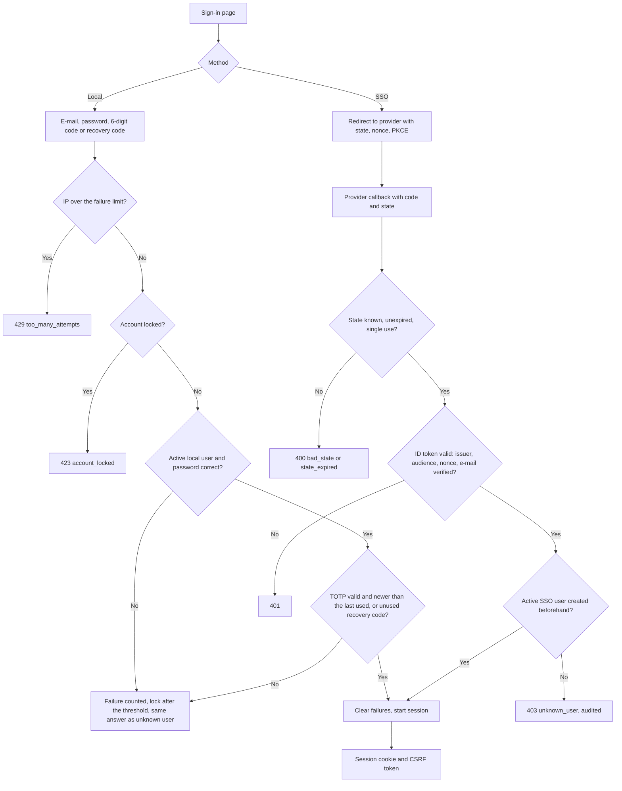
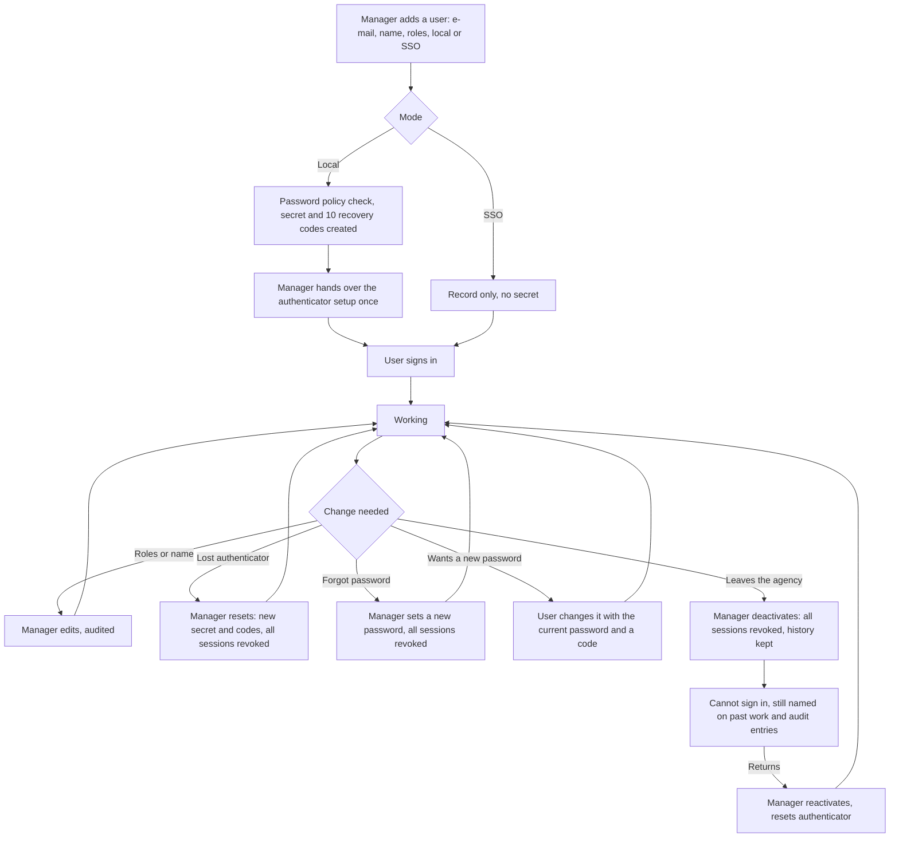
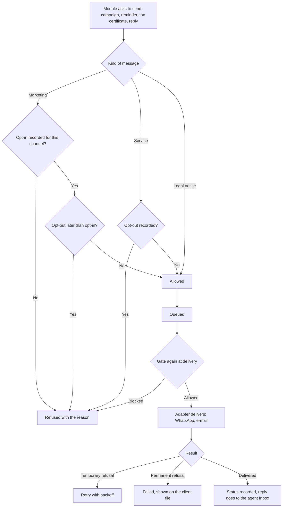
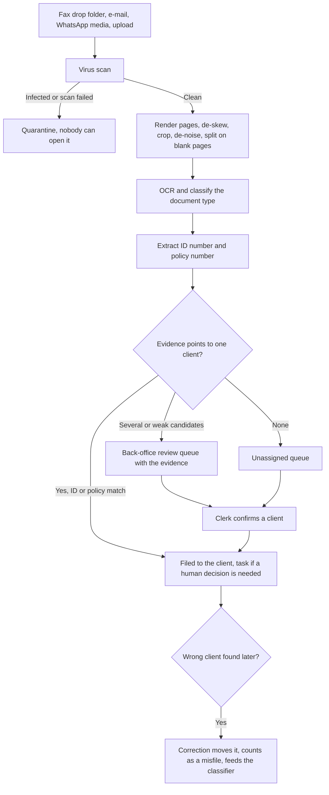

# System flows

The business processes (stages and checklists) are in [PROCESSES.md](PROCESSES.md), generated from the mock.
This document draws the flows that belong to the platform itself and appear in no mock process: who can get in, how a user's life in the system is managed, what stands between a message and the client, and where an incoming document goes.
Each diagram states the code that implements it, so a reader can check the drawing against the source.

## Sign-in

Implemented in `backend/app/auth/service.py` (local login) and `backend/app/auth/sso.py` (OIDC).
Every outcome, success or failure, is written to `login_event` and to the audit chain.
A failure commits before the error is returned, so a rejected attempt is never lost.

## User lifecycle

The create step is implemented (`POST /api/users`, the Users page and the CLI).
The change, reset and deactivate steps are requirement F16 and milestone M11 in [STATUS.md](../STATUS.md).

## Sending a message

Implemented in `backend/app/messaging` and `backend/app/consent`.
One send path serves every module, so no flow can bypass the consent check.
The gate runs when the message is queued and again at delivery, because consent can change in between.

## Incoming document

Implemented in `backend/app/intake`.
An item is filed automatically only when the evidence names exactly one client.
A name alone is never enough, and the sender only breaks a tie.

