# Processes: stages and checklists

Generated from the `PROCS` table in `index.html` (do not edit by hand; rerun the generator). A process is a pipeline of **stages**. Every stage has one or more **checklists**, is owned by a role, and must be finalized by that role (or a manager). A stage is **locked** until the stages it depends on are final. Stages without a dependency between them run in **parallel**. The process is **complete** only when every stage is final.

Each diagram is editable: open it in Mermaid Live with the link, or edit the `.mmd` file in [`docs/processes/`](processes/) (English and Hebrew). draw.io can import a `.mmd` file through Arrange > Insert > Advanced > Mermaid.

Items marked [verify] are legal or tax statements to be confirmed against current Israeli rules before use.

| Process | Spec flow | Stages | Checks | Editable diagram |
|---|---|---|---|---|
| [New client onboarding (KYC/AML)](#onb) | F1 | 4 | 14 | [edit](https://mermaid.live/edit#base64:eyJjb2RlIjoiJSV7aW5pdDoge1wiZmxvd2NoYXJ0XCI6IHtcIndyYXBwaW5nV2lkdGhcIjogMzgwfX19JSVcbmZsb3djaGFydCBMUlxuICBjbGFzc0RlZiBhZ2VudCBmaWxsOiNkYmU4ZmQsc3Ryb2tlOiMxZjZmZWIsY29sb3I6IzExMVxuICBjbGFzc0RlZiBiYWNrIGZpbGw6I2Q5ZjJlNCxzdHJva2U6IzJhOWQ2Myxjb2xvcjojMTExXG4gIGNsYXNzRGVmIG1nciBmaWxsOiNmYmVmZDUsc3Ryb2tlOiNiNzc5MWYsY29sb3I6IzExMVxuICBjbGFzc0RlZiBta3QgZmlsbDojZWNlMWZiLHN0cm9rZTojODI1MGRmLGNvbG9yOiMxMTFcbiAgY2xhc3NEZWYgZW5kMSBmaWxsOiNmZmYsc3Ryb2tlOiMzMzMsY29sb3I6IzExMVxuICBzdGFydChbXCJOZXcgY2xpZW50IG9uYm9hcmRpbmcgKEtZQy9BTUwpXCJdKTo6OmVuZDFcbiAgc19pZFtcIjxiPjEuIElkZW50aWZ5IHRoZSBjbGllbnQ8L2I-PGJyLz5Sb2xlOiBCYWNrLW9mZmljZTxici8-4piQIElEIGNhcmQgYW5kIGFwcGVuZGl4IHJlY2VpdmVkIChib3RoIHNpZGVzKTxici8-4piQIElEIG51bWJlciBjaGVjayBkaWdpdCB2YWxpZDxici8-4piQIE5hbWUgYW5kIGRhdGUgb2YgYmlydGggbWF0Y2ggdGhlIElEPGJyLz7imJAgRHVwbGljYXRlIHNlYXJjaCBpbiB0aGUgZGF0YWJhc2UgZG9uZVwiXTo6OmJhY2tcbiAgc19reWNbXCI8Yj4yLiBLWUMgYW5kIHJpc2sgcHJvZmlsZTwvYj48YnIvPlJvbGU6IEFnZW50PGJyLz7imJAgU291cmNlIG9mIGZ1bmRzIGFuZCBvY2N1cGF0aW9uIHJlY29yZGVkPGJyLz7imJAgRkFUQ0EvQ1JTIHNlbGYtY2VydGlmaWNhdGlvbiBzaWduZWQ8YnIvPuKYkCBOZWVkcyBhbmFseXNpcyBxdWVzdGlvbm5haXJlIGNvbXBsZXRlZDxici8-4piQIFBvbGl0aWNhbGx5IGV4cG9zZWQgcGVyc29uIGNoZWNrXCJdOjo6YWdlbnRcbiAgc19yZWdbXCI8Yj4zLiBSZWdpc3RlciBpbiB0aGUgZGF0YWJhc2U8L2I-PGJyLz5Sb2xlOiBCYWNrLW9mZmljZTxici8-4piQIENsaWVudCByZWNvcmQgY3JlYXRlZDxici8-4piQIENvbnRhY3QgZGV0YWlscyBhbmQgbGFuZ3VhZ2UgcHJlZmVyZW5jZSBzYXZlZDxici8-4piQIE1hcmtldGluZyBjb25zZW50IHJlY29yZGVkIChzZXBhcmF0ZWx5LCBvcHRpb25hbCk8YnIvPuKYkCBXZWxjb21lIG1lc3NhZ2UgYW5kIGFwcCBpbnZpdGF0aW9uIHNlbnRcIl06OjpiYWNrXG4gIHNfZmluW1wiPGI-NC4gQXBwcm92ZSBhbmQgZmlsZTwvYj48YnIvPlJvbGU6IE1hbmFnZXI8YnIvPuKYkCBSaXNrIHJhdGluZyBhcHByb3ZlZDxici8-4piQIERvY3VtZW50cyBhcmNoaXZlZCB3aXRoIDcteWVhciByZXRlbnRpb25cIl06OjptZ3JcbiAgc3RhcnQgLS0-IHNfaWRcbiAgc3RhcnQgLS0-IHNfa3ljXG4gIHNfaWQgLS0-IHNfcmVnXG4gIHNfa3ljIC0tPiBzX3JlZ1xuICBzX3JlZyAtLT4gc19maW5cbiAgZmluKFtcIkNvbXBsZXRlOiBldmVyeSBzdGFnZSBmaW5hbFwiXSk6OjplbmQxXG4gIHNfZmluIC0tPiBmaW4iLCJtZXJtYWlkIjoie1widGhlbWVcIjpcImRlZmF1bHRcIn0iLCJhdXRvU3luYyI6dHJ1ZSwidXBkYXRlRGlhZ3JhbSI6dHJ1ZX0) |
| [Quote, sale and policy issuance](#sale) | F2 | 4 | 14 | [edit](https://mermaid.live/edit#base64:eyJjb2RlIjoiJSV7aW5pdDoge1wiZmxvd2NoYXJ0XCI6IHtcIndyYXBwaW5nV2lkdGhcIjogMzgwfX19JSVcbmZsb3djaGFydCBMUlxuICBjbGFzc0RlZiBhZ2VudCBmaWxsOiNkYmU4ZmQsc3Ryb2tlOiMxZjZmZWIsY29sb3I6IzExMVxuICBjbGFzc0RlZiBiYWNrIGZpbGw6I2Q5ZjJlNCxzdHJva2U6IzJhOWQ2Myxjb2xvcjojMTExXG4gIGNsYXNzRGVmIG1nciBmaWxsOiNmYmVmZDUsc3Ryb2tlOiNiNzc5MWYsY29sb3I6IzExMVxuICBjbGFzc0RlZiBta3QgZmlsbDojZWNlMWZiLHN0cm9rZTojODI1MGRmLGNvbG9yOiMxMTFcbiAgY2xhc3NEZWYgZW5kMSBmaWxsOiNmZmYsc3Ryb2tlOiMzMzMsY29sb3I6IzExMVxuICBzdGFydChbXCJRdW90ZSwgc2FsZSBhbmQgcG9saWN5IGlzc3VhbmNlXCJdKTo6OmVuZDFcbiAgc19uZWVkW1wiPGI-MS4gTmVlZHMgYW5kIHN1aXRhYmlsaXR5PC9iPjxici8-Um9sZTogQWdlbnQ8YnIvPuKYkCBDbGllbnQgbmVlZHMgcmVjb3JkZWQ8YnIvPuKYkCBBdCBsZWFzdCB0d28gYWx0ZXJuYXRpdmVzIGNvbXBhcmVkPGJyLz7imJAgRXhpc3RpbmcgY292ZXIgY2hlY2tlZCAoZHVwbGljYXRlIG9yIHJlcGxhY2VtZW50KTxici8-4piQIFJlYXNvbmluZyBkb2N1bWVudCBkcmFmdGVkXCJdOjo6YWdlbnRcbiAgc19xdW90ZVtcIjxiPjIuIFF1b3RlcyBmcm9tIGluc3VyZXJzPC9iPjxici8-Um9sZTogQmFjay1vZmZpY2U8YnIvPuKYkCBQcm9wb3NhbCBmb3JtIGZpbGxlZCBmb3IgZWFjaCBpbnN1cmVyPGJyLz7imJAgUXVvdGVzIHJlY2VpdmVkIGFuZCBhdHRhY2hlZDxici8-4piQIFVuZGVyd3JpdGluZyBxdWVzdGlvbnMgYW5zd2VyZWRcIl06OjpiYWNrXG4gIHNfc2lnbltcIjxiPjMuIENsaWVudCBkZWNpc2lvbiBhbmQgc2lnbmluZzwvYj48YnIvPlJvbGU6IEFnZW50PGJyLz7imJAgQ29tbWlzc2lvbiBhbmQgZmVlcyBkaXNjbG9zZWQ8YnIvPuKYkCBQcm9wb3NhbCBhbmQgcmVhc29uaW5nIGRvY3VtZW50IHNpZ25lZDxici8-4piQIFBvd2VyIG9mIGF0dG9ybmV5IHNpZ25lZFwiXTo6OmFnZW50XG4gIHNfaXNzdWVbXCI8Yj40LiBJc3N1YW5jZSBhbmQgZmlsaW5nPC9iPjxici8-Um9sZTogQmFjay1vZmZpY2U8YnIvPuKYkCBQcm9wb3NhbCBzZW50IHRvIHRoZSBpbnN1cmVyPGJyLz7imJAgUG9saWN5IG51bWJlciByZWNlaXZlZDxici8-4piQIFBvbGljeSBmaWxlZCBhbmQgY2xpZW50IG5vdGlmaWVkPGJyLz7imJAgUG9zdC1zYWxlIGNvbnRhY3Qgc2NoZWR1bGVkICgzMCArIDEwIGJ1c2luZXNzIGRheXMpXCJdOjo6YmFja1xuICBzdGFydCAtLT4gc19uZWVkXG4gIHNfbmVlZCAtLT4gc19xdW90ZVxuICBzX3F1b3RlIC0tPiBzX3NpZ25cbiAgc19zaWduIC0tPiBzX2lzc3VlXG4gIGZpbihbXCJDb21wbGV0ZTogZXZlcnkgc3RhZ2UgZmluYWxcIl0pOjo6ZW5kMVxuICBzX2lzc3VlIC0tPiBmaW4iLCJtZXJtYWlkIjoie1widGhlbWVcIjpcImRlZmF1bHRcIn0iLCJhdXRvU3luYyI6dHJ1ZSwidXBkYXRlRGlhZ3JhbSI6dHJ1ZX0) |
| [Renewal and endorsement](#renew) | F3 | 3 | 10 | [edit](https://mermaid.live/edit#base64:eyJjb2RlIjoiJSV7aW5pdDoge1wiZmxvd2NoYXJ0XCI6IHtcIndyYXBwaW5nV2lkdGhcIjogMzgwfX19JSVcbmZsb3djaGFydCBMUlxuICBjbGFzc0RlZiBhZ2VudCBmaWxsOiNkYmU4ZmQsc3Ryb2tlOiMxZjZmZWIsY29sb3I6IzExMVxuICBjbGFzc0RlZiBiYWNrIGZpbGw6I2Q5ZjJlNCxzdHJva2U6IzJhOWQ2Myxjb2xvcjojMTExXG4gIGNsYXNzRGVmIG1nciBmaWxsOiNmYmVmZDUsc3Ryb2tlOiNiNzc5MWYsY29sb3I6IzExMVxuICBjbGFzc0RlZiBta3QgZmlsbDojZWNlMWZiLHN0cm9rZTojODI1MGRmLGNvbG9yOiMxMTFcbiAgY2xhc3NEZWYgZW5kMSBmaWxsOiNmZmYsc3Ryb2tlOiMzMzMsY29sb3I6IzExMVxuICBzdGFydChbXCJSZW5ld2FsIGFuZCBlbmRvcnNlbWVudFwiXSk6OjplbmQxXG4gIHNfcHJlcFtcIjxiPjEuIFByZXBhcmUgdGhlIHJlbmV3YWw8L2I-PGJyLz5Sb2xlOiBCYWNrLW9mZmljZTxici8-4piQIFJlbmV3YWwgbm90aWNlIGZyb20gdGhlIGluc3VyZXIgcmVjZWl2ZWQ8YnIvPuKYkCBQcmVtaXVtIGNoYW5nZSBjb21wYXJlZCB3aXRoIGxhc3QgeWVhcjxici8-4piQIE1hcmtldCBjb21wYXJpc29uIGZvciBsYXJnZSBjaGFuZ2VzXCJdOjo6YmFja1xuICBzX2FkdltcIjxiPjIuIEFkdmlzZSB0aGUgY2xpZW50PC9iPjxici8-Um9sZTogQWdlbnQ8YnIvPuKYkCBDbGllbnQgY29udGFjdGVkIChjYWxsIG9yIG1lc3NhZ2UpPGJyLz7imJAgQ2hhbmdlcyBpbiBsaWZlIHNpdHVhdGlvbiBhc2tlZDxici8-4piQIERlY2lzaW9uIHJlY29yZGVkOiByZW5ldywgY2hhbmdlIG9yIGNhbmNlbFwiXTo6OmFnZW50XG4gIHNfZXhlW1wiPGI-My4gRXhlY3V0ZSBhbmQgY29uZmlybTwvYj48YnIvPlJvbGU6IEJhY2stb2ZmaWNlPGJyLz7imJAgSW5zdHJ1Y3Rpb24gc2VudCB0byB0aGUgaW5zdXJlcjxici8-4piQIFdyaXR0ZW4gY29uZmlybWF0aW9uIHJlY2VpdmVkPGJyLz7imJAgUHJlbWl1bSBjb2xsZWN0aW9uIGNoZWNrZWQ8YnIvPuKYkCBDbGllbnQgZmlsZSB1cGRhdGVkXCJdOjo6YmFja1xuICBzdGFydCAtLT4gc19wcmVwXG4gIHNfcHJlcCAtLT4gc19hZHZcbiAgc19hZHYgLS0-IHNfZXhlXG4gIGZpbihbXCJDb21wbGV0ZTogZXZlcnkgc3RhZ2UgZmluYWxcIl0pOjo6ZW5kMVxuICBzX2V4ZSAtLT4gZmluIiwibWVybWFpZCI6IntcInRoZW1lXCI6XCJkZWZhdWx0XCJ9IiwiYXV0b1N5bmMiOnRydWUsInVwZGF0ZURpYWdyYW0iOnRydWV9) |
| [Claim handling](#claim) | F4 | 4 | 12 | [edit](https://mermaid.live/edit#base64:eyJjb2RlIjoiJSV7aW5pdDoge1wiZmxvd2NoYXJ0XCI6IHtcIndyYXBwaW5nV2lkdGhcIjogMzgwfX19JSVcbmZsb3djaGFydCBMUlxuICBjbGFzc0RlZiBhZ2VudCBmaWxsOiNkYmU4ZmQsc3Ryb2tlOiMxZjZmZWIsY29sb3I6IzExMVxuICBjbGFzc0RlZiBiYWNrIGZpbGw6I2Q5ZjJlNCxzdHJva2U6IzJhOWQ2Myxjb2xvcjojMTExXG4gIGNsYXNzRGVmIG1nciBmaWxsOiNmYmVmZDUsc3Ryb2tlOiNiNzc5MWYsY29sb3I6IzExMVxuICBjbGFzc0RlZiBta3QgZmlsbDojZWNlMWZiLHN0cm9rZTojODI1MGRmLGNvbG9yOiMxMTFcbiAgY2xhc3NEZWYgZW5kMSBmaWxsOiNmZmYsc3Ryb2tlOiMzMzMsY29sb3I6IzExMVxuICBzdGFydChbXCJDbGFpbSBoYW5kbGluZ1wiXSk6OjplbmQxXG4gIHNfb3BlbltcIjxiPjEuIE9wZW4gdGhlIGNsYWltPC9iPjxici8-Um9sZTogQWdlbnQ8YnIvPuKYkCBFdmVudCBkZXRhaWxzIGFuZCBkYXRlIHJlY29yZGVkPGJyLz7imJAgUG9saWN5IGNvdmVyIGNvbmZpcm1lZDxici8-4piQIENsaWVudCB0b2xkIHdoaWNoIGRvY3VtZW50cyB0byBicmluZ1wiXTo6OmFnZW50XG4gIHNfZG9jc1tcIjxiPjIuIENvbGxlY3QgZG9jdW1lbnRzPC9iPjxici8-Um9sZTogQmFjay1vZmZpY2U8YnIvPuKYkCBDbGFpbSBmb3JtIGZpbGxlZDxici8-4piQIFN1cHBvcnRpbmcgZG9jdW1lbnRzIHJlY2VpdmVkIChtZWRpY2FsLCBpbnZvaWNlcywgcG9saWNlKTxici8-4piQIENsaWVudCBzaWduYXR1cmUgb24gdGhlIHJlbGVhc2VcIl06OjpiYWNrXG4gIHNfc3ViW1wiPGI-My4gU3VibWl0IHRvIHRoZSBpbnN1cmVyPC9iPjxici8-Um9sZTogQmFjay1vZmZpY2U8YnIvPuKYkCBDbGFpbSBzdWJtaXR0ZWQgYW5kIG51bWJlciByZWNlaXZlZDxici8-4piQIFJlc3BvbnNlIGRlYWRsaW5lIHNldCBpbiBidXNpbmVzcyBkYXlzXCJdOjo6YmFja1xuICBzX2ZvbGxbXCI8Yj40LiBGb2xsb3cgdXAgYW5kIGNsb3NlPC9iPjxici8-Um9sZTogQWdlbnQ8YnIvPuKYkCBJbnN1cmVyIHF1ZXN0aW9ucyBhbnN3ZXJlZDxici8-4piQIERlY2lzaW9uIGV4cGxhaW5lZCB0byB0aGUgY2xpZW50PGJyLz7imJAgUGF5bWVudCBjb25maXJtZWQgb3IgYXBwZWFsIGZpbGVkPGJyLz7imJAgQ2xhaW0gY2xvc2VkXCJdOjo6YWdlbnRcbiAgc3RhcnQgLS0-IHNfb3BlblxuICBzX29wZW4gLS0-IHNfZG9jc1xuICBzX2RvY3MgLS0-IHNfc3ViXG4gIHNfc3ViIC0tPiBzX2ZvbGxcbiAgZmluKFtcIkNvbXBsZXRlOiBldmVyeSBzdGFnZSBmaW5hbFwiXSk6OjplbmQxXG4gIHNfZm9sbCAtLT4gZmluIiwibWVybWFpZCI6IntcInRoZW1lXCI6XCJkZWZhdWx0XCJ9IiwiYXV0b1N5bmMiOnRydWUsInVwZGF0ZURpYWdyYW0iOnRydWV9) |
| [Pension and savings portfolio review](#pen) | F5 | 4 | 12 | [edit](https://mermaid.live/edit#base64:eyJjb2RlIjoiJSV7aW5pdDoge1wiZmxvd2NoYXJ0XCI6IHtcIndyYXBwaW5nV2lkdGhcIjogMzgwfX19JSVcbmZsb3djaGFydCBMUlxuICBjbGFzc0RlZiBhZ2VudCBmaWxsOiNkYmU4ZmQsc3Ryb2tlOiMxZjZmZWIsY29sb3I6IzExMVxuICBjbGFzc0RlZiBiYWNrIGZpbGw6I2Q5ZjJlNCxzdHJva2U6IzJhOWQ2Myxjb2xvcjojMTExXG4gIGNsYXNzRGVmIG1nciBmaWxsOiNmYmVmZDUsc3Ryb2tlOiNiNzc5MWYsY29sb3I6IzExMVxuICBjbGFzc0RlZiBta3QgZmlsbDojZWNlMWZiLHN0cm9rZTojODI1MGRmLGNvbG9yOiMxMTFcbiAgY2xhc3NEZWYgZW5kMSBmaWxsOiNmZmYsc3Ryb2tlOiMzMzMsY29sb3I6IzExMVxuICBzdGFydChbXCJQZW5zaW9uIGFuZCBzYXZpbmdzIHBvcnRmb2xpbyByZXZpZXdcIl0pOjo6ZW5kMVxuICBzX2F1dGhbXCI8Yj4xLiBUaHJlZSBhdXRob3JpemF0aW9uczwvYj48YnIvPlJvbGU6IEJhY2stb2ZmaWNlPGJyLz7imJAgSGFyIEhhQml0dWFjaCBhdXRob3JpemF0aW9uIHNpZ25lZDxici8-4piQIENsZWFyaW5nIGhvdXNlIChNaXNsYWthKSBhdXRob3JpemF0aW9uIHNpZ25lZDxici8-4piQIENvbnRpbnVpbmcgYXV0aG9yaXphdGlvbiAoQjEpIHNpZ25lZCBmb3IgZWFjaCBpbnN1cmVyXCJdOjo6YmFja1xuICBzX2RhdGFbXCI8Yj4yLiBHZXQgdGhlIGRhdGE8L2I-PGJyLz5Sb2xlOiBCYWNrLW9mZmljZTxici8-4piQIEhhciBIYUJpdHVhY2ggcmVwb3J0IHJlcXVlc3RlZDxici8-4piQIENsZWFyaW5nIGhvdXNlIGRhdGEgcmVxdWVzdGVkPGJyLz7imJAgRGF0YSBpbXBvcnRlZCBhbmQgbWF0Y2hlZCB0byB0aGUgY2xpZW50XCJdOjo6YmFja1xuICBzX2FuYVtcIjxiPjMuIEFuYWx5c2lzPC9iPjxici8-Um9sZTogQWdlbnQ8YnIvPuKYkCBEdXBsaWNhdGUgY292ZXIgYW5kIGlkbGUgZnVuZHMgZm91bmQ8YnIvPuKYkCBNYW5hZ2VtZW50IGZlZXMgY29tcGFyZWQ8YnIvPuKYkCBHYXBzIGxpc3RlZCAoZGlzYWJpbGl0eSwgZGVhdGgsIGxvbmctdGVybSBjYXJlKVwiXTo6OmFnZW50XG4gIHNfcmVjW1wiPGI-NC4gUmVjb21tZW5kYXRpb24gYW5kIHNpZ25pbmc8L2I-PGJyLz5Sb2xlOiBBZ2VudDxici8-4piQIFJlY29tbWVuZGF0aW9uIHdpdGggcmVhc29uaW5nIHdyaXR0ZW48YnIvPuKYkCBDbGllbnQgbWVldGluZyBoZWxkPGJyLz7imJAgQWR2aWNlIHJlY29yZCBzaWduZWRcIl06OjphZ2VudFxuICBzdGFydCAtLT4gc19hdXRoXG4gIHNfYXV0aCAtLT4gc19kYXRhXG4gIHNfZGF0YSAtLT4gc19hbmFcbiAgc19hbmEgLS0-IHNfcmVjXG4gIGZpbihbXCJDb21wbGV0ZTogZXZlcnkgc3RhZ2UgZmluYWxcIl0pOjo6ZW5kMVxuICBzX3JlYyAtLT4gZmluIiwibWVybWFpZCI6IntcInRoZW1lXCI6XCJkZWZhdWx0XCJ9IiwiYXV0b1N5bmMiOnRydWUsInVwZGF0ZURpYWdyYW0iOnRydWV9) |
| [Get the ID and register the client](#idreg) | F11 | 3 | 9 | [edit](https://mermaid.live/edit#base64:eyJjb2RlIjoiJSV7aW5pdDoge1wiZmxvd2NoYXJ0XCI6IHtcIndyYXBwaW5nV2lkdGhcIjogMzgwfX19JSVcbmZsb3djaGFydCBMUlxuICBjbGFzc0RlZiBhZ2VudCBmaWxsOiNkYmU4ZmQsc3Ryb2tlOiMxZjZmZWIsY29sb3I6IzExMVxuICBjbGFzc0RlZiBiYWNrIGZpbGw6I2Q5ZjJlNCxzdHJva2U6IzJhOWQ2Myxjb2xvcjojMTExXG4gIGNsYXNzRGVmIG1nciBmaWxsOiNmYmVmZDUsc3Ryb2tlOiNiNzc5MWYsY29sb3I6IzExMVxuICBjbGFzc0RlZiBta3QgZmlsbDojZWNlMWZiLHN0cm9rZTojODI1MGRmLGNvbG9yOiMxMTFcbiAgY2xhc3NEZWYgZW5kMSBmaWxsOiNmZmYsc3Ryb2tlOiMzMzMsY29sb3I6IzExMVxuICBzdGFydChbXCJHZXQgdGhlIElEIGFuZCByZWdpc3RlciB0aGUgY2xpZW50XCJdKTo6OmVuZDFcbiAgc19yZXFbXCI8Yj4xLiBSZXF1ZXN0IHRoZSBJRDwvYj48YnIvPlJvbGU6IEJhY2stb2ZmaWNlPGJyLz7imJAgTWlzc2luZy1JRCBjYXNlIG9wZW5lZCBmcm9tIHRoZSBJbmJveDxici8-4piQIFJlcXVlc3Qgc2VudCAoV2hhdHNBcHAsIGVtYWlsIG9yIHBvc3QpPGJyLz7imJAgUmVtaW5kZXIgc2V0IGZvciAzIGJ1c2luZXNzIGRheXNcIl06OjpiYWNrXG4gIHNfY2hrW1wiPGI-Mi4gVmFsaWRhdGU8L2I-PGJyLz5Sb2xlOiBCYWNrLW9mZmljZTxici8-4piQIEJvdGggc2lkZXMgbGVnaWJsZTxici8-4piQIENoZWNrIGRpZ2l0IHZhbGlkPGJyLz7imJAgTWF0Y2ggd2l0aCB0aGUgZGVjbGFyZWQgbmFtZVwiXTo6OmJhY2tcbiAgc19yZWdbXCI8Yj4zLiBSZWdpc3RlcjwvYj48YnIvPlJvbGU6IEJhY2stb2ZmaWNlPGJyLz7imJAgUmVjb3JkIGNyZWF0ZWQgb3IgdXBkYXRlZDxici8-4piQIENvcHkgZmlsZWQgaW4gdGhlIGNsaWVudCBmaWxlPGJyLz7imJAgQ2FzZSBjbG9zZWQgaW4gdGhlIEluYm94XCJdOjo6YmFja1xuICBzdGFydCAtLT4gc19yZXFcbiAgc19yZXEgLS0-IHNfY2hrXG4gIHNfY2hrIC0tPiBzX3JlZ1xuICBmaW4oW1wiQ29tcGxldGU6IGV2ZXJ5IHN0YWdlIGZpbmFsXCJdKTo6OmVuZDFcbiAgc19yZWcgLS0-IGZpbiIsIm1lcm1haWQiOiJ7XCJ0aGVtZVwiOlwiZGVmYXVsdFwifSIsImF1dG9TeW5jIjp0cnVlLCJ1cGRhdGVEaWFncmFtIjp0cnVlfQ) |
| [Fill and sign a template](#tpl) | F12 | 3 | 7 | [edit](https://mermaid.live/edit#base64:eyJjb2RlIjoiJSV7aW5pdDoge1wiZmxvd2NoYXJ0XCI6IHtcIndyYXBwaW5nV2lkdGhcIjogMzgwfX19JSVcbmZsb3djaGFydCBMUlxuICBjbGFzc0RlZiBhZ2VudCBmaWxsOiNkYmU4ZmQsc3Ryb2tlOiMxZjZmZWIsY29sb3I6IzExMVxuICBjbGFzc0RlZiBiYWNrIGZpbGw6I2Q5ZjJlNCxzdHJva2U6IzJhOWQ2Myxjb2xvcjojMTExXG4gIGNsYXNzRGVmIG1nciBmaWxsOiNmYmVmZDUsc3Ryb2tlOiNiNzc5MWYsY29sb3I6IzExMVxuICBjbGFzc0RlZiBta3QgZmlsbDojZWNlMWZiLHN0cm9rZTojODI1MGRmLGNvbG9yOiMxMTFcbiAgY2xhc3NEZWYgZW5kMSBmaWxsOiNmZmYsc3Ryb2tlOiMzMzMsY29sb3I6IzExMVxuICBzdGFydChbXCJGaWxsIGFuZCBzaWduIGEgdGVtcGxhdGVcIl0pOjo6ZW5kMVxuICBzX3BpY2tbXCI8Yj4xLiBDaG9vc2UgdGhlIHRlbXBsYXRlPC9iPjxici8-Um9sZTogQmFjay1vZmZpY2U8YnIvPuKYkCBUZW1wbGF0ZSBhbmQgY2xpZW50IGNob3Nlbjxici8-4piQIEVtcHR5IGZpZWxkcyBoaWdobGlnaHRlZCBhbmQgcmV2aWV3ZWRcIl06OjpiYWNrXG4gIHNfZmlsbFtcIjxiPjIuIEZpbGwgYW5kIHJldmlldzwvYj48YnIvPlJvbGU6IEJhY2stb2ZmaWNlPGJyLz7imJAgQWxsIGZpZWxkcyBmaWxsZWQgZnJvbSB0aGUgY2xpZW50IGZpbGU8YnIvPuKYkCBTZWNvbmQgcGFpciBvZiBleWVzIG9uIHRoZSBhbW91bnRzIGFuZCBkYXRlc1wiXTo6OmJhY2tcbiAgc19zaWdbXCI8Yj4zLiBTaWduYXR1cmU8L2I-PGJyLz5Sb2xlOiBBZ2VudDxici8-4piQIFNlbnQgdG8gdGhlIGNsaWVudCBmb3Igc2lnbmF0dXJlPGJyLz7imJAgU2lnbmVkIGNvcHkgcmVjZWl2ZWQ8YnIvPuKYkCBTaWduZWQgY29weSBmaWxlZFwiXTo6OmFnZW50XG4gIHN0YXJ0IC0tPiBzX3BpY2tcbiAgc19waWNrIC0tPiBzX2ZpbGxcbiAgc19maWxsIC0tPiBzX3NpZ1xuICBmaW4oW1wiQ29tcGxldGU6IGV2ZXJ5IHN0YWdlIGZpbmFsXCJdKTo6OmVuZDFcbiAgc19zaWcgLS0-IGZpbiIsIm1lcm1haWQiOiJ7XCJ0aGVtZVwiOlwiZGVmYXVsdFwifSIsImF1dG9TeW5jIjp0cnVlLCJ1cGRhdGVEaWFncmFtIjp0cnVlfQ) |
| [Outgoing post and email batch](#post) | F13 | 3 | 7 | [edit](https://mermaid.live/edit#base64:eyJjb2RlIjoiJSV7aW5pdDoge1wiZmxvd2NoYXJ0XCI6IHtcIndyYXBwaW5nV2lkdGhcIjogMzgwfX19JSVcbmZsb3djaGFydCBMUlxuICBjbGFzc0RlZiBhZ2VudCBmaWxsOiNkYmU4ZmQsc3Ryb2tlOiMxZjZmZWIsY29sb3I6IzExMVxuICBjbGFzc0RlZiBiYWNrIGZpbGw6I2Q5ZjJlNCxzdHJva2U6IzJhOWQ2Myxjb2xvcjojMTExXG4gIGNsYXNzRGVmIG1nciBmaWxsOiNmYmVmZDUsc3Ryb2tlOiNiNzc5MWYsY29sb3I6IzExMVxuICBjbGFzc0RlZiBta3QgZmlsbDojZWNlMWZiLHN0cm9rZTojODI1MGRmLGNvbG9yOiMxMTFcbiAgY2xhc3NEZWYgZW5kMSBmaWxsOiNmZmYsc3Ryb2tlOiMzMzMsY29sb3I6IzExMVxuICBzdGFydChbXCJPdXRnb2luZyBwb3N0IGFuZCBlbWFpbCBiYXRjaFwiXSk6OjplbmQxXG4gIHNfcHJlcFtcIjxiPjEuIFByZXBhcmUgdGhlIGJhdGNoPC9iPjxici8-Um9sZTogQmFjay1vZmZpY2U8YnIvPuKYkCBBZGRyZXNzZXMgY2hlY2tlZCAoc3RyZWV0LCBjaXR5LCBwb3N0YWwgY29kZSk8YnIvPuKYkCBSZWNpcGllbnRzJyBsYW5ndWFnZSBhbmQgY2hhbm5lbCBwcmVmZXJlbmNlIGFwcGxpZWRcIl06OjpiYWNrXG4gIHNfbGFiW1wiPGI-Mi4gUHJpbnQ8L2I-PGJyLz5Sb2xlOiBCYWNrLW9mZmljZTxici8-4piQIExhYmVscyBwcmludGVkPGJyLz7imJAgTGV0dGVycyBwcmludGVkIGFuZCBlbmNsb3NlZFwiXTo6OmJhY2tcbiAgc19zbmRbXCI8Yj4zLiBTZW5kIGFuZCBwcm92ZTwvYj48YnIvPlJvbGU6IEJhY2stb2ZmaWNlPGJyLz7imJAgUG9zdCBoYW5kZWQgb3ZlciwgcmVjZWlwdCBrZXB0PGJyLz7imJAgRW1haWxzIHNlbnQ8YnIvPuKYkCBQcm9vZiBvZiBkaXNwYXRjaCBmaWxlZCBpbiB0aGUgY2xpZW50IGZpbGVcIl06OjpiYWNrXG4gIHN0YXJ0IC0tPiBzX3ByZXBcbiAgc19wcmVwIC0tPiBzX2xhYlxuICBzX2xhYiAtLT4gc19zbmRcbiAgZmluKFtcIkNvbXBsZXRlOiBldmVyeSBzdGFnZSBmaW5hbFwiXSk6OjplbmQxXG4gIHNfc25kIC0tPiBmaW4iLCJtZXJtYWlkIjoie1widGhlbWVcIjpcImRlZmF1bHRcIn0iLCJhdXRvU3luYyI6dHJ1ZSwidXBkYXRlRGlhZ3JhbSI6dHJ1ZX0) |
| [Request from another insurance company](#insreq) | F14 | 4 | 12 | [edit](https://mermaid.live/edit#base64:eyJjb2RlIjoiJSV7aW5pdDoge1wiZmxvd2NoYXJ0XCI6IHtcIndyYXBwaW5nV2lkdGhcIjogMzgwfX19JSVcbmZsb3djaGFydCBMUlxuICBjbGFzc0RlZiBhZ2VudCBmaWxsOiNkYmU4ZmQsc3Ryb2tlOiMxZjZmZWIsY29sb3I6IzExMVxuICBjbGFzc0RlZiBiYWNrIGZpbGw6I2Q5ZjJlNCxzdHJva2U6IzJhOWQ2Myxjb2xvcjojMTExXG4gIGNsYXNzRGVmIG1nciBmaWxsOiNmYmVmZDUsc3Ryb2tlOiNiNzc5MWYsY29sb3I6IzExMVxuICBjbGFzc0RlZiBta3QgZmlsbDojZWNlMWZiLHN0cm9rZTojODI1MGRmLGNvbG9yOiMxMTFcbiAgY2xhc3NEZWYgZW5kMSBmaWxsOiNmZmYsc3Ryb2tlOiMzMzMsY29sb3I6IzExMVxuICBzdGFydChbXCJSZXF1ZXN0IGZyb20gYW5vdGhlciBpbnN1cmFuY2UgY29tcGFueVwiXSk6OjplbmQxXG4gIHNfcmN2W1wiPGI-MS4gUmVjZWl2ZSBhbmQgYXR0cmlidXRlPC9iPjxici8-Um9sZTogQmFjay1vZmZpY2U8YnIvPuKYkCBSZXF1ZXN0IGxvZ2dlZCB3aXRoIGRhdGUgYW5kIGluc3VyZXI8YnIvPuKYkCBDbGllbnQgYW5kIHBvbGljeSBpZGVudGlmaWVkPGJyLz7imJAgQnVzaW5lc3MtZGF5IGNsb2NrIHN0YXJ0ZWQgKDIsIDMsIDcgb3IgMTAgZGF5cyBieSBzdGVwKVwiXTo6OmJhY2tcbiAgc19hdXRoW1wiPGI-Mi4gQ2hlY2sgYXV0aG9yaXR5PC9iPjxici8-Um9sZTogQmFjay1vZmZpY2U8YnIvPuKYkCBWYWxpZCBwb3dlciBvZiBhdHRvcm5leSBleGlzdHMgKEIxIHdpdGhpbiA3LTEwIHllYXJzKTxici8-4piQIE5vdCBjYW5jZWxsZWQgYnkgdGhlIGNsaWVudDxici8-4piQIElmIG1pc3NpbmcsIHJlcXVlc3Qgc2lnbmF0dXJlIGZyb20gdGhlIGNsaWVudFwiXTo6OmJhY2tcbiAgc19wcnBbXCI8Yj4zLiBQcmVwYXJlIHRoZSBhbnN3ZXI8L2I-PGJyLz5Sb2xlOiBCYWNrLW9mZmljZTxici8-4piQIERvY3VtZW50cyBjb2xsZWN0ZWQ8YnIvPuKYkCBBbnN3ZXIgdGVtcGxhdGUgZmlsbGVkPGJyLz7imJAgUmV2aWV3ZWQgYnkgdGhlIGFnZW50XCJdOjo6YmFja1xuICBzX3NuZFtcIjxiPjQuIFJlcGx5IGFuZCBjbG9zZTwvYj48YnIvPlJvbGU6IEJhY2stb2ZmaWNlPGJyLz7imJAgUmVwbHkgc2VudCB3aXRoaW4gdGhlIGRlYWRsaW5lPGJyLz7imJAgQ29uZmlybWF0aW9uIG9mIHJlY2VpcHQgb2J0YWluZWQ8YnIvPuKYkCBFeGNoYW5nZSBsb2dnZWQgaW4gdGhlIGluZm9ybWF0aW9uLWV4Y2hhbmdlIHJlZ2lzdGVyXCJdOjo6YmFja1xuICBzdGFydCAtLT4gc19yY3ZcbiAgc19yY3YgLS0-IHNfYXV0aFxuICBzX2F1dGggLS0-IHNfcHJwXG4gIHNfcHJwIC0tPiBzX3NuZFxuICBmaW4oW1wiQ29tcGxldGU6IGV2ZXJ5IHN0YWdlIGZpbmFsXCJdKTo6OmVuZDFcbiAgc19zbmQgLS0-IGZpbiIsIm1lcm1haWQiOiJ7XCJ0aGVtZVwiOlwiZGVmYXVsdFwifSIsImF1dG9TeW5jIjp0cnVlLCJ1cGRhdGVEaWFncmFtIjp0cnVlfQ) |
| [Agent transfer (appointment letter)](#xfer) | F5 / F14 | 3 | 7 | [edit](https://mermaid.live/edit#base64:eyJjb2RlIjoiJSV7aW5pdDoge1wiZmxvd2NoYXJ0XCI6IHtcIndyYXBwaW5nV2lkdGhcIjogMzgwfX19JSVcbmZsb3djaGFydCBMUlxuICBjbGFzc0RlZiBhZ2VudCBmaWxsOiNkYmU4ZmQsc3Ryb2tlOiMxZjZmZWIsY29sb3I6IzExMVxuICBjbGFzc0RlZiBiYWNrIGZpbGw6I2Q5ZjJlNCxzdHJva2U6IzJhOWQ2Myxjb2xvcjojMTExXG4gIGNsYXNzRGVmIG1nciBmaWxsOiNmYmVmZDUsc3Ryb2tlOiNiNzc5MWYsY29sb3I6IzExMVxuICBjbGFzc0RlZiBta3QgZmlsbDojZWNlMWZiLHN0cm9rZTojODI1MGRmLGNvbG9yOiMxMTFcbiAgY2xhc3NEZWYgZW5kMSBmaWxsOiNmZmYsc3Ryb2tlOiMzMzMsY29sb3I6IzExMVxuICBzdGFydChbXCJBZ2VudCB0cmFuc2ZlciAoYXBwb2ludG1lbnQgbGV0dGVyKVwiXSk6OjplbmQxXG4gIHNfc2lnbltcIjxiPjEuIFNpZ24gdGhlIGFwcG9pbnRtZW50PC9iPjxici8-Um9sZTogQWdlbnQ8YnIvPuKYkCBDb250aW51aW5nIGF1dGhvcml6YXRpb24gKGFwcGVuZGl4IEIxKSBzaWduZWQ8YnIvPuKYkCBDbGllbnQgdG9sZCBhYm91dCB0aGUgZWZmZWN0IG9uIHRoZSBvbGQgYWdlbnRcIl06OjphZ2VudFxuICBzX2Z3ZFtcIjxiPjIuIEZvcndhcmQgdG8gdGhlIGluc3VyZXJzPC9iPjxici8-Um9sZTogQmFjay1vZmZpY2U8YnIvPuKYkCBTZW50IHRvIGVhY2ggaW5zdXJlciB3aXRoaW4gMTAgYnVzaW5lc3MgZGF5czxici8-4piQIFJlY2VpcHQgY29uZmlybWVkIGJ5IGVhY2ggaW5zdXJlclwiXTo6OmJhY2tcbiAgc19lZmZbXCI8Yj4zLiBDb25maXJtIHRoZSBlZmZlY3Q8L2I-PGJyLz5Sb2xlOiBCYWNrLW9mZmljZTxici8-4piQIFByZXZpb3VzIGFnZW50J3MgYXV0aG9yaXphdGlvbiBjYW5jZWxsZWQgKGFib3V0IDEwIGJ1c2luZXNzIGRheXMpPGJyLz7imJAgQ29tbWlzc2lvbiBzdHJlYW0gbW92ZWQ8YnIvPuKYkCBWYWxpZGl0eSBlbmQgZGF0ZSAoNy0xMCB5ZWFycykgaW4gdGhlIGNhbGVuZGFyXCJdOjo6YmFja1xuICBzdGFydCAtLT4gc19zaWduXG4gIHNfc2lnbiAtLT4gc19md2RcbiAgc19md2QgLS0-IHNfZWZmXG4gIGZpbihbXCJDb21wbGV0ZTogZXZlcnkgc3RhZ2UgZmluYWxcIl0pOjo6ZW5kMVxuICBzX2VmZiAtLT4gZmluIiwibWVybWFpZCI6IntcInRoZW1lXCI6XCJkZWZhdWx0XCJ9IiwiYXV0b1N5bmMiOnRydWUsInVwZGF0ZURpYWdyYW0iOnRydWV9) |
| [Policy replacement advice](#repl) | F2 | 3 | 8 | [edit](https://mermaid.live/edit#base64:eyJjb2RlIjoiJSV7aW5pdDoge1wiZmxvd2NoYXJ0XCI6IHtcIndyYXBwaW5nV2lkdGhcIjogMzgwfX19JSVcbmZsb3djaGFydCBMUlxuICBjbGFzc0RlZiBhZ2VudCBmaWxsOiNkYmU4ZmQsc3Ryb2tlOiMxZjZmZWIsY29sb3I6IzExMVxuICBjbGFzc0RlZiBiYWNrIGZpbGw6I2Q5ZjJlNCxzdHJva2U6IzJhOWQ2Myxjb2xvcjojMTExXG4gIGNsYXNzRGVmIG1nciBmaWxsOiNmYmVmZDUsc3Ryb2tlOiNiNzc5MWYsY29sb3I6IzExMVxuICBjbGFzc0RlZiBta3QgZmlsbDojZWNlMWZiLHN0cm9rZTojODI1MGRmLGNvbG9yOiMxMTFcbiAgY2xhc3NEZWYgZW5kMSBmaWxsOiNmZmYsc3Ryb2tlOiMzMzMsY29sb3I6IzExMVxuICBzdGFydChbXCJQb2xpY3kgcmVwbGFjZW1lbnQgYWR2aWNlXCJdKTo6OmVuZDFcbiAgc19jbXBbXCI8Yj4xLiBDb21wYXJlIHRoZSBvbGQgYW5kIHRoZSBuZXc8L2I-PGJyLz5Sb2xlOiBBZ2VudDxici8-4piQIE9sZCBwb2xpY3kgdGVybXMgYW5kIGV4Y2x1c2lvbnMgbGlzdGVkPGJyLz7imJAgV2FpdGluZyBwZXJpb2RzIGFuZCBwcmljaW5nIGNvbXBhcmVkPGJyLz7imJAgTG9zcyBvZiBhY2NydWVkIHJpZ2h0cyBjaGVja2VkXCJdOjo6YWdlbnRcbiAgc19hZHZbXCI8Yj4yLiBBZHZpY2UgcmVjb3JkPC9iPjxici8-Um9sZTogQWdlbnQ8YnIvPuKYkCBXcml0dGVuIGFkdmljZSB3aXRoIHRoZSByZWFzb25zPGJyLz7imJAgQ2xpZW50IHNpZ25lZCB0aGF0IHRoZSByaXNrcyB3ZXJlIGV4cGxhaW5lZFwiXTo6OmFnZW50XG4gIHNfY2FuW1wiPGI-My4gQ2FuY2VsIHRoZSBvbGQgcG9saWN5IG9ubHkgYWZ0ZXIgdGhlIG5ldyBvbmUgaXMgaW4gZm9yY2U8L2I-PGJyLz5Sb2xlOiBCYWNrLW9mZmljZTxici8-4piQIE5ldyBwb2xpY3kgY29uZmlybWVkIGluIGZvcmNlPGJyLz7imJAgQ2FuY2VsbGF0aW9uIHJlcXVlc3Qgc2VudCB0byB0aGUgb2xkIGluc3VyZXI8YnIvPuKYkCBJbnN1cmVyJ3MgY2FuY2VsbGF0aW9uIGNoZWNrIGFuc3dlcmVkXCJdOjo6YmFja1xuICBzdGFydCAtLT4gc19jbXBcbiAgc19jbXAgLS0-IHNfYWR2XG4gIHNfYWR2IC0tPiBzX2NhblxuICBmaW4oW1wiQ29tcGxldGU6IGV2ZXJ5IHN0YWdlIGZpbmFsXCJdKTo6OmVuZDFcbiAgc19jYW4gLS0-IGZpbiIsIm1lcm1haWQiOiJ7XCJ0aGVtZVwiOlwiZGVmYXVsdFwifSIsImF1dG9TeW5jIjp0cnVlLCJ1cGRhdGVEaWFncmFtIjp0cnVlfQ) |
| [Severance release and tax forms (160, 161, 161d)](#sev) | F15 | 4 | 11 | [edit](https://mermaid.live/edit#base64:eyJjb2RlIjoiJSV7aW5pdDoge1wiZmxvd2NoYXJ0XCI6IHtcIndyYXBwaW5nV2lkdGhcIjogMzgwfX19JSVcbmZsb3djaGFydCBMUlxuICBjbGFzc0RlZiBhZ2VudCBmaWxsOiNkYmU4ZmQsc3Ryb2tlOiMxZjZmZWIsY29sb3I6IzExMVxuICBjbGFzc0RlZiBiYWNrIGZpbGw6I2Q5ZjJlNCxzdHJva2U6IzJhOWQ2Myxjb2xvcjojMTExXG4gIGNsYXNzRGVmIG1nciBmaWxsOiNmYmVmZDUsc3Ryb2tlOiNiNzc5MWYsY29sb3I6IzExMVxuICBjbGFzc0RlZiBta3QgZmlsbDojZWNlMWZiLHN0cm9rZTojODI1MGRmLGNvbG9yOiMxMTFcbiAgY2xhc3NEZWYgZW5kMSBmaWxsOiNmZmYsc3Ryb2tlOiMzMzMsY29sb3I6IzExMVxuICBzdGFydChbXCJTZXZlcmFuY2UgcmVsZWFzZSBhbmQgdGF4IGZvcm1zICgxNjAsIDE2MSwgMTYxZClcIl0pOjo6ZW5kMVxuICBzX2VtcFtcIjxiPjEuIEVtcGxveWVyIG5vdGljZSAoMTYxKTwvYj48YnIvPlJvbGU6IEJhY2stb2ZmaWNlPGJyLz7imJAgRm9ybSAxNjEgcmVxdWVzdGVkIGZyb20gdGhlIGVtcGxveWVyPGJyLz7imJAgRm9ybSAxNjEgcmVjZWl2ZWQgYW5kIGNoZWNrZWRcIl06OjpiYWNrXG4gIHNfZml4W1wiPGI-Mi4gUmlnaHRzIGZpeGF0aW9uICgxNjFkKTwvYj48YnIvPlJvbGU6IEJhY2stb2ZmaWNlPGJyLz7imJAgRm9ybSAxNjFkIHByZXBhcmVkIHdpdGggZXhlbXB0aW9uIGRldGFpbHM8YnIvPuKYkCBTaWduZWQgYnkgdGhlIGNsaWVudDxici8-4piQIFNlbnQgdG8gdGhlIHRheCBhdXRob3JpdHlcIl06OjpiYWNrXG4gIHNfcmVsW1wiPGI-My4gUmVsZWFzZSByZXF1ZXN0IHRvIHRoZSBmdW5kPC9iPjxici8-Um9sZTogQmFjay1vZmZpY2U8YnIvPuKYkCBSZXF1ZXN0IHdpdGggRm9ybXMgMTYxIGFuZCAxNjAgb3IgMTYxZDxici8-4piQIFdpdGhvdXQgMTYwIG9yIDE2MSB0aGUgZnVuZCB3aXRoaG9sZHMgdGhlIG1heGltdW06IHdhcm5lZDxici8-4piQIFNlbnQgdG8gdGhlIGZ1bmRcIl06OjpiYWNrXG4gIHNfcGF5W1wiPGI-NC4gUGF5bWVudCBhbmQgY2VydGlmaWNhdGU8L2I-PGJyLz5Sb2xlOiBCYWNrLW9mZmljZTxici8-4piQIFBheW1lbnQgcmVjZWl2ZWQgYW5kIHRheCB3aXRoaGVsZCBtYXRjaGVzPGJyLz7imJAgQ2xpZW50IGluZm9ybWVkIHdpdGggdGhlIGNlcnRpZmljYXRlPGJyLz7imJAgUmVmdW5kIGNsYWltIGNoZWNrZWQgKHVwIHRvIDYgeWVhcnMgYmFjaylcIl06OjpiYWNrXG4gIHN0YXJ0IC0tPiBzX2VtcFxuICBzdGFydCAtLT4gc19maXhcbiAgc19lbXAgLS0-IHNfcmVsXG4gIHNfZml4IC0tPiBzX3JlbFxuICBzX3JlbCAtLT4gc19wYXlcbiAgZmluKFtcIkNvbXBsZXRlOiBldmVyeSBzdGFnZSBmaW5hbFwiXSk6OjplbmQxXG4gIHNfcGF5IC0tPiBmaW4iLCJtZXJtYWlkIjoie1widGhlbWVcIjpcImRlZmF1bHRcIn0iLCJhdXRvU3luYyI6dHJ1ZSwidXBkYXRlRGlhZ3JhbSI6dHJ1ZX0) |
| [Annual tax cycle (agency)](#tax) | F15 | 5 | 10 | [edit](https://mermaid.live/edit#base64:eyJjb2RlIjoiJSV7aW5pdDoge1wiZmxvd2NoYXJ0XCI6IHtcIndyYXBwaW5nV2lkdGhcIjogMzgwfX19JSVcbmZsb3djaGFydCBMUlxuICBjbGFzc0RlZiBhZ2VudCBmaWxsOiNkYmU4ZmQsc3Ryb2tlOiMxZjZmZWIsY29sb3I6IzExMVxuICBjbGFzc0RlZiBiYWNrIGZpbGw6I2Q5ZjJlNCxzdHJva2U6IzJhOWQ2Myxjb2xvcjojMTExXG4gIGNsYXNzRGVmIG1nciBmaWxsOiNmYmVmZDUsc3Ryb2tlOiNiNzc5MWYsY29sb3I6IzExMVxuICBjbGFzc0RlZiBta3QgZmlsbDojZWNlMWZiLHN0cm9rZTojODI1MGRmLGNvbG9yOiMxMTFcbiAgY2xhc3NEZWYgZW5kMSBmaWxsOiNmZmYsc3Ryb2tlOiMzMzMsY29sb3I6IzExMVxuICBzdGFydChbXCJBbm51YWwgdGF4IGN5Y2xlIChhZ2VuY3kpXCJdKTo6OmVuZDFcbiAgc19jZXJ0W1wiPGI-MS4gV2l0aGhvbGRpbmcgY2VydGlmaWNhdGVzICg4NTcgLyA4MDYpPC9iPjxici8-Um9sZTogQmFjay1vZmZpY2U8YnIvPuKYkCBBbm51YWwgY2VydGlmaWNhdGUgcmVjZWl2ZWQgZnJvbSBlYWNoIGluc3VyZXIgKGV2ZW4gaWYgbm8gdGF4IHdhcyB3aXRoaGVsZCk8YnIvPuKYkCBBbW91bnRzIG1hdGNoIHRoZSBjb21taXNzaW9uIHN0YXRlbWVudHNcIl06OjpiYWNrXG4gIHNfaW52W1wiPGI-Mi4gSW52b2ljZXMgYW5kIGFsbG9jYXRpb24gbnVtYmVyczwvYj48YnIvPlJvbGU6IEJhY2stb2ZmaWNlPGJyLz7imJAgSW52b2ljZXMgYWJvdmUgdGhlIHRocmVzaG9sZCBjYXJyeSBhbiBhbGxvY2F0aW9uIG51bWJlcjxici8-4piQIEludm9pY2VzIHdpdGhvdXQgYSBudW1iZXIgbGlzdGVkIGFuZCBmaXhlZFwiXTo6OmJhY2tcbiAgc19jbGlbXCI8Yj4zLiBDbGllbnQgZGVwb3NpdCBjZXJ0aWZpY2F0ZXMgKDQ1QSk8L2I-PGJyLz5Sb2xlOiBCYWNrLW9mZmljZTxici8-4piQIEFubnVhbCBjZXJ0aWZpY2F0ZXMgcmVxdWVzdGVkIGZyb20gdGhlIGluc3VyZXJzPGJyLz7imJAgU2VudCB0byBjbGllbnRzXCJdOjo6YmFja1xuICBzX2FjY1tcIjxiPjQuIEV4dGVybmFsIGFjY291bnRhbnQ8L2I-PGJyLz5Sb2xlOiBCYWNrLW9mZmljZTxici8-4piQIFBhY2thZ2Ugc2VudCB0byB0aGUgYWNjb3VudGFudDxici8-4piQIEFjY291bnRhbnQncyBxdWVzdGlvbnMgYW5zd2VyZWRcIl06OjpiYWNrXG4gIHNfYXByW1wiPGI-NS4gTWFuYWdlciBhcHByb3ZhbDwvYj48YnIvPlJvbGU6IE1hbmFnZXI8YnIvPuKYkCBGaWd1cmVzIHJldmlld2VkPGJyLz7imJAgQ3ljbGUgY2xvc2VkXCJdOjo6bWdyXG4gIHN0YXJ0IC0tPiBzX2NlcnRcbiAgc3RhcnQgLS0-IHNfaW52XG4gIHN0YXJ0IC0tPiBzX2NsaVxuICBzX2NlcnQgLS0-IHNfYWNjXG4gIHNfaW52IC0tPiBzX2FjY1xuICBzX2FjYyAtLT4gc19hcHJcbiAgc19jbGkgLS0-IHNfYXByXG4gIGZpbihbXCJDb21wbGV0ZTogZXZlcnkgc3RhZ2UgZmluYWxcIl0pOjo6ZW5kMVxuICBzX2FwciAtLT4gZmluIiwibWVybWFpZCI6IntcInRoZW1lXCI6XCJkZWZhdWx0XCJ9IiwiYXV0b1N5bmMiOnRydWUsInVwZGF0ZURpYWdyYW0iOnRydWV9) |
| [Commission reconciliation (monthly)](#comm) | F7 | 4 | 8 | [edit](https://mermaid.live/edit#base64:eyJjb2RlIjoiJSV7aW5pdDoge1wiZmxvd2NoYXJ0XCI6IHtcIndyYXBwaW5nV2lkdGhcIjogMzgwfX19JSVcbmZsb3djaGFydCBMUlxuICBjbGFzc0RlZiBhZ2VudCBmaWxsOiNkYmU4ZmQsc3Ryb2tlOiMxZjZmZWIsY29sb3I6IzExMVxuICBjbGFzc0RlZiBiYWNrIGZpbGw6I2Q5ZjJlNCxzdHJva2U6IzJhOWQ2Myxjb2xvcjojMTExXG4gIGNsYXNzRGVmIG1nciBmaWxsOiNmYmVmZDUsc3Ryb2tlOiNiNzc5MWYsY29sb3I6IzExMVxuICBjbGFzc0RlZiBta3QgZmlsbDojZWNlMWZiLHN0cm9rZTojODI1MGRmLGNvbG9yOiMxMTFcbiAgY2xhc3NEZWYgZW5kMSBmaWxsOiNmZmYsc3Ryb2tlOiMzMzMsY29sb3I6IzExMVxuICBzdGFydChbXCJDb21taXNzaW9uIHJlY29uY2lsaWF0aW9uIChtb250aGx5KVwiXSk6OjplbmQxXG4gIHNfaW1wW1wiPGI-MS4gSW1wb3J0IHN0YXRlbWVudHM8L2I-PGJyLz5Sb2xlOiBCYWNrLW9mZmljZTxici8-4piQIFN0YXRlbWVudCBmcm9tIGVhY2ggaW5zdXJlciByZWNlaXZlZDxici8-4piQIFN0YXRlbWVudHMgaW1wb3J0ZWQgKEV4Y2VsIG9yIGZpbGUpXCJdOjo6YmFja1xuICBzX21hdFtcIjxiPjIuIE1hdGNoIHRvIHBvbGljaWVzPC9iPjxici8-Um9sZTogQmFjay1vZmZpY2U8YnIvPuKYkCBQb2xpY3ktbGV2ZWwgbWF0Y2hpbmcgZG9uZTxici8-4piQIERpZmZlcmVuY2VzIGFuZCBtaXNzaW5nIGNvbW1pc3Npb25zIGxpc3RlZFwiXTo6OmJhY2tcbiAgc19xcnlbXCI8Yj4zLiBRdWVyaWVzIHRvIHRoZSBpbnN1cmVyczwvYj48YnIvPlJvbGU6IEJhY2stb2ZmaWNlPGJyLz7imJAgUXVlcmllcyBzZW50IHdpdGggZXZpZGVuY2U8YnIvPuKYkCBBbnN3ZXJzIHJlY2VpdmVkIGFuZCBib29rZWRcIl06OjpiYWNrXG4gIHNfYXByW1wiPGI-NC4gTWFuYWdlciBhcHByb3ZhbDwvYj48YnIvPlJvbGU6IE1hbmFnZXI8YnIvPuKYkCBGaW5hbCByZXBvcnQgcmV2aWV3ZWQ8YnIvPuKYkCBNb250aCBjbG9zZWRcIl06OjptZ3JcbiAgc3RhcnQgLS0-IHNfaW1wXG4gIHNfaW1wIC0tPiBzX21hdFxuICBzX21hdCAtLT4gc19xcnlcbiAgc19xcnkgLS0-IHNfYXByXG4gIGZpbihbXCJDb21wbGV0ZTogZXZlcnkgc3RhZ2UgZmluYWxcIl0pOjo6ZW5kMVxuICBzX2FwciAtLT4gZmluIiwibWVybWFpZCI6IntcInRoZW1lXCI6XCJkZWZhdWx0XCJ9IiwiYXV0b1N5bmMiOnRydWUsInVwZGF0ZURpYWdyYW0iOnRydWV9) |
| [Complaint handling](#compl) | F8 | 4 | 9 | [edit](https://mermaid.live/edit#base64:eyJjb2RlIjoiJSV7aW5pdDoge1wiZmxvd2NoYXJ0XCI6IHtcIndyYXBwaW5nV2lkdGhcIjogMzgwfX19JSVcbmZsb3djaGFydCBMUlxuICBjbGFzc0RlZiBhZ2VudCBmaWxsOiNkYmU4ZmQsc3Ryb2tlOiMxZjZmZWIsY29sb3I6IzExMVxuICBjbGFzc0RlZiBiYWNrIGZpbGw6I2Q5ZjJlNCxzdHJva2U6IzJhOWQ2Myxjb2xvcjojMTExXG4gIGNsYXNzRGVmIG1nciBmaWxsOiNmYmVmZDUsc3Ryb2tlOiNiNzc5MWYsY29sb3I6IzExMVxuICBjbGFzc0RlZiBta3QgZmlsbDojZWNlMWZiLHN0cm9rZTojODI1MGRmLGNvbG9yOiMxMTFcbiAgY2xhc3NEZWYgZW5kMSBmaWxsOiNmZmYsc3Ryb2tlOiMzMzMsY29sb3I6IzExMVxuICBzdGFydChbXCJDb21wbGFpbnQgaGFuZGxpbmdcIl0pOjo6ZW5kMVxuICBzX3JjdltcIjxiPjEuIFJlY2VpdmUgYW5kIHJlZ2lzdGVyPC9iPjxici8-Um9sZTogQmFjay1vZmZpY2U8YnIvPuKYkCBDb21wbGFpbnQgbG9nZ2VkIHdpdGggZGF0ZTxici8-4piQIEZpcnN0IHJlcGx5IHRvIHRoZSBjbGllbnQgd2l0aGluIDIgYnVzaW5lc3MgZGF5c1wiXTo6OmJhY2tcbiAgc19pbnZbXCI8Yj4yLiBJbnZlc3RpZ2F0ZTwvYj48YnIvPlJvbGU6IEFnZW50PGJyLz7imJAgRmFjdHMgYW5kIGRvY3VtZW50cyBjb2xsZWN0ZWQ8YnIvPuKYkCBJbnN1cmVyIGFza2VkIGZvciBpdHMgcG9zaXRpb24gKDMwIGRheXMsIDIxIGZvciBzZW5pb3JzKVwiXTo6OmFnZW50XG4gIHNfcmVzW1wiPGI-My4gUmVzb2x2ZSBhbmQgYW5zd2VyPC9iPjxici8-Um9sZTogTWFuYWdlcjxici8-4piQIFJlc29sdXRpb24gYXBwcm92ZWQ8YnIvPuKYkCBXcml0dGVuIGFuc3dlciBzZW50PGJyLz7imJAgUmVmZXJyYWwgdG8gdGhlIENvbW1pc3Npb25lciBtZW50aW9uZWQgaWYgcmVqZWN0ZWRcIl06OjptZ3JcbiAgc19jbHNbXCI8Yj40LiBDbG9zZSBhbmQgbGVhcm48L2I-PGJyLz5Sb2xlOiBNYW5hZ2VyPGJyLz7imJAgUm9vdCBjYXVzZSByZWNvcmRlZDxici8-4piQIENvbXBsYWludCBjbG9zZWRcIl06OjptZ3JcbiAgc3RhcnQgLS0-IHNfcmN2XG4gIHNfcmN2IC0tPiBzX2ludlxuICBzX2ludiAtLT4gc19yZXNcbiAgc19yZXMgLS0-IHNfY2xzXG4gIGZpbihbXCJDb21wbGV0ZTogZXZlcnkgc3RhZ2UgZmluYWxcIl0pOjo6ZW5kMVxuICBzX2NscyAtLT4gZmluIiwibWVybWFpZCI6IntcInRoZW1lXCI6XCJkZWZhdWx0XCJ9IiwiYXV0b1N5bmMiOnRydWUsInVwZGF0ZURpYWdyYW0iOnRydWV9) |
| [Marketing campaign with consent](#camp) | F10 | 4 | 10 | [edit](https://mermaid.live/edit#base64:eyJjb2RlIjoiJSV7aW5pdDoge1wiZmxvd2NoYXJ0XCI6IHtcIndyYXBwaW5nV2lkdGhcIjogMzgwfX19JSVcbmZsb3djaGFydCBMUlxuICBjbGFzc0RlZiBhZ2VudCBmaWxsOiNkYmU4ZmQsc3Ryb2tlOiMxZjZmZWIsY29sb3I6IzExMVxuICBjbGFzc0RlZiBiYWNrIGZpbGw6I2Q5ZjJlNCxzdHJva2U6IzJhOWQ2Myxjb2xvcjojMTExXG4gIGNsYXNzRGVmIG1nciBmaWxsOiNmYmVmZDUsc3Ryb2tlOiNiNzc5MWYsY29sb3I6IzExMVxuICBjbGFzc0RlZiBta3QgZmlsbDojZWNlMWZiLHN0cm9rZTojODI1MGRmLGNvbG9yOiMxMTFcbiAgY2xhc3NEZWYgZW5kMSBmaWxsOiNmZmYsc3Ryb2tlOiMzMzMsY29sb3I6IzExMVxuICBzdGFydChbXCJNYXJrZXRpbmcgY2FtcGFpZ24gd2l0aCBjb25zZW50XCJdKTo6OmVuZDFcbiAgc19zZWdbXCI8Yj4xLiBTZWdtZW50IGFuZCBjb25zZW50PC9iPjxici8-Um9sZTogTWFya2V0aW5nPGJyLz7imJAgU2VnbWVudCBkZWZpbmVkPGJyLz7imJAgT25seSBjbGllbnRzIHdpdGggbWFya2V0aW5nIGNvbnNlbnQgaW5jbHVkZWQ8YnIvPuKYkCBPcHQtb3V0cyBhbmQgYm91bmNlcyByZW1vdmVkXCJdOjo6bWt0XG4gIHNfZHJbXCI8Yj4yLiBEcmFmdCBhbmQgdHJhbnNsYXRlPC9iPjxici8-Um9sZTogTWFya2V0aW5nPGJyLz7imJAgTWVzc2FnZSBkcmFmdGVkPGJyLz7imJAgTGFuZ3VhZ2Ugb2YgZWFjaCBjbGllbnQgYXBwbGllZDxici8-4piQIFVuc3Vic2NyaWJlIGxpbmsgaW5jbHVkZWRcIl06Ojpta3RcbiAgc19hcHJbXCI8Yj4zLiBNYW5hZ2VyIGFwcHJvdmFsPC9iPjxici8-Um9sZTogTWFuYWdlcjxici8-4piQIE1lc3NhZ2UgYW5kIGF1ZGllbmNlIGFwcHJvdmVkXCJdOjo6bWdyXG4gIHNfc25kW1wiPGI-NC4gU2VuZCBhbmQgbWVhc3VyZTwvYj48YnIvPlJvbGU6IE1hcmtldGluZzxici8-4piQIFNlbnQgdGhyb3VnaCB0aGUgY2hvc2VuIGNoYW5uZWw8YnIvPuKYkCBSZXBsaWVzIHJvdXRlZCB0byB0aGUgYWdlbnRzJyBJbmJveDxici8-4piQIFJlc3VsdHMgcmVjb3JkZWRcIl06Ojpta3RcbiAgc3RhcnQgLS0-IHNfc2VnXG4gIHNfc2VnIC0tPiBzX2RyXG4gIHNfZHIgLS0-IHNfYXByXG4gIHNfYXByIC0tPiBzX3NuZFxuICBmaW4oW1wiQ29tcGxldGU6IGV2ZXJ5IHN0YWdlIGZpbmFsXCJdKTo6OmVuZDFcbiAgc19zbmQgLS0-IGZpbiIsIm1lcm1haWQiOiJ7XCJ0aGVtZVwiOlwiZGVmYXVsdFwifSIsImF1dG9TeW5jIjp0cnVlLCJ1cGRhdGVEaWFncmFtIjp0cnVlfQ) |
| [Incoming document intake](#intake) | F6 | 3 | 7 | [edit](https://mermaid.live/edit#base64:eyJjb2RlIjoiJSV7aW5pdDoge1wiZmxvd2NoYXJ0XCI6IHtcIndyYXBwaW5nV2lkdGhcIjogMzgwfX19JSVcbmZsb3djaGFydCBMUlxuICBjbGFzc0RlZiBhZ2VudCBmaWxsOiNkYmU4ZmQsc3Ryb2tlOiMxZjZmZWIsY29sb3I6IzExMVxuICBjbGFzc0RlZiBiYWNrIGZpbGw6I2Q5ZjJlNCxzdHJva2U6IzJhOWQ2Myxjb2xvcjojMTExXG4gIGNsYXNzRGVmIG1nciBmaWxsOiNmYmVmZDUsc3Ryb2tlOiNiNzc5MWYsY29sb3I6IzExMVxuICBjbGFzc0RlZiBta3QgZmlsbDojZWNlMWZiLHN0cm9rZTojODI1MGRmLGNvbG9yOiMxMTFcbiAgY2xhc3NEZWYgZW5kMSBmaWxsOiNmZmYsc3Ryb2tlOiMzMzMsY29sb3I6IzExMVxuICBzdGFydChbXCJJbmNvbWluZyBkb2N1bWVudCBpbnRha2VcIl0pOjo6ZW5kMVxuICBzX2RpZ1tcIjxiPjEuIERpZ2l0aXplIGFuZCBjbGFzc2lmeTwvYj48YnIvPlJvbGU6IEJhY2stb2ZmaWNlPGJyLz7imJAgRmF4LCBlbWFpbCBvciBXaGF0c0FwcCBjYXB0dXJlZDxici8-4piQIE9DUiBhbmQgdHlwZSBjbGFzc2lmaWNhdGlvbiBkb25lPGJyLz7imJAgTGFuZ3VhZ2UgZGV0ZWN0ZWRcIl06OjpiYWNrXG4gIHNfYXR0W1wiPGI-Mi4gQXR0cmlidXRlIHRvIHRoZSBjbGllbnQ8L2I-PGJyLz5Sb2xlOiBCYWNrLW9mZmljZTxici8-4piQIENsaWVudCBtYXRjaGVkIChJRCwgbmFtZSwgcG9saWN5IG51bWJlcik8YnIvPuKYkCBMb3cgY29uZmlkZW5jZSBzZW50IHRvIHJldmlld1wiXTo6OmJhY2tcbiAgc19ydGVbXCI8Yj4zLiBSb3V0ZSBhbmQgZmlsZTwvYj48YnIvPlJvbGU6IEJhY2stb2ZmaWNlPGJyLz7imJAgRmlsZWQgaW4gdGhlIGNsaWVudCBmaWxlPGJyLz7imJAgVGFzayBjcmVhdGVkIGZvciB0aGUgcmlnaHQgcm9sZVwiXTo6OmJhY2tcbiAgc3RhcnQgLS0-IHNfZGlnXG4gIHNfZGlnIC0tPiBzX2F0dFxuICBzX2F0dCAtLT4gc19ydGVcbiAgZmluKFtcIkNvbXBsZXRlOiBldmVyeSBzdGFnZSBmaW5hbFwiXSk6OjplbmQxXG4gIHNfcnRlIC0tPiBmaW4iLCJtZXJtYWlkIjoie1widGhlbWVcIjpcImRlZmF1bHRcIn0iLCJhdXRvU3luYyI6dHJ1ZSwidXBkYXRlRGlhZ3JhbSI6dHJ1ZX0) |
| [Exit to retirement planning](#retire) | F5 / F15 | 10 | 54 | [edit](https://mermaid.live/edit#base64:eyJjb2RlIjoiJSV7aW5pdDoge1wiZmxvd2NoYXJ0XCI6IHtcIndyYXBwaW5nV2lkdGhcIjogMzgwfX19JSVcbmZsb3djaGFydCBMUlxuICBjbGFzc0RlZiBhZ2VudCBmaWxsOiNkYmU4ZmQsc3Ryb2tlOiMxZjZmZWIsY29sb3I6IzExMVxuICBjbGFzc0RlZiBiYWNrIGZpbGw6I2Q5ZjJlNCxzdHJva2U6IzJhOWQ2Myxjb2xvcjojMTExXG4gIGNsYXNzRGVmIG1nciBmaWxsOiNmYmVmZDUsc3Ryb2tlOiNiNzc5MWYsY29sb3I6IzExMVxuICBjbGFzc0RlZiBta3QgZmlsbDojZWNlMWZiLHN0cm9rZTojODI1MGRmLGNvbG9yOiMxMTFcbiAgY2xhc3NEZWYgZW5kMSBmaWxsOiNmZmYsc3Ryb2tlOiMzMzMsY29sb3I6IzExMVxuICBzdGFydChbXCJFeGl0IHRvIHJldGlyZW1lbnQgcGxhbm5pbmdcIl0pOjo6ZW5kMVxuICBzX2ludFtcIjxiPjEuIEludGVydmlldyBhbmQgZ29hbHM8L2I-PGJyLz5Sb2xlOiBBZ2VudDxici8-PHU-QmFzaWNzPC91Pjxici8-4piQIFRhcmdldCByZXRpcmVtZW50IGRhdGUgYW5kIGFnZSBzZXQ8YnIvPuKYkCBNb250aGx5IGluY29tZSBnb2FsIGluIHRvZGF5J3MgbW9uZXk8YnIvPuKYkCBTcG91c2UsIGRlcGVuZGFudHMgYW5kIGhlYWx0aCByZWNvcmRlZDxici8-4piQIE90aGVyIGFzc2V0cyAoaG9tZSwgc2F2aW5ncywgYnVzaW5lc3MpIGxpc3RlZDxici8-PHU-Q29tcGxpYW5jZTwvdT48YnIvPuKYkCBLWUMgdmFsaWQgKGxlc3MgdGhhbiBhIHllYXIpPGJyLz7imJAgUmlzayBxdWVzdGlvbm5haXJlIGNvbXBsZXRlZFwiXTo6OmFnZW50XG4gIHNfYXV0aFtcIjxiPjIuIEF1dGhvcml6YXRpb25zIGFuZCBkYXRhPC9iPjxici8-Um9sZTogQmFjay1vZmZpY2U8YnIvPuKYkCBIYXIgSGFCaXR1YWNoLCBjbGVhcmluZyBob3VzZSBhbmQgQjEgYXV0aG9yaXphdGlvbnMgc2lnbmVkPGJyLz7imJAgTWlzbGFrYSByZXBvcnQgcmVxdWVzdGVkPGJyLz7imJAgSGFyIEhhQml0dWFjaCByZXBvcnQgcmVxdWVzdGVkPGJyLz7imJAgRGF0YSBpbXBvcnRlZCBhbmQgbWF0Y2hlZCwgZHVwbGljYXRlcyBtYXJrZWRcIl06OjpiYWNrXG4gIHNfYW5hW1wiPGI-My4gR2FwIGFuYWx5c2lzPC9iPjxici8-Um9sZTogQWdlbnQ8YnIvPuKYkCBQcm9qZWN0ZWQgbW9udGhseSBhbm51aXR5IHBlciBwcm9kdWN0PGJyLz7imJAgR2FwIGFnYWluc3QgdGhlIGluY29tZSBnb2FsIGNhbGN1bGF0ZWQ8YnIvPuKYkCBCcmlkZ2UgdG8gc3RhdGUgb2xkLWFnZSBwZW5zaW9uIHBsYW5uZWQ8YnIvPuKYkCBNYW5hZ2VtZW50IGZlZXMgY29tcGFyZWQgd2l0aCB0aGUgbWFya2V0PGJyLz7imJAgSW5zdXJhbmNlIG5lZWRzIGFmdGVyIHJldGlyZW1lbnQgKGxpZmUsIGxvbmctdGVybSBjYXJlLCBoZWFsdGgpXCJdOjo6YWdlbnRcbiAgc19yZWNbXCI8Yj40LiBSZWNvbW1lbmRhdGlvbjwvYj48YnIvPlJvbGU6IEFnZW50PGJyLz48dT5Qcm9kdWN0cyB0byBzdWdnZXN0PC91Pjxici8-4piQIFBlbnNpb24gYW5udWl0eSB3aXRoIGEgZ3VhcmFudGVlZCBwZXJpb2QgYW5kIHNwb3VzZSdzIHN1cnZpdm9yIHNoYXJlPGJyLz7imJAgS2VlcCB0aGUgc3R1ZHkgZnVuZCBhcyBicmlkZ2UgaW5jb21lLCB0YXgtZnJlZSBhZnRlciB0aGUgdmVzdGluZyBwZXJpb2Q8YnIvPuKYkCBQcm92aWRlbnQgZnVuZCBmb3IgaW52ZXN0bWVudCBmb3IgY2FwaXRhbCBrZXB0IGFmdGVyIHJldGlyZW1lbnQ8YnIvPuKYkCBMb25nLXRlcm0gY2FyZSBjb3ZlciB0aGF0IGNvbnRpbnVlcyBhZnRlciByZXRpcmVtZW50PGJyLz7imJAgUmVkdWNlIGxpZmUgY292ZXIgYXMgZGVwZW5kYW50cyBsZWF2ZTxici8-PHU-VGF4IHBvaW50czwvdT48YnIvPuKYkCBBbm51aXR5IHZlcnN1cyBjYXBpdGFsIHdpdGhkcmF3YWw6IGV4ZW1wdGlvbiBwZXJjZW50YWdlIGFuZCBjZWlsaW5nIFt2ZXJpZnldPGJyLz7imJAgRm9ybSAxNjFkIHRvIGZpeCBleGVtcHRpb24gcmlnaHRzLCBhbmQgdGF4IGNvb3JkaW5hdGlvbiBpZiB0aGVyZSBhcmUgdHdvIHNvdXJjZXM8YnIvPuKYkCBTZWN0aW9uIDQ1QSBjcmVkaXQgZW5kcyB3aXRoIHRoZSBkZXBvc2l0czxici8-4piQIFN1cnRheCBvbiBoaWdoIGluY29tZSBhbmQgb24gY2FwaXRhbCBpbmNvbWUgW3ZlcmlmeV08YnIvPuKYkCBTZXZlcmFuY2U6IGV4ZW1wdCBjZWlsaW5nIGFuZCBzcHJlYWQgb2YgdGhlIHRheCB5ZWFyczxici8-PHU-SW52ZXN0bWVudCBzdHJhdGVneSBjaGFuZ2VzPC91Pjxici8-4piQIE1vdmUgZnJvbSBhIHN0b2NrLWhlYXZ5IHRyYWNrIHRvIGFuIGFnZS1iYXNlZCB0cmFjayBhYm91dCA1IHllYXJzIGJlZm9yZSByZXRpcmVtZW50PGJyLz7imJAgQ2hvb3NlIHRoZSB0cmFjayBmb3IgdGhlIGFubnVpdHkgcGhhc2UgKG1vZGVyYXRlIHJpc2spPGJyLz7imJAgS2VlcCB0d28geWVhcnMgb2YgZXhwZW5zZXMgaW4gbG93LXJpc2sgYXNzZXRzPGJyLz48dT5TYXZpbmdzIHByb2dyYW1zPC91Pjxici8-4piQIE1vdmUgaWRsZSBwb2xpY3kgc2F2aW5ncyBpbnRvIGFuIGFubnVpdHkgb3IgYSBwcm92aWRlbnQgZnVuZDxici8-4piQIFZvbHVudGFyeSBkZXBvc2l0cyB1cCB0byB0aGUgdGF4LWFkdmFudGFnZWQgY2VpbGluZyB1bnRpbCB0aGUgZXhpdCBkYXRlPGJyLz48dT5SZWNvcmQ8L3U-PGJyLz7imJAgUmVhc29uaW5nIGRvY3VtZW50IHdpdGggYWx0ZXJuYXRpdmVzLCBmZWVzIGFuZCBjb21taXNzaW9ucyBkaXNjbG9zZWRcIl06OjphZ2VudFxuICBzX3JldltcIjxiPjUuIE1hbmFnZXIgcmV2aWV3IChmb3VyIGV5ZXMpPC9iPjxici8-Um9sZTogTWFuYWdlcjxici8-4piQIFN1aXRhYmlsaXR5IG9mIGVhY2ggcmVjb21tZW5kZWQgcHJvZHVjdDxici8-4piQIENvbmZsaWN0IG9mIGludGVyZXN0IGFuZCBjb21taXNzaW9ucyByZXZpZXdlZDxici8-4piQIFRheCBzdGF0ZW1lbnRzIG1hcmtlZCBmb3IgdmVyaWZpY2F0aW9uIGFyZSBjb25maXJtZWQ8YnIvPuKYkCBBcHByb3ZlZCBvciByZXR1cm5lZCB3aXRoIGNvbW1lbnRzXCJdOjo6bWdyXG4gIHNfZGVjW1wiPGI-Ni4gQ2xpZW50IGRlY2lzaW9uIGFuZCBzaWduaW5nPC9iPjxici8-Um9sZTogQWdlbnQ8YnIvPuKYkCBSZWNvbW1lbmRhdGlvbiBwcmVzZW50ZWQsIGNsaWVudCBxdWVzdGlvbnMgYW5zd2VyZWQ8YnIvPuKYkCBDbGllbnQgY2hvaWNlcyByZWNvcmRlZCAoYWNjZXB0ZWQsIGNoYW5nZWQsIGRlY2xpbmVkKTxici8-4piQIEFkdmljZSByZWNvcmQgYW5kIGluc3RydWN0aW9ucyBzaWduZWQ8YnIvPuKYkCBDb29saW5nLW9mZiBhbmQgY2FuY2VsbGF0aW9uIHJpZ2h0cyBleHBsYWluZWQgW3ZlcmlmeV1cIl06OjphZ2VudFxuICBzX2V4ZVtcIjxiPjcuIEJhY2stb2ZmaWNlIGV4ZWN1dGlvbjwvYj48YnIvPlJvbGU6IEJhY2stb2ZmaWNlPGJyLz7imJAgSUQgY29waWVzIGFuZCBzaWduZWQgZm9ybXMgY29tcGxldGU8YnIvPuKYkCBJbnN1cmVyIGZvcm1zIGZpbGxlZCBmcm9tIHRlbXBsYXRlcyAocGF5b3V0LCB0cmFjayBjaGFuZ2UsIHRyYW5zZmVyKTxici8-4piQIExhYmVscyBwcmludGVkLCBwb3N0IGFuZCBlbWFpbCBkaXNwYXRjaGVkPGJyLz7imJAgSW5zdHJ1Y3Rpb25zIGxvZ2dlZCBpbiB0aGUgZGF0YWJhc2VcIl06OjpiYWNrXG4gIHNfaW5xW1wiPGI-OC4gSW5xdWlyaWVzIHRvIHRoZSBpbnN1cmFuY2UgY29tcGFuaWVzPC9iPjxici8-Um9sZTogQmFjay1vZmZpY2U8YnIvPuKYkCBJbnF1aXJ5IHNlbnQgdG8gZWFjaCBmdW5kIGFuZCBpbnN1cmVyPGJyLz7imJAgQnVzaW5lc3MtZGF5IGRlYWRsaW5lIHNldCBmb3IgZWFjaCByZXBseTxici8-4piQIFJlcGxpZXMgcmVjZWl2ZWQgYW5kIGNvbXBhcmVkIHdpdGggdGhlIGluc3RydWN0aW9uczxici8-4piQIEZvbGxvdy11cCBhbmQgZXNjYWxhdGlvbiBpZiB0aGUgZGVhZGxpbmUgcGFzc2VkXCJdOjo6YmFja1xuICBzX3R4W1wiPGI-OS4gVGF4IGZpbGluZ3M8L2I-PGJyLz5Sb2xlOiBCYWNrLW9mZmljZTxici8-4piQIEZvcm0gMTYxZCBzdWJtaXR0ZWQ8YnIvPuKYkCBUYXggY29vcmRpbmF0aW9uIGNlcnRpZmljYXRlIChpZiBuZWVkZWQpIG9idGFpbmVkPGJyLz7imJAgV2l0aGhvbGRpbmcgcmF0ZSBhdCB0aGUgcGF5ZXIgbWF0Y2hlcyB0aGUgY2VydGlmaWNhdGVcIl06OjpiYWNrXG4gIHNfY2xzW1wiPGI-MTAuIENsb3NlIGFuZCBmb2xsb3cgdXA8L2I-PGJyLz5Sb2xlOiBBZ2VudDxici8-4piQIENvbmZpcm1hdGlvbiBsZXR0ZXIgdG8gdGhlIGNsaWVudDxici8-4piQIEZpcnN0IGFubnVpdHkgcGF5bWVudCBjaGVja2VkPGJyLz7imJAgRm9sbG93LXVwIGNvbnRhY3RzIHNjaGVkdWxlZCAoMzAgYW5kIDQwIGRheXMpPGJyLz7imJAgRmlsZSBjbG9zZWQgYW5kIGFyY2hpdmVkIGZvciA3IHllYXJzXCJdOjo6YWdlbnRcbiAgc3RhcnQgLS0-IHNfaW50XG4gIHN0YXJ0IC0tPiBzX2F1dGhcbiAgc19pbnQgLS0-IHNfYW5hXG4gIHNfYXV0aCAtLT4gc19hbmFcbiAgc19hbmEgLS0-IHNfcmVjXG4gIHNfcmVjIC0tPiBzX3JldlxuICBzX3JldiAtLT4gc19kZWNcbiAgc19kZWMgLS0-IHNfZXhlXG4gIHNfZXhlIC0tPiBzX2lucVxuICBzX2V4ZSAtLT4gc190eFxuICBzX2lucSAtLT4gc19jbHNcbiAgc190eCAtLT4gc19jbHNcbiAgZmluKFtcIkNvbXBsZXRlOiBldmVyeSBzdGFnZSBmaW5hbFwiXSk6OjplbmQxXG4gIHNfY2xzIC0tPiBmaW4iLCJtZXJtYWlkIjoie1widGhlbWVcIjpcImRlZmF1bHRcIn0iLCJhdXRvU3luYyI6dHJ1ZSwidXBkYXRlRGlhZ3JhbSI6dHJ1ZX0) |

## New client onboarding (KYC/AML)

Spec flow F1. Owner: Agent. [Edit the diagram](https://mermaid.live/edit#base64:eyJjb2RlIjoiJSV7aW5pdDoge1wiZmxvd2NoYXJ0XCI6IHtcIndyYXBwaW5nV2lkdGhcIjogMzgwfX19JSVcbmZsb3djaGFydCBMUlxuICBjbGFzc0RlZiBhZ2VudCBmaWxsOiNkYmU4ZmQsc3Ryb2tlOiMxZjZmZWIsY29sb3I6IzExMVxuICBjbGFzc0RlZiBiYWNrIGZpbGw6I2Q5ZjJlNCxzdHJva2U6IzJhOWQ2Myxjb2xvcjojMTExXG4gIGNsYXNzRGVmIG1nciBmaWxsOiNmYmVmZDUsc3Ryb2tlOiNiNzc5MWYsY29sb3I6IzExMVxuICBjbGFzc0RlZiBta3QgZmlsbDojZWNlMWZiLHN0cm9rZTojODI1MGRmLGNvbG9yOiMxMTFcbiAgY2xhc3NEZWYgZW5kMSBmaWxsOiNmZmYsc3Ryb2tlOiMzMzMsY29sb3I6IzExMVxuICBzdGFydChbXCJOZXcgY2xpZW50IG9uYm9hcmRpbmcgKEtZQy9BTUwpXCJdKTo6OmVuZDFcbiAgc19pZFtcIjxiPjEuIElkZW50aWZ5IHRoZSBjbGllbnQ8L2I-PGJyLz5Sb2xlOiBCYWNrLW9mZmljZTxici8-4piQIElEIGNhcmQgYW5kIGFwcGVuZGl4IHJlY2VpdmVkIChib3RoIHNpZGVzKTxici8-4piQIElEIG51bWJlciBjaGVjayBkaWdpdCB2YWxpZDxici8-4piQIE5hbWUgYW5kIGRhdGUgb2YgYmlydGggbWF0Y2ggdGhlIElEPGJyLz7imJAgRHVwbGljYXRlIHNlYXJjaCBpbiB0aGUgZGF0YWJhc2UgZG9uZVwiXTo6OmJhY2tcbiAgc19reWNbXCI8Yj4yLiBLWUMgYW5kIHJpc2sgcHJvZmlsZTwvYj48YnIvPlJvbGU6IEFnZW50PGJyLz7imJAgU291cmNlIG9mIGZ1bmRzIGFuZCBvY2N1cGF0aW9uIHJlY29yZGVkPGJyLz7imJAgRkFUQ0EvQ1JTIHNlbGYtY2VydGlmaWNhdGlvbiBzaWduZWQ8YnIvPuKYkCBOZWVkcyBhbmFseXNpcyBxdWVzdGlvbm5haXJlIGNvbXBsZXRlZDxici8-4piQIFBvbGl0aWNhbGx5IGV4cG9zZWQgcGVyc29uIGNoZWNrXCJdOjo6YWdlbnRcbiAgc19yZWdbXCI8Yj4zLiBSZWdpc3RlciBpbiB0aGUgZGF0YWJhc2U8L2I-PGJyLz5Sb2xlOiBCYWNrLW9mZmljZTxici8-4piQIENsaWVudCByZWNvcmQgY3JlYXRlZDxici8-4piQIENvbnRhY3QgZGV0YWlscyBhbmQgbGFuZ3VhZ2UgcHJlZmVyZW5jZSBzYXZlZDxici8-4piQIE1hcmtldGluZyBjb25zZW50IHJlY29yZGVkIChzZXBhcmF0ZWx5LCBvcHRpb25hbCk8YnIvPuKYkCBXZWxjb21lIG1lc3NhZ2UgYW5kIGFwcCBpbnZpdGF0aW9uIHNlbnRcIl06OjpiYWNrXG4gIHNfZmluW1wiPGI-NC4gQXBwcm92ZSBhbmQgZmlsZTwvYj48YnIvPlJvbGU6IE1hbmFnZXI8YnIvPuKYkCBSaXNrIHJhdGluZyBhcHByb3ZlZDxici8-4piQIERvY3VtZW50cyBhcmNoaXZlZCB3aXRoIDcteWVhciByZXRlbnRpb25cIl06OjptZ3JcbiAgc3RhcnQgLS0-IHNfaWRcbiAgc3RhcnQgLS0-IHNfa3ljXG4gIHNfaWQgLS0-IHNfcmVnXG4gIHNfa3ljIC0tPiBzX3JlZ1xuICBzX3JlZyAtLT4gc19maW5cbiAgZmluKFtcIkNvbXBsZXRlOiBldmVyeSBzdGFnZSBmaW5hbFwiXSk6OjplbmQxXG4gIHNfZmluIC0tPiBmaW4iLCJtZXJtYWlkIjoie1widGhlbWVcIjpcImRlZmF1bHRcIn0iLCJhdXRvU3luYyI6dHJ1ZSwidXBkYXRlRGlhZ3JhbSI6dHJ1ZX0) · [English .mmd](processes/onb.mmd) · [Hebrew .mmd](processes/onb.he.mmd)

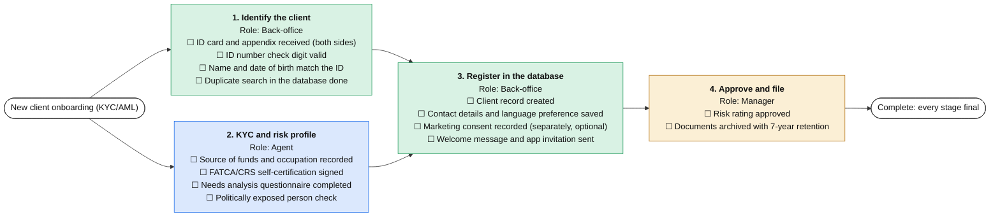

**1. Identify the client** (Back-office; can start at once)

  - [ ] ID card and appendix received (both sides) _(verify)_
  - [ ] ID number check digit valid _(verify)_
  - [ ] Name and date of birth match the ID _(verify)_
  - [ ] Duplicate search in the database done _(verify)_

**2. KYC and risk profile** (Agent; can start at once)

  - [ ] Source of funds and occupation recorded _(fill)_
  - [ ] FATCA/CRS self-certification signed _(fill)_
  - [ ] Needs analysis questionnaire completed _(fill)_
  - [ ] Politically exposed person check _(verify)_

**3. Register in the database** (Back-office; after Identify the client, KYC and risk profile)

  - [ ] Client record created _(fill)_
  - [ ] Contact details and language preference saved _(fill)_
  - [ ] Marketing consent recorded (separately, optional) _(fill)_
  - [ ] Welcome message and app invitation sent _(send)_

**4. Approve and file** (Manager; after Register in the database)

  - [ ] Risk rating approved _(verify)_
  - [ ] Documents archived with 7-year retention

## Quote, sale and policy issuance

Spec flow F2. Owner: Agent. [Edit the diagram](https://mermaid.live/edit#base64:eyJjb2RlIjoiJSV7aW5pdDoge1wiZmxvd2NoYXJ0XCI6IHtcIndyYXBwaW5nV2lkdGhcIjogMzgwfX19JSVcbmZsb3djaGFydCBMUlxuICBjbGFzc0RlZiBhZ2VudCBmaWxsOiNkYmU4ZmQsc3Ryb2tlOiMxZjZmZWIsY29sb3I6IzExMVxuICBjbGFzc0RlZiBiYWNrIGZpbGw6I2Q5ZjJlNCxzdHJva2U6IzJhOWQ2Myxjb2xvcjojMTExXG4gIGNsYXNzRGVmIG1nciBmaWxsOiNmYmVmZDUsc3Ryb2tlOiNiNzc5MWYsY29sb3I6IzExMVxuICBjbGFzc0RlZiBta3QgZmlsbDojZWNlMWZiLHN0cm9rZTojODI1MGRmLGNvbG9yOiMxMTFcbiAgY2xhc3NEZWYgZW5kMSBmaWxsOiNmZmYsc3Ryb2tlOiMzMzMsY29sb3I6IzExMVxuICBzdGFydChbXCJRdW90ZSwgc2FsZSBhbmQgcG9saWN5IGlzc3VhbmNlXCJdKTo6OmVuZDFcbiAgc19uZWVkW1wiPGI-MS4gTmVlZHMgYW5kIHN1aXRhYmlsaXR5PC9iPjxici8-Um9sZTogQWdlbnQ8YnIvPuKYkCBDbGllbnQgbmVlZHMgcmVjb3JkZWQ8YnIvPuKYkCBBdCBsZWFzdCB0d28gYWx0ZXJuYXRpdmVzIGNvbXBhcmVkPGJyLz7imJAgRXhpc3RpbmcgY292ZXIgY2hlY2tlZCAoZHVwbGljYXRlIG9yIHJlcGxhY2VtZW50KTxici8-4piQIFJlYXNvbmluZyBkb2N1bWVudCBkcmFmdGVkXCJdOjo6YWdlbnRcbiAgc19xdW90ZVtcIjxiPjIuIFF1b3RlcyBmcm9tIGluc3VyZXJzPC9iPjxici8-Um9sZTogQmFjay1vZmZpY2U8YnIvPuKYkCBQcm9wb3NhbCBmb3JtIGZpbGxlZCBmb3IgZWFjaCBpbnN1cmVyPGJyLz7imJAgUXVvdGVzIHJlY2VpdmVkIGFuZCBhdHRhY2hlZDxici8-4piQIFVuZGVyd3JpdGluZyBxdWVzdGlvbnMgYW5zd2VyZWRcIl06OjpiYWNrXG4gIHNfc2lnbltcIjxiPjMuIENsaWVudCBkZWNpc2lvbiBhbmQgc2lnbmluZzwvYj48YnIvPlJvbGU6IEFnZW50PGJyLz7imJAgQ29tbWlzc2lvbiBhbmQgZmVlcyBkaXNjbG9zZWQ8YnIvPuKYkCBQcm9wb3NhbCBhbmQgcmVhc29uaW5nIGRvY3VtZW50IHNpZ25lZDxici8-4piQIFBvd2VyIG9mIGF0dG9ybmV5IHNpZ25lZFwiXTo6OmFnZW50XG4gIHNfaXNzdWVbXCI8Yj40LiBJc3N1YW5jZSBhbmQgZmlsaW5nPC9iPjxici8-Um9sZTogQmFjay1vZmZpY2U8YnIvPuKYkCBQcm9wb3NhbCBzZW50IHRvIHRoZSBpbnN1cmVyPGJyLz7imJAgUG9saWN5IG51bWJlciByZWNlaXZlZDxici8-4piQIFBvbGljeSBmaWxlZCBhbmQgY2xpZW50IG5vdGlmaWVkPGJyLz7imJAgUG9zdC1zYWxlIGNvbnRhY3Qgc2NoZWR1bGVkICgzMCArIDEwIGJ1c2luZXNzIGRheXMpXCJdOjo6YmFja1xuICBzdGFydCAtLT4gc19uZWVkXG4gIHNfbmVlZCAtLT4gc19xdW90ZVxuICBzX3F1b3RlIC0tPiBzX3NpZ25cbiAgc19zaWduIC0tPiBzX2lzc3VlXG4gIGZpbihbXCJDb21wbGV0ZTogZXZlcnkgc3RhZ2UgZmluYWxcIl0pOjo6ZW5kMVxuICBzX2lzc3VlIC0tPiBmaW4iLCJtZXJtYWlkIjoie1widGhlbWVcIjpcImRlZmF1bHRcIn0iLCJhdXRvU3luYyI6dHJ1ZSwidXBkYXRlRGlhZ3JhbSI6dHJ1ZX0) · [English .mmd](processes/sale.mmd) · [Hebrew .mmd](processes/sale.he.mmd)

```mermaid
%%{init: {"flowchart": {"wrappingWidth": 380}}}%%
flowchart LR
  classDef agent fill:#dbe8fd,stroke:#1f6feb,color:#111
  classDef back fill:#d9f2e4,stroke:#2a9d63,color:#111
  classDef mgr fill:#fbefd5,stroke:#b7791f,color:#111
  classDef mkt fill:#ece1fb,stroke:#8250df,color:#111
  classDef end1 fill:#fff,stroke:#333,color:#111
  start(["Quote, sale and policy issuance"]):::end1
  s_need["<b>1. Needs and suitability</b><br/>Role: Agent<br/>☐ Client needs recorded<br/>☐ At least two alternatives compared<br/>☐ Existing cover checked (duplicate or replacement)<br/>☐ Reasoning document drafted"]:::agent
  s_quote["<b>2. Quotes from insurers</b><br/>Role: Back-office<br/>☐ Proposal form filled for each insurer<br/>☐ Quotes received and attached<br/>☐ Underwriting questions answered"]:::back
  s_sign["<b>3. Client decision and signing</b><br/>Role: Agent<br/>☐ Commission and fees disclosed<br/>☐ Proposal and reasoning document signed<br/>☐ Power of attorney signed"]:::agent
  s_issue["<b>4. Issuance and filing</b><br/>Role: Back-office<br/>☐ Proposal sent to the insurer<br/>☐ Policy number received<br/>☐ Policy filed and client notified<br/>☐ Post-sale contact scheduled (30 + 10 business days)"]:::back
  start --> s_need
  s_need --> s_quote
  s_quote --> s_sign
  s_sign --> s_issue
  fin(["Complete: every stage final"]):::end1
  s_issue --> fin
```

**1. Needs and suitability** (Agent; can start at once)

  - [ ] Client needs recorded _(fill)_
  - [ ] At least two alternatives compared _(verify)_
  - [ ] Existing cover checked (duplicate or replacement) _(verify)_
  - [ ] Reasoning document drafted _(fill)_

**2. Quotes from insurers** (Back-office; after Needs and suitability)

  - [ ] Proposal form filled for each insurer _(fill)_
  - [ ] Quotes received and attached _(verify)_
  - [ ] Underwriting questions answered _(fill)_

**3. Client decision and signing** (Agent; after Quotes from insurers)

  - [ ] Commission and fees disclosed _(verify)_
  - [ ] Proposal and reasoning document signed _(fill)_
  - [ ] Power of attorney signed _(fill)_

**4. Issuance and filing** (Back-office; after Client decision and signing)

  - [ ] Proposal sent to the insurer _(send)_
  - [ ] Policy number received _(verify)_
  - [ ] Policy filed and client notified _(send)_
  - [ ] Post-sale contact scheduled (30 + 10 business days) _(fill)_

## Renewal and endorsement

Spec flow F3. Owner: Agent. [Edit the diagram](https://mermaid.live/edit#base64:eyJjb2RlIjoiJSV7aW5pdDoge1wiZmxvd2NoYXJ0XCI6IHtcIndyYXBwaW5nV2lkdGhcIjogMzgwfX19JSVcbmZsb3djaGFydCBMUlxuICBjbGFzc0RlZiBhZ2VudCBmaWxsOiNkYmU4ZmQsc3Ryb2tlOiMxZjZmZWIsY29sb3I6IzExMVxuICBjbGFzc0RlZiBiYWNrIGZpbGw6I2Q5ZjJlNCxzdHJva2U6IzJhOWQ2Myxjb2xvcjojMTExXG4gIGNsYXNzRGVmIG1nciBmaWxsOiNmYmVmZDUsc3Ryb2tlOiNiNzc5MWYsY29sb3I6IzExMVxuICBjbGFzc0RlZiBta3QgZmlsbDojZWNlMWZiLHN0cm9rZTojODI1MGRmLGNvbG9yOiMxMTFcbiAgY2xhc3NEZWYgZW5kMSBmaWxsOiNmZmYsc3Ryb2tlOiMzMzMsY29sb3I6IzExMVxuICBzdGFydChbXCJSZW5ld2FsIGFuZCBlbmRvcnNlbWVudFwiXSk6OjplbmQxXG4gIHNfcHJlcFtcIjxiPjEuIFByZXBhcmUgdGhlIHJlbmV3YWw8L2I-PGJyLz5Sb2xlOiBCYWNrLW9mZmljZTxici8-4piQIFJlbmV3YWwgbm90aWNlIGZyb20gdGhlIGluc3VyZXIgcmVjZWl2ZWQ8YnIvPuKYkCBQcmVtaXVtIGNoYW5nZSBjb21wYXJlZCB3aXRoIGxhc3QgeWVhcjxici8-4piQIE1hcmtldCBjb21wYXJpc29uIGZvciBsYXJnZSBjaGFuZ2VzXCJdOjo6YmFja1xuICBzX2FkdltcIjxiPjIuIEFkdmlzZSB0aGUgY2xpZW50PC9iPjxici8-Um9sZTogQWdlbnQ8YnIvPuKYkCBDbGllbnQgY29udGFjdGVkIChjYWxsIG9yIG1lc3NhZ2UpPGJyLz7imJAgQ2hhbmdlcyBpbiBsaWZlIHNpdHVhdGlvbiBhc2tlZDxici8-4piQIERlY2lzaW9uIHJlY29yZGVkOiByZW5ldywgY2hhbmdlIG9yIGNhbmNlbFwiXTo6OmFnZW50XG4gIHNfZXhlW1wiPGI-My4gRXhlY3V0ZSBhbmQgY29uZmlybTwvYj48YnIvPlJvbGU6IEJhY2stb2ZmaWNlPGJyLz7imJAgSW5zdHJ1Y3Rpb24gc2VudCB0byB0aGUgaW5zdXJlcjxici8-4piQIFdyaXR0ZW4gY29uZmlybWF0aW9uIHJlY2VpdmVkPGJyLz7imJAgUHJlbWl1bSBjb2xsZWN0aW9uIGNoZWNrZWQ8YnIvPuKYkCBDbGllbnQgZmlsZSB1cGRhdGVkXCJdOjo6YmFja1xuICBzdGFydCAtLT4gc19wcmVwXG4gIHNfcHJlcCAtLT4gc19hZHZcbiAgc19hZHYgLS0-IHNfZXhlXG4gIGZpbihbXCJDb21wbGV0ZTogZXZlcnkgc3RhZ2UgZmluYWxcIl0pOjo6ZW5kMVxuICBzX2V4ZSAtLT4gZmluIiwibWVybWFpZCI6IntcInRoZW1lXCI6XCJkZWZhdWx0XCJ9IiwiYXV0b1N5bmMiOnRydWUsInVwZGF0ZURpYWdyYW0iOnRydWV9) · [English .mmd](processes/renew.mmd) · [Hebrew .mmd](processes/renew.he.mmd)

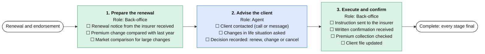

**1. Prepare the renewal** (Back-office; can start at once)

  - [ ] Renewal notice from the insurer received _(verify)_
  - [ ] Premium change compared with last year _(verify)_
  - [ ] Market comparison for large changes _(fill)_

**2. Advise the client** (Agent; after Prepare the renewal)

  - [ ] Client contacted (call or message) _(send)_
  - [ ] Changes in life situation asked _(verify)_
  - [ ] Decision recorded: renew, change or cancel _(fill)_

**3. Execute and confirm** (Back-office; after Advise the client)

  - [ ] Instruction sent to the insurer _(send)_
  - [ ] Written confirmation received _(verify)_
  - [ ] Premium collection checked _(verify)_
  - [ ] Client file updated _(fill)_

## Claim handling

Spec flow F4. Owner: Agent. [Edit the diagram](https://mermaid.live/edit#base64:eyJjb2RlIjoiJSV7aW5pdDoge1wiZmxvd2NoYXJ0XCI6IHtcIndyYXBwaW5nV2lkdGhcIjogMzgwfX19JSVcbmZsb3djaGFydCBMUlxuICBjbGFzc0RlZiBhZ2VudCBmaWxsOiNkYmU4ZmQsc3Ryb2tlOiMxZjZmZWIsY29sb3I6IzExMVxuICBjbGFzc0RlZiBiYWNrIGZpbGw6I2Q5ZjJlNCxzdHJva2U6IzJhOWQ2Myxjb2xvcjojMTExXG4gIGNsYXNzRGVmIG1nciBmaWxsOiNmYmVmZDUsc3Ryb2tlOiNiNzc5MWYsY29sb3I6IzExMVxuICBjbGFzc0RlZiBta3QgZmlsbDojZWNlMWZiLHN0cm9rZTojODI1MGRmLGNvbG9yOiMxMTFcbiAgY2xhc3NEZWYgZW5kMSBmaWxsOiNmZmYsc3Ryb2tlOiMzMzMsY29sb3I6IzExMVxuICBzdGFydChbXCJDbGFpbSBoYW5kbGluZ1wiXSk6OjplbmQxXG4gIHNfb3BlbltcIjxiPjEuIE9wZW4gdGhlIGNsYWltPC9iPjxici8-Um9sZTogQWdlbnQ8YnIvPuKYkCBFdmVudCBkZXRhaWxzIGFuZCBkYXRlIHJlY29yZGVkPGJyLz7imJAgUG9saWN5IGNvdmVyIGNvbmZpcm1lZDxici8-4piQIENsaWVudCB0b2xkIHdoaWNoIGRvY3VtZW50cyB0byBicmluZ1wiXTo6OmFnZW50XG4gIHNfZG9jc1tcIjxiPjIuIENvbGxlY3QgZG9jdW1lbnRzPC9iPjxici8-Um9sZTogQmFjay1vZmZpY2U8YnIvPuKYkCBDbGFpbSBmb3JtIGZpbGxlZDxici8-4piQIFN1cHBvcnRpbmcgZG9jdW1lbnRzIHJlY2VpdmVkIChtZWRpY2FsLCBpbnZvaWNlcywgcG9saWNlKTxici8-4piQIENsaWVudCBzaWduYXR1cmUgb24gdGhlIHJlbGVhc2VcIl06OjpiYWNrXG4gIHNfc3ViW1wiPGI-My4gU3VibWl0IHRvIHRoZSBpbnN1cmVyPC9iPjxici8-Um9sZTogQmFjay1vZmZpY2U8YnIvPuKYkCBDbGFpbSBzdWJtaXR0ZWQgYW5kIG51bWJlciByZWNlaXZlZDxici8-4piQIFJlc3BvbnNlIGRlYWRsaW5lIHNldCBpbiBidXNpbmVzcyBkYXlzXCJdOjo6YmFja1xuICBzX2ZvbGxbXCI8Yj40LiBGb2xsb3cgdXAgYW5kIGNsb3NlPC9iPjxici8-Um9sZTogQWdlbnQ8YnIvPuKYkCBJbnN1cmVyIHF1ZXN0aW9ucyBhbnN3ZXJlZDxici8-4piQIERlY2lzaW9uIGV4cGxhaW5lZCB0byB0aGUgY2xpZW50PGJyLz7imJAgUGF5bWVudCBjb25maXJtZWQgb3IgYXBwZWFsIGZpbGVkPGJyLz7imJAgQ2xhaW0gY2xvc2VkXCJdOjo6YWdlbnRcbiAgc3RhcnQgLS0-IHNfb3BlblxuICBzX29wZW4gLS0-IHNfZG9jc1xuICBzX2RvY3MgLS0-IHNfc3ViXG4gIHNfc3ViIC0tPiBzX2ZvbGxcbiAgZmluKFtcIkNvbXBsZXRlOiBldmVyeSBzdGFnZSBmaW5hbFwiXSk6OjplbmQxXG4gIHNfZm9sbCAtLT4gZmluIiwibWVybWFpZCI6IntcInRoZW1lXCI6XCJkZWZhdWx0XCJ9IiwiYXV0b1N5bmMiOnRydWUsInVwZGF0ZURpYWdyYW0iOnRydWV9) · [English .mmd](processes/claim.mmd) · [Hebrew .mmd](processes/claim.he.mmd)

```mermaid
%%{init: {"flowchart": {"wrappingWidth": 380}}}%%
flowchart LR
  classDef agent fill:#dbe8fd,stroke:#1f6feb,color:#111
  classDef back fill:#d9f2e4,stroke:#2a9d63,color:#111
  classDef mgr fill:#fbefd5,stroke:#b7791f,color:#111
  classDef mkt fill:#ece1fb,stroke:#8250df,color:#111
  classDef end1 fill:#fff,stroke:#333,color:#111
  start(["Claim handling"]):::end1
  s_open["<b>1. Open the claim</b><br/>Role: Agent<br/>☐ Event details and date recorded<br/>☐ Policy cover confirmed<br/>☐ Client told which documents to bring"]:::agent
  s_docs["<b>2. Collect documents</b><br/>Role: Back-office<br/>☐ Claim form filled<br/>☐ Supporting documents received (medical, invoices, police)<br/>☐ Client signature on the release"]:::back
  s_sub["<b>3. Submit to the insurer</b><br/>Role: Back-office<br/>☐ Claim submitted and number received<br/>☐ Response deadline set in business days"]:::back
  s_foll["<b>4. Follow up and close</b><br/>Role: Agent<br/>☐ Insurer questions answered<br/>☐ Decision explained to the client<br/>☐ Payment confirmed or appeal filed<br/>☐ Claim closed"]:::agent
  start --> s_open
  s_open --> s_docs
  s_docs --> s_sub
  s_sub --> s_foll
  fin(["Complete: every stage final"]):::end1
  s_foll --> fin
```

**1. Open the claim** (Agent; can start at once)

  - [ ] Event details and date recorded _(fill)_
  - [ ] Policy cover confirmed _(verify)_
  - [ ] Client told which documents to bring _(send)_

**2. Collect documents** (Back-office; after Open the claim)

  - [ ] Claim form filled _(fill)_
  - [ ] Supporting documents received (medical, invoices, police) _(verify)_
  - [ ] Client signature on the release _(fill)_

**3. Submit to the insurer** (Back-office; after Collect documents)

  - [ ] Claim submitted and number received _(send)_
  - [ ] Response deadline set in business days _(fill)_

**4. Follow up and close** (Agent; after Submit to the insurer)

  - [ ] Insurer questions answered _(fill)_
  - [ ] Decision explained to the client _(send)_
  - [ ] Payment confirmed or appeal filed _(verify)_
  - [ ] Claim closed

## Pension and savings portfolio review

Spec flow F5. Owner: Agent. [Edit the diagram](https://mermaid.live/edit#base64:eyJjb2RlIjoiJSV7aW5pdDoge1wiZmxvd2NoYXJ0XCI6IHtcIndyYXBwaW5nV2lkdGhcIjogMzgwfX19JSVcbmZsb3djaGFydCBMUlxuICBjbGFzc0RlZiBhZ2VudCBmaWxsOiNkYmU4ZmQsc3Ryb2tlOiMxZjZmZWIsY29sb3I6IzExMVxuICBjbGFzc0RlZiBiYWNrIGZpbGw6I2Q5ZjJlNCxzdHJva2U6IzJhOWQ2Myxjb2xvcjojMTExXG4gIGNsYXNzRGVmIG1nciBmaWxsOiNmYmVmZDUsc3Ryb2tlOiNiNzc5MWYsY29sb3I6IzExMVxuICBjbGFzc0RlZiBta3QgZmlsbDojZWNlMWZiLHN0cm9rZTojODI1MGRmLGNvbG9yOiMxMTFcbiAgY2xhc3NEZWYgZW5kMSBmaWxsOiNmZmYsc3Ryb2tlOiMzMzMsY29sb3I6IzExMVxuICBzdGFydChbXCJQZW5zaW9uIGFuZCBzYXZpbmdzIHBvcnRmb2xpbyByZXZpZXdcIl0pOjo6ZW5kMVxuICBzX2F1dGhbXCI8Yj4xLiBUaHJlZSBhdXRob3JpemF0aW9uczwvYj48YnIvPlJvbGU6IEJhY2stb2ZmaWNlPGJyLz7imJAgSGFyIEhhQml0dWFjaCBhdXRob3JpemF0aW9uIHNpZ25lZDxici8-4piQIENsZWFyaW5nIGhvdXNlIChNaXNsYWthKSBhdXRob3JpemF0aW9uIHNpZ25lZDxici8-4piQIENvbnRpbnVpbmcgYXV0aG9yaXphdGlvbiAoQjEpIHNpZ25lZCBmb3IgZWFjaCBpbnN1cmVyXCJdOjo6YmFja1xuICBzX2RhdGFbXCI8Yj4yLiBHZXQgdGhlIGRhdGE8L2I-PGJyLz5Sb2xlOiBCYWNrLW9mZmljZTxici8-4piQIEhhciBIYUJpdHVhY2ggcmVwb3J0IHJlcXVlc3RlZDxici8-4piQIENsZWFyaW5nIGhvdXNlIGRhdGEgcmVxdWVzdGVkPGJyLz7imJAgRGF0YSBpbXBvcnRlZCBhbmQgbWF0Y2hlZCB0byB0aGUgY2xpZW50XCJdOjo6YmFja1xuICBzX2FuYVtcIjxiPjMuIEFuYWx5c2lzPC9iPjxici8-Um9sZTogQWdlbnQ8YnIvPuKYkCBEdXBsaWNhdGUgY292ZXIgYW5kIGlkbGUgZnVuZHMgZm91bmQ8YnIvPuKYkCBNYW5hZ2VtZW50IGZlZXMgY29tcGFyZWQ8YnIvPuKYkCBHYXBzIGxpc3RlZCAoZGlzYWJpbGl0eSwgZGVhdGgsIGxvbmctdGVybSBjYXJlKVwiXTo6OmFnZW50XG4gIHNfcmVjW1wiPGI-NC4gUmVjb21tZW5kYXRpb24gYW5kIHNpZ25pbmc8L2I-PGJyLz5Sb2xlOiBBZ2VudDxici8-4piQIFJlY29tbWVuZGF0aW9uIHdpdGggcmVhc29uaW5nIHdyaXR0ZW48YnIvPuKYkCBDbGllbnQgbWVldGluZyBoZWxkPGJyLz7imJAgQWR2aWNlIHJlY29yZCBzaWduZWRcIl06OjphZ2VudFxuICBzdGFydCAtLT4gc19hdXRoXG4gIHNfYXV0aCAtLT4gc19kYXRhXG4gIHNfZGF0YSAtLT4gc19hbmFcbiAgc19hbmEgLS0-IHNfcmVjXG4gIGZpbihbXCJDb21wbGV0ZTogZXZlcnkgc3RhZ2UgZmluYWxcIl0pOjo6ZW5kMVxuICBzX3JlYyAtLT4gZmluIiwibWVybWFpZCI6IntcInRoZW1lXCI6XCJkZWZhdWx0XCJ9IiwiYXV0b1N5bmMiOnRydWUsInVwZGF0ZURpYWdyYW0iOnRydWV9) · [English .mmd](processes/pen.mmd) · [Hebrew .mmd](processes/pen.he.mmd)

```mermaid
%%{init: {"flowchart": {"wrappingWidth": 380}}}%%
flowchart LR
  classDef agent fill:#dbe8fd,stroke:#1f6feb,color:#111
  classDef back fill:#d9f2e4,stroke:#2a9d63,color:#111
  classDef mgr fill:#fbefd5,stroke:#b7791f,color:#111
  classDef mkt fill:#ece1fb,stroke:#8250df,color:#111
  classDef end1 fill:#fff,stroke:#333,color:#111
  start(["Pension and savings portfolio review"]):::end1
  s_auth["<b>1. Three authorizations</b><br/>Role: Back-office<br/>☐ Har HaBituach authorization signed<br/>☐ Clearing house (Mislaka) authorization signed<br/>☐ Continuing authorization (B1) signed for each insurer"]:::back
  s_data["<b>2. Get the data</b><br/>Role: Back-office<br/>☐ Har HaBituach report requested<br/>☐ Clearing house data requested<br/>☐ Data imported and matched to the client"]:::back
  s_ana["<b>3. Analysis</b><br/>Role: Agent<br/>☐ Duplicate cover and idle funds found<br/>☐ Management fees compared<br/>☐ Gaps listed (disability, death, long-term care)"]:::agent
  s_rec["<b>4. Recommendation and signing</b><br/>Role: Agent<br/>☐ Recommendation with reasoning written<br/>☐ Client meeting held<br/>☐ Advice record signed"]:::agent
  start --> s_auth
  s_auth --> s_data
  s_data --> s_ana
  s_ana --> s_rec
  fin(["Complete: every stage final"]):::end1
  s_rec --> fin
```

**1. Three authorizations** (Back-office; can start at once)

  - [ ] Har HaBituach authorization signed _(fill)_
  - [ ] Clearing house (Mislaka) authorization signed _(fill)_
  - [ ] Continuing authorization (B1) signed for each insurer _(fill)_

**2. Get the data** (Back-office; after Three authorizations)

  - [ ] Har HaBituach report requested _(send)_
  - [ ] Clearing house data requested _(send)_
  - [ ] Data imported and matched to the client _(verify)_

**3. Analysis** (Agent; after Get the data)

  - [ ] Duplicate cover and idle funds found _(verify)_
  - [ ] Management fees compared _(verify)_
  - [ ] Gaps listed (disability, death, long-term care) _(fill)_

**4. Recommendation and signing** (Agent; after Analysis)

  - [ ] Recommendation with reasoning written _(fill)_
  - [ ] Client meeting held _(verify)_
  - [ ] Advice record signed _(fill)_

## Get the ID and register the client

Spec flow F11. Owner: Back-office. [Edit the diagram](https://mermaid.live/edit#base64:eyJjb2RlIjoiJSV7aW5pdDoge1wiZmxvd2NoYXJ0XCI6IHtcIndyYXBwaW5nV2lkdGhcIjogMzgwfX19JSVcbmZsb3djaGFydCBMUlxuICBjbGFzc0RlZiBhZ2VudCBmaWxsOiNkYmU4ZmQsc3Ryb2tlOiMxZjZmZWIsY29sb3I6IzExMVxuICBjbGFzc0RlZiBiYWNrIGZpbGw6I2Q5ZjJlNCxzdHJva2U6IzJhOWQ2Myxjb2xvcjojMTExXG4gIGNsYXNzRGVmIG1nciBmaWxsOiNmYmVmZDUsc3Ryb2tlOiNiNzc5MWYsY29sb3I6IzExMVxuICBjbGFzc0RlZiBta3QgZmlsbDojZWNlMWZiLHN0cm9rZTojODI1MGRmLGNvbG9yOiMxMTFcbiAgY2xhc3NEZWYgZW5kMSBmaWxsOiNmZmYsc3Ryb2tlOiMzMzMsY29sb3I6IzExMVxuICBzdGFydChbXCJHZXQgdGhlIElEIGFuZCByZWdpc3RlciB0aGUgY2xpZW50XCJdKTo6OmVuZDFcbiAgc19yZXFbXCI8Yj4xLiBSZXF1ZXN0IHRoZSBJRDwvYj48YnIvPlJvbGU6IEJhY2stb2ZmaWNlPGJyLz7imJAgTWlzc2luZy1JRCBjYXNlIG9wZW5lZCBmcm9tIHRoZSBJbmJveDxici8-4piQIFJlcXVlc3Qgc2VudCAoV2hhdHNBcHAsIGVtYWlsIG9yIHBvc3QpPGJyLz7imJAgUmVtaW5kZXIgc2V0IGZvciAzIGJ1c2luZXNzIGRheXNcIl06OjpiYWNrXG4gIHNfY2hrW1wiPGI-Mi4gVmFsaWRhdGU8L2I-PGJyLz5Sb2xlOiBCYWNrLW9mZmljZTxici8-4piQIEJvdGggc2lkZXMgbGVnaWJsZTxici8-4piQIENoZWNrIGRpZ2l0IHZhbGlkPGJyLz7imJAgTWF0Y2ggd2l0aCB0aGUgZGVjbGFyZWQgbmFtZVwiXTo6OmJhY2tcbiAgc19yZWdbXCI8Yj4zLiBSZWdpc3RlcjwvYj48YnIvPlJvbGU6IEJhY2stb2ZmaWNlPGJyLz7imJAgUmVjb3JkIGNyZWF0ZWQgb3IgdXBkYXRlZDxici8-4piQIENvcHkgZmlsZWQgaW4gdGhlIGNsaWVudCBmaWxlPGJyLz7imJAgQ2FzZSBjbG9zZWQgaW4gdGhlIEluYm94XCJdOjo6YmFja1xuICBzdGFydCAtLT4gc19yZXFcbiAgc19yZXEgLS0-IHNfY2hrXG4gIHNfY2hrIC0tPiBzX3JlZ1xuICBmaW4oW1wiQ29tcGxldGU6IGV2ZXJ5IHN0YWdlIGZpbmFsXCJdKTo6OmVuZDFcbiAgc19yZWcgLS0-IGZpbiIsIm1lcm1haWQiOiJ7XCJ0aGVtZVwiOlwiZGVmYXVsdFwifSIsImF1dG9TeW5jIjp0cnVlLCJ1cGRhdGVEaWFncmFtIjp0cnVlfQ) · [English .mmd](processes/idreg.mmd) · [Hebrew .mmd](processes/idreg.he.mmd)

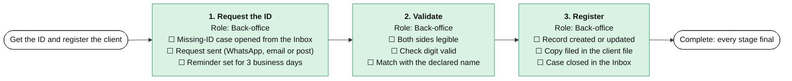

**1. Request the ID** (Back-office; can start at once)

  - [ ] Missing-ID case opened from the Inbox _(fill)_
  - [ ] Request sent (WhatsApp, email or post) _(send)_
  - [ ] Reminder set for 3 business days _(fill)_

**2. Validate** (Back-office; after Request the ID)

  - [ ] Both sides legible _(verify)_
  - [ ] Check digit valid _(verify)_
  - [ ] Match with the declared name _(verify)_

**3. Register** (Back-office; after Validate)

  - [ ] Record created or updated _(fill)_
  - [ ] Copy filed in the client file _(fill)_
  - [ ] Case closed in the Inbox _(fill)_

## Fill and sign a template

Spec flow F12. Owner: Back-office. [Edit the diagram](https://mermaid.live/edit#base64:eyJjb2RlIjoiJSV7aW5pdDoge1wiZmxvd2NoYXJ0XCI6IHtcIndyYXBwaW5nV2lkdGhcIjogMzgwfX19JSVcbmZsb3djaGFydCBMUlxuICBjbGFzc0RlZiBhZ2VudCBmaWxsOiNkYmU4ZmQsc3Ryb2tlOiMxZjZmZWIsY29sb3I6IzExMVxuICBjbGFzc0RlZiBiYWNrIGZpbGw6I2Q5ZjJlNCxzdHJva2U6IzJhOWQ2Myxjb2xvcjojMTExXG4gIGNsYXNzRGVmIG1nciBmaWxsOiNmYmVmZDUsc3Ryb2tlOiNiNzc5MWYsY29sb3I6IzExMVxuICBjbGFzc0RlZiBta3QgZmlsbDojZWNlMWZiLHN0cm9rZTojODI1MGRmLGNvbG9yOiMxMTFcbiAgY2xhc3NEZWYgZW5kMSBmaWxsOiNmZmYsc3Ryb2tlOiMzMzMsY29sb3I6IzExMVxuICBzdGFydChbXCJGaWxsIGFuZCBzaWduIGEgdGVtcGxhdGVcIl0pOjo6ZW5kMVxuICBzX3BpY2tbXCI8Yj4xLiBDaG9vc2UgdGhlIHRlbXBsYXRlPC9iPjxici8-Um9sZTogQmFjay1vZmZpY2U8YnIvPuKYkCBUZW1wbGF0ZSBhbmQgY2xpZW50IGNob3Nlbjxici8-4piQIEVtcHR5IGZpZWxkcyBoaWdobGlnaHRlZCBhbmQgcmV2aWV3ZWRcIl06OjpiYWNrXG4gIHNfZmlsbFtcIjxiPjIuIEZpbGwgYW5kIHJldmlldzwvYj48YnIvPlJvbGU6IEJhY2stb2ZmaWNlPGJyLz7imJAgQWxsIGZpZWxkcyBmaWxsZWQgZnJvbSB0aGUgY2xpZW50IGZpbGU8YnIvPuKYkCBTZWNvbmQgcGFpciBvZiBleWVzIG9uIHRoZSBhbW91bnRzIGFuZCBkYXRlc1wiXTo6OmJhY2tcbiAgc19zaWdbXCI8Yj4zLiBTaWduYXR1cmU8L2I-PGJyLz5Sb2xlOiBBZ2VudDxici8-4piQIFNlbnQgdG8gdGhlIGNsaWVudCBmb3Igc2lnbmF0dXJlPGJyLz7imJAgU2lnbmVkIGNvcHkgcmVjZWl2ZWQ8YnIvPuKYkCBTaWduZWQgY29weSBmaWxlZFwiXTo6OmFnZW50XG4gIHN0YXJ0IC0tPiBzX3BpY2tcbiAgc19waWNrIC0tPiBzX2ZpbGxcbiAgc19maWxsIC0tPiBzX3NpZ1xuICBmaW4oW1wiQ29tcGxldGU6IGV2ZXJ5IHN0YWdlIGZpbmFsXCJdKTo6OmVuZDFcbiAgc19zaWcgLS0-IGZpbiIsIm1lcm1haWQiOiJ7XCJ0aGVtZVwiOlwiZGVmYXVsdFwifSIsImF1dG9TeW5jIjp0cnVlLCJ1cGRhdGVEaWFncmFtIjp0cnVlfQ) · [English .mmd](processes/tpl.mmd) · [Hebrew .mmd](processes/tpl.he.mmd)

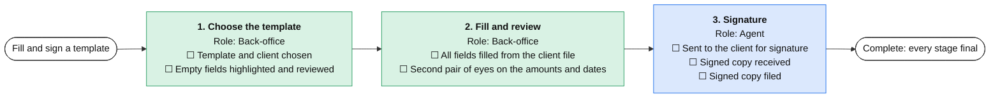

**1. Choose the template** (Back-office; can start at once)

  - [ ] Template and client chosen _(fill)_
  - [ ] Empty fields highlighted and reviewed _(verify)_

**2. Fill and review** (Back-office; after Choose the template)

  - [ ] All fields filled from the client file _(fill)_
  - [ ] Second pair of eyes on the amounts and dates _(verify)_

**3. Signature** (Agent; after Fill and review)

  - [ ] Sent to the client for signature _(send)_
  - [ ] Signed copy received _(verify)_
  - [ ] Signed copy filed _(fill)_

## Outgoing post and email batch

Spec flow F13. Owner: Back-office. [Edit the diagram](https://mermaid.live/edit#base64:eyJjb2RlIjoiJSV7aW5pdDoge1wiZmxvd2NoYXJ0XCI6IHtcIndyYXBwaW5nV2lkdGhcIjogMzgwfX19JSVcbmZsb3djaGFydCBMUlxuICBjbGFzc0RlZiBhZ2VudCBmaWxsOiNkYmU4ZmQsc3Ryb2tlOiMxZjZmZWIsY29sb3I6IzExMVxuICBjbGFzc0RlZiBiYWNrIGZpbGw6I2Q5ZjJlNCxzdHJva2U6IzJhOWQ2Myxjb2xvcjojMTExXG4gIGNsYXNzRGVmIG1nciBmaWxsOiNmYmVmZDUsc3Ryb2tlOiNiNzc5MWYsY29sb3I6IzExMVxuICBjbGFzc0RlZiBta3QgZmlsbDojZWNlMWZiLHN0cm9rZTojODI1MGRmLGNvbG9yOiMxMTFcbiAgY2xhc3NEZWYgZW5kMSBmaWxsOiNmZmYsc3Ryb2tlOiMzMzMsY29sb3I6IzExMVxuICBzdGFydChbXCJPdXRnb2luZyBwb3N0IGFuZCBlbWFpbCBiYXRjaFwiXSk6OjplbmQxXG4gIHNfcHJlcFtcIjxiPjEuIFByZXBhcmUgdGhlIGJhdGNoPC9iPjxici8-Um9sZTogQmFjay1vZmZpY2U8YnIvPuKYkCBBZGRyZXNzZXMgY2hlY2tlZCAoc3RyZWV0LCBjaXR5LCBwb3N0YWwgY29kZSk8YnIvPuKYkCBSZWNpcGllbnRzJyBsYW5ndWFnZSBhbmQgY2hhbm5lbCBwcmVmZXJlbmNlIGFwcGxpZWRcIl06OjpiYWNrXG4gIHNfbGFiW1wiPGI-Mi4gUHJpbnQ8L2I-PGJyLz5Sb2xlOiBCYWNrLW9mZmljZTxici8-4piQIExhYmVscyBwcmludGVkPGJyLz7imJAgTGV0dGVycyBwcmludGVkIGFuZCBlbmNsb3NlZFwiXTo6OmJhY2tcbiAgc19zbmRbXCI8Yj4zLiBTZW5kIGFuZCBwcm92ZTwvYj48YnIvPlJvbGU6IEJhY2stb2ZmaWNlPGJyLz7imJAgUG9zdCBoYW5kZWQgb3ZlciwgcmVjZWlwdCBrZXB0PGJyLz7imJAgRW1haWxzIHNlbnQ8YnIvPuKYkCBQcm9vZiBvZiBkaXNwYXRjaCBmaWxlZCBpbiB0aGUgY2xpZW50IGZpbGVcIl06OjpiYWNrXG4gIHN0YXJ0IC0tPiBzX3ByZXBcbiAgc19wcmVwIC0tPiBzX2xhYlxuICBzX2xhYiAtLT4gc19zbmRcbiAgZmluKFtcIkNvbXBsZXRlOiBldmVyeSBzdGFnZSBmaW5hbFwiXSk6OjplbmQxXG4gIHNfc25kIC0tPiBmaW4iLCJtZXJtYWlkIjoie1widGhlbWVcIjpcImRlZmF1bHRcIn0iLCJhdXRvU3luYyI6dHJ1ZSwidXBkYXRlRGlhZ3JhbSI6dHJ1ZX0) · [English .mmd](processes/post.mmd) · [Hebrew .mmd](processes/post.he.mmd)

```mermaid
%%{init: {"flowchart": {"wrappingWidth": 380}}}%%
flowchart LR
  classDef agent fill:#dbe8fd,stroke:#1f6feb,color:#111
  classDef back fill:#d9f2e4,stroke:#2a9d63,color:#111
  classDef mgr fill:#fbefd5,stroke:#b7791f,color:#111
  classDef mkt fill:#ece1fb,stroke:#8250df,color:#111
  classDef end1 fill:#fff,stroke:#333,color:#111
  start(["Outgoing post and email batch"]):::end1
  s_prep["<b>1. Prepare the batch</b><br/>Role: Back-office<br/>☐ Addresses checked (street, city, postal code)<br/>☐ Recipients' language and channel preference applied"]:::back
  s_lab["<b>2. Print</b><br/>Role: Back-office<br/>☐ Labels printed<br/>☐ Letters printed and enclosed"]:::back
  s_snd["<b>3. Send and prove</b><br/>Role: Back-office<br/>☐ Post handed over, receipt kept<br/>☐ Emails sent<br/>☐ Proof of dispatch filed in the client file"]:::back
  start --> s_prep
  s_prep --> s_lab
  s_lab --> s_snd
  fin(["Complete: every stage final"]):::end1
  s_snd --> fin
```

**1. Prepare the batch** (Back-office; can start at once)

  - [ ] Addresses checked (street, city, postal code) _(verify)_
  - [ ] Recipients' language and channel preference applied _(verify)_

**2. Print** (Back-office; after Prepare the batch)

  - [ ] Labels printed _(fill)_
  - [ ] Letters printed and enclosed _(fill)_

**3. Send and prove** (Back-office; after Print)

  - [ ] Post handed over, receipt kept _(send)_
  - [ ] Emails sent _(send)_
  - [ ] Proof of dispatch filed in the client file _(fill)_

## Request from another insurance company

Spec flow F14. Owner: Back-office. [Edit the diagram](https://mermaid.live/edit#base64:eyJjb2RlIjoiJSV7aW5pdDoge1wiZmxvd2NoYXJ0XCI6IHtcIndyYXBwaW5nV2lkdGhcIjogMzgwfX19JSVcbmZsb3djaGFydCBMUlxuICBjbGFzc0RlZiBhZ2VudCBmaWxsOiNkYmU4ZmQsc3Ryb2tlOiMxZjZmZWIsY29sb3I6IzExMVxuICBjbGFzc0RlZiBiYWNrIGZpbGw6I2Q5ZjJlNCxzdHJva2U6IzJhOWQ2Myxjb2xvcjojMTExXG4gIGNsYXNzRGVmIG1nciBmaWxsOiNmYmVmZDUsc3Ryb2tlOiNiNzc5MWYsY29sb3I6IzExMVxuICBjbGFzc0RlZiBta3QgZmlsbDojZWNlMWZiLHN0cm9rZTojODI1MGRmLGNvbG9yOiMxMTFcbiAgY2xhc3NEZWYgZW5kMSBmaWxsOiNmZmYsc3Ryb2tlOiMzMzMsY29sb3I6IzExMVxuICBzdGFydChbXCJSZXF1ZXN0IGZyb20gYW5vdGhlciBpbnN1cmFuY2UgY29tcGFueVwiXSk6OjplbmQxXG4gIHNfcmN2W1wiPGI-MS4gUmVjZWl2ZSBhbmQgYXR0cmlidXRlPC9iPjxici8-Um9sZTogQmFjay1vZmZpY2U8YnIvPuKYkCBSZXF1ZXN0IGxvZ2dlZCB3aXRoIGRhdGUgYW5kIGluc3VyZXI8YnIvPuKYkCBDbGllbnQgYW5kIHBvbGljeSBpZGVudGlmaWVkPGJyLz7imJAgQnVzaW5lc3MtZGF5IGNsb2NrIHN0YXJ0ZWQgKDIsIDMsIDcgb3IgMTAgZGF5cyBieSBzdGVwKVwiXTo6OmJhY2tcbiAgc19hdXRoW1wiPGI-Mi4gQ2hlY2sgYXV0aG9yaXR5PC9iPjxici8-Um9sZTogQmFjay1vZmZpY2U8YnIvPuKYkCBWYWxpZCBwb3dlciBvZiBhdHRvcm5leSBleGlzdHMgKEIxIHdpdGhpbiA3LTEwIHllYXJzKTxici8-4piQIE5vdCBjYW5jZWxsZWQgYnkgdGhlIGNsaWVudDxici8-4piQIElmIG1pc3NpbmcsIHJlcXVlc3Qgc2lnbmF0dXJlIGZyb20gdGhlIGNsaWVudFwiXTo6OmJhY2tcbiAgc19wcnBbXCI8Yj4zLiBQcmVwYXJlIHRoZSBhbnN3ZXI8L2I-PGJyLz5Sb2xlOiBCYWNrLW9mZmljZTxici8-4piQIERvY3VtZW50cyBjb2xsZWN0ZWQ8YnIvPuKYkCBBbnN3ZXIgdGVtcGxhdGUgZmlsbGVkPGJyLz7imJAgUmV2aWV3ZWQgYnkgdGhlIGFnZW50XCJdOjo6YmFja1xuICBzX3NuZFtcIjxiPjQuIFJlcGx5IGFuZCBjbG9zZTwvYj48YnIvPlJvbGU6IEJhY2stb2ZmaWNlPGJyLz7imJAgUmVwbHkgc2VudCB3aXRoaW4gdGhlIGRlYWRsaW5lPGJyLz7imJAgQ29uZmlybWF0aW9uIG9mIHJlY2VpcHQgb2J0YWluZWQ8YnIvPuKYkCBFeGNoYW5nZSBsb2dnZWQgaW4gdGhlIGluZm9ybWF0aW9uLWV4Y2hhbmdlIHJlZ2lzdGVyXCJdOjo6YmFja1xuICBzdGFydCAtLT4gc19yY3ZcbiAgc19yY3YgLS0-IHNfYXV0aFxuICBzX2F1dGggLS0-IHNfcHJwXG4gIHNfcHJwIC0tPiBzX3NuZFxuICBmaW4oW1wiQ29tcGxldGU6IGV2ZXJ5IHN0YWdlIGZpbmFsXCJdKTo6OmVuZDFcbiAgc19zbmQgLS0-IGZpbiIsIm1lcm1haWQiOiJ7XCJ0aGVtZVwiOlwiZGVmYXVsdFwifSIsImF1dG9TeW5jIjp0cnVlLCJ1cGRhdGVEaWFncmFtIjp0cnVlfQ) · [English .mmd](processes/insreq.mmd) · [Hebrew .mmd](processes/insreq.he.mmd)

**1. Receive and attribute** (Back-office; can start at once)

  - [ ] Request logged with date and insurer _(fill)_
  - [ ] Client and policy identified _(verify)_
  - [ ] Business-day clock started (2, 3, 7 or 10 days by step) _(fill)_

**2. Check authority** (Back-office; after Receive and attribute)

  - [ ] Valid power of attorney exists (B1 within 7-10 years) _(verify)_
  - [ ] Not cancelled by the client _(verify)_
  - [ ] If missing, request signature from the client _(send)_

**3. Prepare the answer** (Back-office; after Check authority)

  - [ ] Documents collected _(fill)_
  - [ ] Answer template filled _(fill)_
  - [ ] Reviewed by the agent _(verify)_

**4. Reply and close** (Back-office; after Prepare the answer)

  - [ ] Reply sent within the deadline _(send)_
  - [ ] Confirmation of receipt obtained _(verify)_
  - [ ] Exchange logged in the information-exchange register _(fill)_

## Agent transfer (appointment letter)

Spec flow F5 / F14. Owner: Agent. [Edit the diagram](https://mermaid.live/edit#base64:eyJjb2RlIjoiJSV7aW5pdDoge1wiZmxvd2NoYXJ0XCI6IHtcIndyYXBwaW5nV2lkdGhcIjogMzgwfX19JSVcbmZsb3djaGFydCBMUlxuICBjbGFzc0RlZiBhZ2VudCBmaWxsOiNkYmU4ZmQsc3Ryb2tlOiMxZjZmZWIsY29sb3I6IzExMVxuICBjbGFzc0RlZiBiYWNrIGZpbGw6I2Q5ZjJlNCxzdHJva2U6IzJhOWQ2Myxjb2xvcjojMTExXG4gIGNsYXNzRGVmIG1nciBmaWxsOiNmYmVmZDUsc3Ryb2tlOiNiNzc5MWYsY29sb3I6IzExMVxuICBjbGFzc0RlZiBta3QgZmlsbDojZWNlMWZiLHN0cm9rZTojODI1MGRmLGNvbG9yOiMxMTFcbiAgY2xhc3NEZWYgZW5kMSBmaWxsOiNmZmYsc3Ryb2tlOiMzMzMsY29sb3I6IzExMVxuICBzdGFydChbXCJBZ2VudCB0cmFuc2ZlciAoYXBwb2ludG1lbnQgbGV0dGVyKVwiXSk6OjplbmQxXG4gIHNfc2lnbltcIjxiPjEuIFNpZ24gdGhlIGFwcG9pbnRtZW50PC9iPjxici8-Um9sZTogQWdlbnQ8YnIvPuKYkCBDb250aW51aW5nIGF1dGhvcml6YXRpb24gKGFwcGVuZGl4IEIxKSBzaWduZWQ8YnIvPuKYkCBDbGllbnQgdG9sZCBhYm91dCB0aGUgZWZmZWN0IG9uIHRoZSBvbGQgYWdlbnRcIl06OjphZ2VudFxuICBzX2Z3ZFtcIjxiPjIuIEZvcndhcmQgdG8gdGhlIGluc3VyZXJzPC9iPjxici8-Um9sZTogQmFjay1vZmZpY2U8YnIvPuKYkCBTZW50IHRvIGVhY2ggaW5zdXJlciB3aXRoaW4gMTAgYnVzaW5lc3MgZGF5czxici8-4piQIFJlY2VpcHQgY29uZmlybWVkIGJ5IGVhY2ggaW5zdXJlclwiXTo6OmJhY2tcbiAgc19lZmZbXCI8Yj4zLiBDb25maXJtIHRoZSBlZmZlY3Q8L2I-PGJyLz5Sb2xlOiBCYWNrLW9mZmljZTxici8-4piQIFByZXZpb3VzIGFnZW50J3MgYXV0aG9yaXphdGlvbiBjYW5jZWxsZWQgKGFib3V0IDEwIGJ1c2luZXNzIGRheXMpPGJyLz7imJAgQ29tbWlzc2lvbiBzdHJlYW0gbW92ZWQ8YnIvPuKYkCBWYWxpZGl0eSBlbmQgZGF0ZSAoNy0xMCB5ZWFycykgaW4gdGhlIGNhbGVuZGFyXCJdOjo6YmFja1xuICBzdGFydCAtLT4gc19zaWduXG4gIHNfc2lnbiAtLT4gc19md2RcbiAgc19md2QgLS0-IHNfZWZmXG4gIGZpbihbXCJDb21wbGV0ZTogZXZlcnkgc3RhZ2UgZmluYWxcIl0pOjo6ZW5kMVxuICBzX2VmZiAtLT4gZmluIiwibWVybWFpZCI6IntcInRoZW1lXCI6XCJkZWZhdWx0XCJ9IiwiYXV0b1N5bmMiOnRydWUsInVwZGF0ZURpYWdyYW0iOnRydWV9) · [English .mmd](processes/xfer.mmd) · [Hebrew .mmd](processes/xfer.he.mmd)

```mermaid
%%{init: {"flowchart": {"wrappingWidth": 380}}}%%
flowchart LR
  classDef agent fill:#dbe8fd,stroke:#1f6feb,color:#111
  classDef back fill:#d9f2e4,stroke:#2a9d63,color:#111
  classDef mgr fill:#fbefd5,stroke:#b7791f,color:#111
  classDef mkt fill:#ece1fb,stroke:#8250df,color:#111
  classDef end1 fill:#fff,stroke:#333,color:#111
  start(["Agent transfer (appointment letter)"]):::end1
  s_sign["<b>1. Sign the appointment</b><br/>Role: Agent<br/>☐ Continuing authorization (appendix B1) signed<br/>☐ Client told about the effect on the old agent"]:::agent
  s_fwd["<b>2. Forward to the insurers</b><br/>Role: Back-office<br/>☐ Sent to each insurer within 10 business days<br/>☐ Receipt confirmed by each insurer"]:::back
  s_eff["<b>3. Confirm the effect</b><br/>Role: Back-office<br/>☐ Previous agent's authorization cancelled (about 10 business days)<br/>☐ Commission stream moved<br/>☐ Validity end date (7-10 years) in the calendar"]:::back
  start --> s_sign
  s_sign --> s_fwd
  s_fwd --> s_eff
  fin(["Complete: every stage final"]):::end1
  s_eff --> fin
```

**1. Sign the appointment** (Agent; can start at once)

  - [ ] Continuing authorization (appendix B1) signed _(fill)_
  - [ ] Client told about the effect on the old agent _(verify)_

**2. Forward to the insurers** (Back-office; after Sign the appointment)

  - [ ] Sent to each insurer within 10 business days _(send)_
  - [ ] Receipt confirmed by each insurer _(verify)_

**3. Confirm the effect** (Back-office; after Forward to the insurers)

  - [ ] Previous agent's authorization cancelled (about 10 business days) _(verify)_
  - [ ] Commission stream moved _(verify)_
  - [ ] Validity end date (7-10 years) in the calendar _(fill)_

## Policy replacement advice

Spec flow F2. Owner: Agent. [Edit the diagram](https://mermaid.live/edit#base64:eyJjb2RlIjoiJSV7aW5pdDoge1wiZmxvd2NoYXJ0XCI6IHtcIndyYXBwaW5nV2lkdGhcIjogMzgwfX19JSVcbmZsb3djaGFydCBMUlxuICBjbGFzc0RlZiBhZ2VudCBmaWxsOiNkYmU4ZmQsc3Ryb2tlOiMxZjZmZWIsY29sb3I6IzExMVxuICBjbGFzc0RlZiBiYWNrIGZpbGw6I2Q5ZjJlNCxzdHJva2U6IzJhOWQ2Myxjb2xvcjojMTExXG4gIGNsYXNzRGVmIG1nciBmaWxsOiNmYmVmZDUsc3Ryb2tlOiNiNzc5MWYsY29sb3I6IzExMVxuICBjbGFzc0RlZiBta3QgZmlsbDojZWNlMWZiLHN0cm9rZTojODI1MGRmLGNvbG9yOiMxMTFcbiAgY2xhc3NEZWYgZW5kMSBmaWxsOiNmZmYsc3Ryb2tlOiMzMzMsY29sb3I6IzExMVxuICBzdGFydChbXCJQb2xpY3kgcmVwbGFjZW1lbnQgYWR2aWNlXCJdKTo6OmVuZDFcbiAgc19jbXBbXCI8Yj4xLiBDb21wYXJlIHRoZSBvbGQgYW5kIHRoZSBuZXc8L2I-PGJyLz5Sb2xlOiBBZ2VudDxici8-4piQIE9sZCBwb2xpY3kgdGVybXMgYW5kIGV4Y2x1c2lvbnMgbGlzdGVkPGJyLz7imJAgV2FpdGluZyBwZXJpb2RzIGFuZCBwcmljaW5nIGNvbXBhcmVkPGJyLz7imJAgTG9zcyBvZiBhY2NydWVkIHJpZ2h0cyBjaGVja2VkXCJdOjo6YWdlbnRcbiAgc19hZHZbXCI8Yj4yLiBBZHZpY2UgcmVjb3JkPC9iPjxici8-Um9sZTogQWdlbnQ8YnIvPuKYkCBXcml0dGVuIGFkdmljZSB3aXRoIHRoZSByZWFzb25zPGJyLz7imJAgQ2xpZW50IHNpZ25lZCB0aGF0IHRoZSByaXNrcyB3ZXJlIGV4cGxhaW5lZFwiXTo6OmFnZW50XG4gIHNfY2FuW1wiPGI-My4gQ2FuY2VsIHRoZSBvbGQgcG9saWN5IG9ubHkgYWZ0ZXIgdGhlIG5ldyBvbmUgaXMgaW4gZm9yY2U8L2I-PGJyLz5Sb2xlOiBCYWNrLW9mZmljZTxici8-4piQIE5ldyBwb2xpY3kgY29uZmlybWVkIGluIGZvcmNlPGJyLz7imJAgQ2FuY2VsbGF0aW9uIHJlcXVlc3Qgc2VudCB0byB0aGUgb2xkIGluc3VyZXI8YnIvPuKYkCBJbnN1cmVyJ3MgY2FuY2VsbGF0aW9uIGNoZWNrIGFuc3dlcmVkXCJdOjo6YmFja1xuICBzdGFydCAtLT4gc19jbXBcbiAgc19jbXAgLS0-IHNfYWR2XG4gIHNfYWR2IC0tPiBzX2NhblxuICBmaW4oW1wiQ29tcGxldGU6IGV2ZXJ5IHN0YWdlIGZpbmFsXCJdKTo6OmVuZDFcbiAgc19jYW4gLS0-IGZpbiIsIm1lcm1haWQiOiJ7XCJ0aGVtZVwiOlwiZGVmYXVsdFwifSIsImF1dG9TeW5jIjp0cnVlLCJ1cGRhdGVEaWFncmFtIjp0cnVlfQ) · [English .mmd](processes/repl.mmd) · [Hebrew .mmd](processes/repl.he.mmd)

```mermaid
%%{init: {"flowchart": {"wrappingWidth": 380}}}%%
flowchart LR
  classDef agent fill:#dbe8fd,stroke:#1f6feb,color:#111
  classDef back fill:#d9f2e4,stroke:#2a9d63,color:#111
  classDef mgr fill:#fbefd5,stroke:#b7791f,color:#111
  classDef mkt fill:#ece1fb,stroke:#8250df,color:#111
  classDef end1 fill:#fff,stroke:#333,color:#111
  start(["Policy replacement advice"]):::end1
  s_cmp["<b>1. Compare the old and the new</b><br/>Role: Agent<br/>☐ Old policy terms and exclusions listed<br/>☐ Waiting periods and pricing compared<br/>☐ Loss of accrued rights checked"]:::agent
  s_adv["<b>2. Advice record</b><br/>Role: Agent<br/>☐ Written advice with the reasons<br/>☐ Client signed that the risks were explained"]:::agent
  s_can["<b>3. Cancel the old policy only after the new one is in force</b><br/>Role: Back-office<br/>☐ New policy confirmed in force<br/>☐ Cancellation request sent to the old insurer<br/>☐ Insurer's cancellation check answered"]:::back
  start --> s_cmp
  s_cmp --> s_adv
  s_adv --> s_can
  fin(["Complete: every stage final"]):::end1
  s_can --> fin
```

**1. Compare the old and the new** (Agent; can start at once)

  - [ ] Old policy terms and exclusions listed _(fill)_
  - [ ] Waiting periods and pricing compared _(verify)_
  - [ ] Loss of accrued rights checked _(verify)_

**2. Advice record** (Agent; after Compare the old and the new)

  - [ ] Written advice with the reasons _(fill)_
  - [ ] Client signed that the risks were explained _(fill)_

**3. Cancel the old policy only after the new one is in force** (Back-office; after Advice record)

  - [ ] New policy confirmed in force _(verify)_
  - [ ] Cancellation request sent to the old insurer _(send)_
  - [ ] Insurer's cancellation check answered _(verify)_

## Severance release and tax forms (160, 161, 161d)

Spec flow F15. Owner: Back-office. [Edit the diagram](https://mermaid.live/edit#base64:eyJjb2RlIjoiJSV7aW5pdDoge1wiZmxvd2NoYXJ0XCI6IHtcIndyYXBwaW5nV2lkdGhcIjogMzgwfX19JSVcbmZsb3djaGFydCBMUlxuICBjbGFzc0RlZiBhZ2VudCBmaWxsOiNkYmU4ZmQsc3Ryb2tlOiMxZjZmZWIsY29sb3I6IzExMVxuICBjbGFzc0RlZiBiYWNrIGZpbGw6I2Q5ZjJlNCxzdHJva2U6IzJhOWQ2Myxjb2xvcjojMTExXG4gIGNsYXNzRGVmIG1nciBmaWxsOiNmYmVmZDUsc3Ryb2tlOiNiNzc5MWYsY29sb3I6IzExMVxuICBjbGFzc0RlZiBta3QgZmlsbDojZWNlMWZiLHN0cm9rZTojODI1MGRmLGNvbG9yOiMxMTFcbiAgY2xhc3NEZWYgZW5kMSBmaWxsOiNmZmYsc3Ryb2tlOiMzMzMsY29sb3I6IzExMVxuICBzdGFydChbXCJTZXZlcmFuY2UgcmVsZWFzZSBhbmQgdGF4IGZvcm1zICgxNjAsIDE2MSwgMTYxZClcIl0pOjo6ZW5kMVxuICBzX2VtcFtcIjxiPjEuIEVtcGxveWVyIG5vdGljZSAoMTYxKTwvYj48YnIvPlJvbGU6IEJhY2stb2ZmaWNlPGJyLz7imJAgRm9ybSAxNjEgcmVxdWVzdGVkIGZyb20gdGhlIGVtcGxveWVyPGJyLz7imJAgRm9ybSAxNjEgcmVjZWl2ZWQgYW5kIGNoZWNrZWRcIl06OjpiYWNrXG4gIHNfZml4W1wiPGI-Mi4gUmlnaHRzIGZpeGF0aW9uICgxNjFkKTwvYj48YnIvPlJvbGU6IEJhY2stb2ZmaWNlPGJyLz7imJAgRm9ybSAxNjFkIHByZXBhcmVkIHdpdGggZXhlbXB0aW9uIGRldGFpbHM8YnIvPuKYkCBTaWduZWQgYnkgdGhlIGNsaWVudDxici8-4piQIFNlbnQgdG8gdGhlIHRheCBhdXRob3JpdHlcIl06OjpiYWNrXG4gIHNfcmVsW1wiPGI-My4gUmVsZWFzZSByZXF1ZXN0IHRvIHRoZSBmdW5kPC9iPjxici8-Um9sZTogQmFjay1vZmZpY2U8YnIvPuKYkCBSZXF1ZXN0IHdpdGggRm9ybXMgMTYxIGFuZCAxNjAgb3IgMTYxZDxici8-4piQIFdpdGhvdXQgMTYwIG9yIDE2MSB0aGUgZnVuZCB3aXRoaG9sZHMgdGhlIG1heGltdW06IHdhcm5lZDxici8-4piQIFNlbnQgdG8gdGhlIGZ1bmRcIl06OjpiYWNrXG4gIHNfcGF5W1wiPGI-NC4gUGF5bWVudCBhbmQgY2VydGlmaWNhdGU8L2I-PGJyLz5Sb2xlOiBCYWNrLW9mZmljZTxici8-4piQIFBheW1lbnQgcmVjZWl2ZWQgYW5kIHRheCB3aXRoaGVsZCBtYXRjaGVzPGJyLz7imJAgQ2xpZW50IGluZm9ybWVkIHdpdGggdGhlIGNlcnRpZmljYXRlPGJyLz7imJAgUmVmdW5kIGNsYWltIGNoZWNrZWQgKHVwIHRvIDYgeWVhcnMgYmFjaylcIl06OjpiYWNrXG4gIHN0YXJ0IC0tPiBzX2VtcFxuICBzdGFydCAtLT4gc19maXhcbiAgc19lbXAgLS0-IHNfcmVsXG4gIHNfZml4IC0tPiBzX3JlbFxuICBzX3JlbCAtLT4gc19wYXlcbiAgZmluKFtcIkNvbXBsZXRlOiBldmVyeSBzdGFnZSBmaW5hbFwiXSk6OjplbmQxXG4gIHNfcGF5IC0tPiBmaW4iLCJtZXJtYWlkIjoie1widGhlbWVcIjpcImRlZmF1bHRcIn0iLCJhdXRvU3luYyI6dHJ1ZSwidXBkYXRlRGlhZ3JhbSI6dHJ1ZX0) · [English .mmd](processes/sev.mmd) · [Hebrew .mmd](processes/sev.he.mmd)

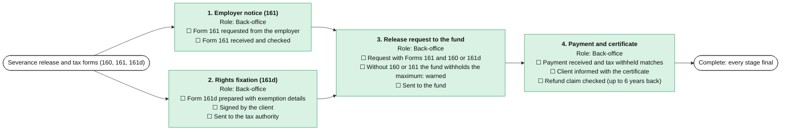

**1. Employer notice (161)** (Back-office; can start at once)

  - [ ] Form 161 requested from the employer _(send)_
  - [ ] Form 161 received and checked _(verify)_

**2. Rights fixation (161d)** (Back-office; can start at once)

  - [ ] Form 161d prepared with exemption details _(fill)_
  - [ ] Signed by the client _(fill)_
  - [ ] Sent to the tax authority _(send)_

**3. Release request to the fund** (Back-office; after Employer notice (161), Rights fixation (161d))

  - [ ] Request with Forms 161 and 160 or 161d _(fill)_
  - [ ] Without 160 or 161 the fund withholds the maximum: warned _(verify)_
  - [ ] Sent to the fund _(send)_

**4. Payment and certificate** (Back-office; after Release request to the fund)

  - [ ] Payment received and tax withheld matches _(verify)_
  - [ ] Client informed with the certificate _(send)_
  - [ ] Refund claim checked (up to 6 years back) _(fill)_

## Annual tax cycle (agency)

Spec flow F15. Owner: Manager. [Edit the diagram](https://mermaid.live/edit#base64:eyJjb2RlIjoiJSV7aW5pdDoge1wiZmxvd2NoYXJ0XCI6IHtcIndyYXBwaW5nV2lkdGhcIjogMzgwfX19JSVcbmZsb3djaGFydCBMUlxuICBjbGFzc0RlZiBhZ2VudCBmaWxsOiNkYmU4ZmQsc3Ryb2tlOiMxZjZmZWIsY29sb3I6IzExMVxuICBjbGFzc0RlZiBiYWNrIGZpbGw6I2Q5ZjJlNCxzdHJva2U6IzJhOWQ2Myxjb2xvcjojMTExXG4gIGNsYXNzRGVmIG1nciBmaWxsOiNmYmVmZDUsc3Ryb2tlOiNiNzc5MWYsY29sb3I6IzExMVxuICBjbGFzc0RlZiBta3QgZmlsbDojZWNlMWZiLHN0cm9rZTojODI1MGRmLGNvbG9yOiMxMTFcbiAgY2xhc3NEZWYgZW5kMSBmaWxsOiNmZmYsc3Ryb2tlOiMzMzMsY29sb3I6IzExMVxuICBzdGFydChbXCJBbm51YWwgdGF4IGN5Y2xlIChhZ2VuY3kpXCJdKTo6OmVuZDFcbiAgc19jZXJ0W1wiPGI-MS4gV2l0aGhvbGRpbmcgY2VydGlmaWNhdGVzICg4NTcgLyA4MDYpPC9iPjxici8-Um9sZTogQmFjay1vZmZpY2U8YnIvPuKYkCBBbm51YWwgY2VydGlmaWNhdGUgcmVjZWl2ZWQgZnJvbSBlYWNoIGluc3VyZXIgKGV2ZW4gaWYgbm8gdGF4IHdhcyB3aXRoaGVsZCk8YnIvPuKYkCBBbW91bnRzIG1hdGNoIHRoZSBjb21taXNzaW9uIHN0YXRlbWVudHNcIl06OjpiYWNrXG4gIHNfaW52W1wiPGI-Mi4gSW52b2ljZXMgYW5kIGFsbG9jYXRpb24gbnVtYmVyczwvYj48YnIvPlJvbGU6IEJhY2stb2ZmaWNlPGJyLz7imJAgSW52b2ljZXMgYWJvdmUgdGhlIHRocmVzaG9sZCBjYXJyeSBhbiBhbGxvY2F0aW9uIG51bWJlcjxici8-4piQIEludm9pY2VzIHdpdGhvdXQgYSBudW1iZXIgbGlzdGVkIGFuZCBmaXhlZFwiXTo6OmJhY2tcbiAgc19jbGlbXCI8Yj4zLiBDbGllbnQgZGVwb3NpdCBjZXJ0aWZpY2F0ZXMgKDQ1QSk8L2I-PGJyLz5Sb2xlOiBCYWNrLW9mZmljZTxici8-4piQIEFubnVhbCBjZXJ0aWZpY2F0ZXMgcmVxdWVzdGVkIGZyb20gdGhlIGluc3VyZXJzPGJyLz7imJAgU2VudCB0byBjbGllbnRzXCJdOjo6YmFja1xuICBzX2FjY1tcIjxiPjQuIEV4dGVybmFsIGFjY291bnRhbnQ8L2I-PGJyLz5Sb2xlOiBCYWNrLW9mZmljZTxici8-4piQIFBhY2thZ2Ugc2VudCB0byB0aGUgYWNjb3VudGFudDxici8-4piQIEFjY291bnRhbnQncyBxdWVzdGlvbnMgYW5zd2VyZWRcIl06OjpiYWNrXG4gIHNfYXByW1wiPGI-NS4gTWFuYWdlciBhcHByb3ZhbDwvYj48YnIvPlJvbGU6IE1hbmFnZXI8YnIvPuKYkCBGaWd1cmVzIHJldmlld2VkPGJyLz7imJAgQ3ljbGUgY2xvc2VkXCJdOjo6bWdyXG4gIHN0YXJ0IC0tPiBzX2NlcnRcbiAgc3RhcnQgLS0-IHNfaW52XG4gIHN0YXJ0IC0tPiBzX2NsaVxuICBzX2NlcnQgLS0-IHNfYWNjXG4gIHNfaW52IC0tPiBzX2FjY1xuICBzX2FjYyAtLT4gc19hcHJcbiAgc19jbGkgLS0-IHNfYXByXG4gIGZpbihbXCJDb21wbGV0ZTogZXZlcnkgc3RhZ2UgZmluYWxcIl0pOjo6ZW5kMVxuICBzX2FwciAtLT4gZmluIiwibWVybWFpZCI6IntcInRoZW1lXCI6XCJkZWZhdWx0XCJ9IiwiYXV0b1N5bmMiOnRydWUsInVwZGF0ZURpYWdyYW0iOnRydWV9) · [English .mmd](processes/tax.mmd) · [Hebrew .mmd](processes/tax.he.mmd)

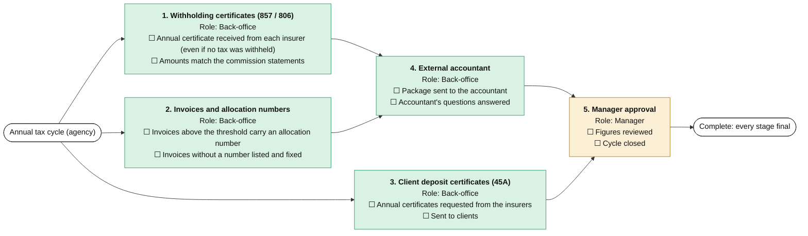

**1. Withholding certificates (857 / 806)** (Back-office; can start at once)

  - [ ] Annual certificate received from each insurer (even if no tax was withheld) _(verify)_
  - [ ] Amounts match the commission statements _(verify)_

**2. Invoices and allocation numbers** (Back-office; can start at once)

  - [ ] Invoices above the threshold carry an allocation number _(verify)_
  - [ ] Invoices without a number listed and fixed _(fill)_

**3. Client deposit certificates (45A)** (Back-office; can start at once)

  - [ ] Annual certificates requested from the insurers _(send)_
  - [ ] Sent to clients _(send)_

**4. External accountant** (Back-office; after Withholding certificates (857 / 806), Invoices and allocation numbers)

  - [ ] Package sent to the accountant _(send)_
  - [ ] Accountant's questions answered _(fill)_

**5. Manager approval** (Manager; after External accountant, Client deposit certificates (45A))

  - [ ] Figures reviewed _(verify)_
  - [ ] Cycle closed

## Commission reconciliation (monthly)

Spec flow F7. Owner: Manager. [Edit the diagram](https://mermaid.live/edit#base64:eyJjb2RlIjoiJSV7aW5pdDoge1wiZmxvd2NoYXJ0XCI6IHtcIndyYXBwaW5nV2lkdGhcIjogMzgwfX19JSVcbmZsb3djaGFydCBMUlxuICBjbGFzc0RlZiBhZ2VudCBmaWxsOiNkYmU4ZmQsc3Ryb2tlOiMxZjZmZWIsY29sb3I6IzExMVxuICBjbGFzc0RlZiBiYWNrIGZpbGw6I2Q5ZjJlNCxzdHJva2U6IzJhOWQ2Myxjb2xvcjojMTExXG4gIGNsYXNzRGVmIG1nciBmaWxsOiNmYmVmZDUsc3Ryb2tlOiNiNzc5MWYsY29sb3I6IzExMVxuICBjbGFzc0RlZiBta3QgZmlsbDojZWNlMWZiLHN0cm9rZTojODI1MGRmLGNvbG9yOiMxMTFcbiAgY2xhc3NEZWYgZW5kMSBmaWxsOiNmZmYsc3Ryb2tlOiMzMzMsY29sb3I6IzExMVxuICBzdGFydChbXCJDb21taXNzaW9uIHJlY29uY2lsaWF0aW9uIChtb250aGx5KVwiXSk6OjplbmQxXG4gIHNfaW1wW1wiPGI-MS4gSW1wb3J0IHN0YXRlbWVudHM8L2I-PGJyLz5Sb2xlOiBCYWNrLW9mZmljZTxici8-4piQIFN0YXRlbWVudCBmcm9tIGVhY2ggaW5zdXJlciByZWNlaXZlZDxici8-4piQIFN0YXRlbWVudHMgaW1wb3J0ZWQgKEV4Y2VsIG9yIGZpbGUpXCJdOjo6YmFja1xuICBzX21hdFtcIjxiPjIuIE1hdGNoIHRvIHBvbGljaWVzPC9iPjxici8-Um9sZTogQmFjay1vZmZpY2U8YnIvPuKYkCBQb2xpY3ktbGV2ZWwgbWF0Y2hpbmcgZG9uZTxici8-4piQIERpZmZlcmVuY2VzIGFuZCBtaXNzaW5nIGNvbW1pc3Npb25zIGxpc3RlZFwiXTo6OmJhY2tcbiAgc19xcnlbXCI8Yj4zLiBRdWVyaWVzIHRvIHRoZSBpbnN1cmVyczwvYj48YnIvPlJvbGU6IEJhY2stb2ZmaWNlPGJyLz7imJAgUXVlcmllcyBzZW50IHdpdGggZXZpZGVuY2U8YnIvPuKYkCBBbnN3ZXJzIHJlY2VpdmVkIGFuZCBib29rZWRcIl06OjpiYWNrXG4gIHNfYXByW1wiPGI-NC4gTWFuYWdlciBhcHByb3ZhbDwvYj48YnIvPlJvbGU6IE1hbmFnZXI8YnIvPuKYkCBGaW5hbCByZXBvcnQgcmV2aWV3ZWQ8YnIvPuKYkCBNb250aCBjbG9zZWRcIl06OjptZ3JcbiAgc3RhcnQgLS0-IHNfaW1wXG4gIHNfaW1wIC0tPiBzX21hdFxuICBzX21hdCAtLT4gc19xcnlcbiAgc19xcnkgLS0-IHNfYXByXG4gIGZpbihbXCJDb21wbGV0ZTogZXZlcnkgc3RhZ2UgZmluYWxcIl0pOjo6ZW5kMVxuICBzX2FwciAtLT4gZmluIiwibWVybWFpZCI6IntcInRoZW1lXCI6XCJkZWZhdWx0XCJ9IiwiYXV0b1N5bmMiOnRydWUsInVwZGF0ZURpYWdyYW0iOnRydWV9) · [English .mmd](processes/comm.mmd) · [Hebrew .mmd](processes/comm.he.mmd)

**1. Import statements** (Back-office; can start at once)

  - [ ] Statement from each insurer received _(verify)_
  - [ ] Statements imported (Excel or file) _(fill)_

**2. Match to policies** (Back-office; after Import statements)

  - [ ] Policy-level matching done _(verify)_
  - [ ] Differences and missing commissions listed _(fill)_

**3. Queries to the insurers** (Back-office; after Match to policies)

  - [ ] Queries sent with evidence _(send)_
  - [ ] Answers received and booked _(verify)_

**4. Manager approval** (Manager; after Queries to the insurers)

  - [ ] Final report reviewed _(verify)_
  - [ ] Month closed

## Complaint handling

Spec flow F8. Owner: Manager. [Edit the diagram](https://mermaid.live/edit#base64:eyJjb2RlIjoiJSV7aW5pdDoge1wiZmxvd2NoYXJ0XCI6IHtcIndyYXBwaW5nV2lkdGhcIjogMzgwfX19JSVcbmZsb3djaGFydCBMUlxuICBjbGFzc0RlZiBhZ2VudCBmaWxsOiNkYmU4ZmQsc3Ryb2tlOiMxZjZmZWIsY29sb3I6IzExMVxuICBjbGFzc0RlZiBiYWNrIGZpbGw6I2Q5ZjJlNCxzdHJva2U6IzJhOWQ2Myxjb2xvcjojMTExXG4gIGNsYXNzRGVmIG1nciBmaWxsOiNmYmVmZDUsc3Ryb2tlOiNiNzc5MWYsY29sb3I6IzExMVxuICBjbGFzc0RlZiBta3QgZmlsbDojZWNlMWZiLHN0cm9rZTojODI1MGRmLGNvbG9yOiMxMTFcbiAgY2xhc3NEZWYgZW5kMSBmaWxsOiNmZmYsc3Ryb2tlOiMzMzMsY29sb3I6IzExMVxuICBzdGFydChbXCJDb21wbGFpbnQgaGFuZGxpbmdcIl0pOjo6ZW5kMVxuICBzX3JjdltcIjxiPjEuIFJlY2VpdmUgYW5kIHJlZ2lzdGVyPC9iPjxici8-Um9sZTogQmFjay1vZmZpY2U8YnIvPuKYkCBDb21wbGFpbnQgbG9nZ2VkIHdpdGggZGF0ZTxici8-4piQIEZpcnN0IHJlcGx5IHRvIHRoZSBjbGllbnQgd2l0aGluIDIgYnVzaW5lc3MgZGF5c1wiXTo6OmJhY2tcbiAgc19pbnZbXCI8Yj4yLiBJbnZlc3RpZ2F0ZTwvYj48YnIvPlJvbGU6IEFnZW50PGJyLz7imJAgRmFjdHMgYW5kIGRvY3VtZW50cyBjb2xsZWN0ZWQ8YnIvPuKYkCBJbnN1cmVyIGFza2VkIGZvciBpdHMgcG9zaXRpb24gKDMwIGRheXMsIDIxIGZvciBzZW5pb3JzKVwiXTo6OmFnZW50XG4gIHNfcmVzW1wiPGI-My4gUmVzb2x2ZSBhbmQgYW5zd2VyPC9iPjxici8-Um9sZTogTWFuYWdlcjxici8-4piQIFJlc29sdXRpb24gYXBwcm92ZWQ8YnIvPuKYkCBXcml0dGVuIGFuc3dlciBzZW50PGJyLz7imJAgUmVmZXJyYWwgdG8gdGhlIENvbW1pc3Npb25lciBtZW50aW9uZWQgaWYgcmVqZWN0ZWRcIl06OjptZ3JcbiAgc19jbHNbXCI8Yj40LiBDbG9zZSBhbmQgbGVhcm48L2I-PGJyLz5Sb2xlOiBNYW5hZ2VyPGJyLz7imJAgUm9vdCBjYXVzZSByZWNvcmRlZDxici8-4piQIENvbXBsYWludCBjbG9zZWRcIl06OjptZ3JcbiAgc3RhcnQgLS0-IHNfcmN2XG4gIHNfcmN2IC0tPiBzX2ludlxuICBzX2ludiAtLT4gc19yZXNcbiAgc19yZXMgLS0-IHNfY2xzXG4gIGZpbihbXCJDb21wbGV0ZTogZXZlcnkgc3RhZ2UgZmluYWxcIl0pOjo6ZW5kMVxuICBzX2NscyAtLT4gZmluIiwibWVybWFpZCI6IntcInRoZW1lXCI6XCJkZWZhdWx0XCJ9IiwiYXV0b1N5bmMiOnRydWUsInVwZGF0ZURpYWdyYW0iOnRydWV9) · [English .mmd](processes/compl.mmd) · [Hebrew .mmd](processes/compl.he.mmd)

```mermaid
%%{init: {"flowchart": {"wrappingWidth": 380}}}%%
flowchart LR
  classDef agent fill:#dbe8fd,stroke:#1f6feb,color:#111
  classDef back fill:#d9f2e4,stroke:#2a9d63,color:#111
  classDef mgr fill:#fbefd5,stroke:#b7791f,color:#111
  classDef mkt fill:#ece1fb,stroke:#8250df,color:#111
  classDef end1 fill:#fff,stroke:#333,color:#111
  start(["Complaint handling"]):::end1
  s_rcv["<b>1. Receive and register</b><br/>Role: Back-office<br/>☐ Complaint logged with date<br/>☐ First reply to the client within 2 business days"]:::back
  s_inv["<b>2. Investigate</b><br/>Role: Agent<br/>☐ Facts and documents collected<br/>☐ Insurer asked for its position (30 days, 21 for seniors)"]:::agent
  s_res["<b>3. Resolve and answer</b><br/>Role: Manager<br/>☐ Resolution approved<br/>☐ Written answer sent<br/>☐ Referral to the Commissioner mentioned if rejected"]:::mgr
  s_cls["<b>4. Close and learn</b><br/>Role: Manager<br/>☐ Root cause recorded<br/>☐ Complaint closed"]:::mgr
  start --> s_rcv
  s_rcv --> s_inv
  s_inv --> s_res
  s_res --> s_cls
  fin(["Complete: every stage final"]):::end1
  s_cls --> fin
```

**1. Receive and register** (Back-office; can start at once)

  - [ ] Complaint logged with date _(fill)_
  - [ ] First reply to the client within 2 business days _(send)_

**2. Investigate** (Agent; after Receive and register)

  - [ ] Facts and documents collected _(fill)_
  - [ ] Insurer asked for its position (30 days, 21 for seniors) _(send)_

**3. Resolve and answer** (Manager; after Investigate)

  - [ ] Resolution approved _(verify)_
  - [ ] Written answer sent _(send)_
  - [ ] Referral to the Commissioner mentioned if rejected _(verify)_

**4. Close and learn** (Manager; after Resolve and answer)

  - [ ] Root cause recorded _(fill)_
  - [ ] Complaint closed

## Marketing campaign with consent

Spec flow F10. Owner: Marketing. [Edit the diagram](https://mermaid.live/edit#base64:eyJjb2RlIjoiJSV7aW5pdDoge1wiZmxvd2NoYXJ0XCI6IHtcIndyYXBwaW5nV2lkdGhcIjogMzgwfX19JSVcbmZsb3djaGFydCBMUlxuICBjbGFzc0RlZiBhZ2VudCBmaWxsOiNkYmU4ZmQsc3Ryb2tlOiMxZjZmZWIsY29sb3I6IzExMVxuICBjbGFzc0RlZiBiYWNrIGZpbGw6I2Q5ZjJlNCxzdHJva2U6IzJhOWQ2Myxjb2xvcjojMTExXG4gIGNsYXNzRGVmIG1nciBmaWxsOiNmYmVmZDUsc3Ryb2tlOiNiNzc5MWYsY29sb3I6IzExMVxuICBjbGFzc0RlZiBta3QgZmlsbDojZWNlMWZiLHN0cm9rZTojODI1MGRmLGNvbG9yOiMxMTFcbiAgY2xhc3NEZWYgZW5kMSBmaWxsOiNmZmYsc3Ryb2tlOiMzMzMsY29sb3I6IzExMVxuICBzdGFydChbXCJNYXJrZXRpbmcgY2FtcGFpZ24gd2l0aCBjb25zZW50XCJdKTo6OmVuZDFcbiAgc19zZWdbXCI8Yj4xLiBTZWdtZW50IGFuZCBjb25zZW50PC9iPjxici8-Um9sZTogTWFya2V0aW5nPGJyLz7imJAgU2VnbWVudCBkZWZpbmVkPGJyLz7imJAgT25seSBjbGllbnRzIHdpdGggbWFya2V0aW5nIGNvbnNlbnQgaW5jbHVkZWQ8YnIvPuKYkCBPcHQtb3V0cyBhbmQgYm91bmNlcyByZW1vdmVkXCJdOjo6bWt0XG4gIHNfZHJbXCI8Yj4yLiBEcmFmdCBhbmQgdHJhbnNsYXRlPC9iPjxici8-Um9sZTogTWFya2V0aW5nPGJyLz7imJAgTWVzc2FnZSBkcmFmdGVkPGJyLz7imJAgTGFuZ3VhZ2Ugb2YgZWFjaCBjbGllbnQgYXBwbGllZDxici8-4piQIFVuc3Vic2NyaWJlIGxpbmsgaW5jbHVkZWRcIl06Ojpta3RcbiAgc19hcHJbXCI8Yj4zLiBNYW5hZ2VyIGFwcHJvdmFsPC9iPjxici8-Um9sZTogTWFuYWdlcjxici8-4piQIE1lc3NhZ2UgYW5kIGF1ZGllbmNlIGFwcHJvdmVkXCJdOjo6bWdyXG4gIHNfc25kW1wiPGI-NC4gU2VuZCBhbmQgbWVhc3VyZTwvYj48YnIvPlJvbGU6IE1hcmtldGluZzxici8-4piQIFNlbnQgdGhyb3VnaCB0aGUgY2hvc2VuIGNoYW5uZWw8YnIvPuKYkCBSZXBsaWVzIHJvdXRlZCB0byB0aGUgYWdlbnRzJyBJbmJveDxici8-4piQIFJlc3VsdHMgcmVjb3JkZWRcIl06Ojpta3RcbiAgc3RhcnQgLS0-IHNfc2VnXG4gIHNfc2VnIC0tPiBzX2RyXG4gIHNfZHIgLS0-IHNfYXByXG4gIHNfYXByIC0tPiBzX3NuZFxuICBmaW4oW1wiQ29tcGxldGU6IGV2ZXJ5IHN0YWdlIGZpbmFsXCJdKTo6OmVuZDFcbiAgc19zbmQgLS0-IGZpbiIsIm1lcm1haWQiOiJ7XCJ0aGVtZVwiOlwiZGVmYXVsdFwifSIsImF1dG9TeW5jIjp0cnVlLCJ1cGRhdGVEaWFncmFtIjp0cnVlfQ) · [English .mmd](processes/camp.mmd) · [Hebrew .mmd](processes/camp.he.mmd)

```mermaid
%%{init: {"flowchart": {"wrappingWidth": 380}}}%%
flowchart LR
  classDef agent fill:#dbe8fd,stroke:#1f6feb,color:#111
  classDef back fill:#d9f2e4,stroke:#2a9d63,color:#111
  classDef mgr fill:#fbefd5,stroke:#b7791f,color:#111
  classDef mkt fill:#ece1fb,stroke:#8250df,color:#111
  classDef end1 fill:#fff,stroke:#333,color:#111
  start(["Marketing campaign with consent"]):::end1
  s_seg["<b>1. Segment and consent</b><br/>Role: Marketing<br/>☐ Segment defined<br/>☐ Only clients with marketing consent included<br/>☐ Opt-outs and bounces removed"]:::mkt
  s_dr["<b>2. Draft and translate</b><br/>Role: Marketing<br/>☐ Message drafted<br/>☐ Language of each client applied<br/>☐ Unsubscribe link included"]:::mkt
  s_apr["<b>3. Manager approval</b><br/>Role: Manager<br/>☐ Message and audience approved"]:::mgr
  s_snd["<b>4. Send and measure</b><br/>Role: Marketing<br/>☐ Sent through the chosen channel<br/>☐ Replies routed to the agents' Inbox<br/>☐ Results recorded"]:::mkt
  start --> s_seg
  s_seg --> s_dr
  s_dr --> s_apr
  s_apr --> s_snd
  fin(["Complete: every stage final"]):::end1
  s_snd --> fin
```

**1. Segment and consent** (Marketing; can start at once)

  - [ ] Segment defined _(fill)_
  - [ ] Only clients with marketing consent included _(verify)_
  - [ ] Opt-outs and bounces removed _(verify)_

**2. Draft and translate** (Marketing; after Segment and consent)

  - [ ] Message drafted _(fill)_
  - [ ] Language of each client applied _(verify)_
  - [ ] Unsubscribe link included _(verify)_

**3. Manager approval** (Manager; after Draft and translate)

  - [ ] Message and audience approved _(verify)_

**4. Send and measure** (Marketing; after Manager approval)

  - [ ] Sent through the chosen channel _(send)_
  - [ ] Replies routed to the agents' Inbox _(fill)_
  - [ ] Results recorded _(fill)_

## Incoming document intake

Spec flow F6. Owner: Back-office. [Edit the diagram](https://mermaid.live/edit#base64:eyJjb2RlIjoiJSV7aW5pdDoge1wiZmxvd2NoYXJ0XCI6IHtcIndyYXBwaW5nV2lkdGhcIjogMzgwfX19JSVcbmZsb3djaGFydCBMUlxuICBjbGFzc0RlZiBhZ2VudCBmaWxsOiNkYmU4ZmQsc3Ryb2tlOiMxZjZmZWIsY29sb3I6IzExMVxuICBjbGFzc0RlZiBiYWNrIGZpbGw6I2Q5ZjJlNCxzdHJva2U6IzJhOWQ2Myxjb2xvcjojMTExXG4gIGNsYXNzRGVmIG1nciBmaWxsOiNmYmVmZDUsc3Ryb2tlOiNiNzc5MWYsY29sb3I6IzExMVxuICBjbGFzc0RlZiBta3QgZmlsbDojZWNlMWZiLHN0cm9rZTojODI1MGRmLGNvbG9yOiMxMTFcbiAgY2xhc3NEZWYgZW5kMSBmaWxsOiNmZmYsc3Ryb2tlOiMzMzMsY29sb3I6IzExMVxuICBzdGFydChbXCJJbmNvbWluZyBkb2N1bWVudCBpbnRha2VcIl0pOjo6ZW5kMVxuICBzX2RpZ1tcIjxiPjEuIERpZ2l0aXplIGFuZCBjbGFzc2lmeTwvYj48YnIvPlJvbGU6IEJhY2stb2ZmaWNlPGJyLz7imJAgRmF4LCBlbWFpbCBvciBXaGF0c0FwcCBjYXB0dXJlZDxici8-4piQIE9DUiBhbmQgdHlwZSBjbGFzc2lmaWNhdGlvbiBkb25lPGJyLz7imJAgTGFuZ3VhZ2UgZGV0ZWN0ZWRcIl06OjpiYWNrXG4gIHNfYXR0W1wiPGI-Mi4gQXR0cmlidXRlIHRvIHRoZSBjbGllbnQ8L2I-PGJyLz5Sb2xlOiBCYWNrLW9mZmljZTxici8-4piQIENsaWVudCBtYXRjaGVkIChJRCwgbmFtZSwgcG9saWN5IG51bWJlcik8YnIvPuKYkCBMb3cgY29uZmlkZW5jZSBzZW50IHRvIHJldmlld1wiXTo6OmJhY2tcbiAgc19ydGVbXCI8Yj4zLiBSb3V0ZSBhbmQgZmlsZTwvYj48YnIvPlJvbGU6IEJhY2stb2ZmaWNlPGJyLz7imJAgRmlsZWQgaW4gdGhlIGNsaWVudCBmaWxlPGJyLz7imJAgVGFzayBjcmVhdGVkIGZvciB0aGUgcmlnaHQgcm9sZVwiXTo6OmJhY2tcbiAgc3RhcnQgLS0-IHNfZGlnXG4gIHNfZGlnIC0tPiBzX2F0dFxuICBzX2F0dCAtLT4gc19ydGVcbiAgZmluKFtcIkNvbXBsZXRlOiBldmVyeSBzdGFnZSBmaW5hbFwiXSk6OjplbmQxXG4gIHNfcnRlIC0tPiBmaW4iLCJtZXJtYWlkIjoie1widGhlbWVcIjpcImRlZmF1bHRcIn0iLCJhdXRvU3luYyI6dHJ1ZSwidXBkYXRlRGlhZ3JhbSI6dHJ1ZX0) · [English .mmd](processes/intake.mmd) · [Hebrew .mmd](processes/intake.he.mmd)

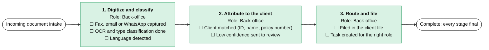

**1. Digitize and classify** (Back-office; can start at once)

  - [ ] Fax, email or WhatsApp captured _(fill)_
  - [ ] OCR and type classification done _(verify)_
  - [ ] Language detected _(verify)_

**2. Attribute to the client** (Back-office; after Digitize and classify)

  - [ ] Client matched (ID, name, policy number) _(verify)_
  - [ ] Low confidence sent to review _(verify)_

**3. Route and file** (Back-office; after Attribute to the client)

  - [ ] Filed in the client file _(fill)_
  - [ ] Task created for the right role _(fill)_

## Exit to retirement planning

Spec flow F5 / F15. Owner: Agent. [Edit the diagram](https://mermaid.live/edit#base64:eyJjb2RlIjoiJSV7aW5pdDoge1wiZmxvd2NoYXJ0XCI6IHtcIndyYXBwaW5nV2lkdGhcIjogMzgwfX19JSVcbmZsb3djaGFydCBMUlxuICBjbGFzc0RlZiBhZ2VudCBmaWxsOiNkYmU4ZmQsc3Ryb2tlOiMxZjZmZWIsY29sb3I6IzExMVxuICBjbGFzc0RlZiBiYWNrIGZpbGw6I2Q5ZjJlNCxzdHJva2U6IzJhOWQ2Myxjb2xvcjojMTExXG4gIGNsYXNzRGVmIG1nciBmaWxsOiNmYmVmZDUsc3Ryb2tlOiNiNzc5MWYsY29sb3I6IzExMVxuICBjbGFzc0RlZiBta3QgZmlsbDojZWNlMWZiLHN0cm9rZTojODI1MGRmLGNvbG9yOiMxMTFcbiAgY2xhc3NEZWYgZW5kMSBmaWxsOiNmZmYsc3Ryb2tlOiMzMzMsY29sb3I6IzExMVxuICBzdGFydChbXCJFeGl0IHRvIHJldGlyZW1lbnQgcGxhbm5pbmdcIl0pOjo6ZW5kMVxuICBzX2ludFtcIjxiPjEuIEludGVydmlldyBhbmQgZ29hbHM8L2I-PGJyLz5Sb2xlOiBBZ2VudDxici8-PHU-QmFzaWNzPC91Pjxici8-4piQIFRhcmdldCByZXRpcmVtZW50IGRhdGUgYW5kIGFnZSBzZXQ8YnIvPuKYkCBNb250aGx5IGluY29tZSBnb2FsIGluIHRvZGF5J3MgbW9uZXk8YnIvPuKYkCBTcG91c2UsIGRlcGVuZGFudHMgYW5kIGhlYWx0aCByZWNvcmRlZDxici8-4piQIE90aGVyIGFzc2V0cyAoaG9tZSwgc2F2aW5ncywgYnVzaW5lc3MpIGxpc3RlZDxici8-PHU-Q29tcGxpYW5jZTwvdT48YnIvPuKYkCBLWUMgdmFsaWQgKGxlc3MgdGhhbiBhIHllYXIpPGJyLz7imJAgUmlzayBxdWVzdGlvbm5haXJlIGNvbXBsZXRlZFwiXTo6OmFnZW50XG4gIHNfYXV0aFtcIjxiPjIuIEF1dGhvcml6YXRpb25zIGFuZCBkYXRhPC9iPjxici8-Um9sZTogQmFjay1vZmZpY2U8YnIvPuKYkCBIYXIgSGFCaXR1YWNoLCBjbGVhcmluZyBob3VzZSBhbmQgQjEgYXV0aG9yaXphdGlvbnMgc2lnbmVkPGJyLz7imJAgTWlzbGFrYSByZXBvcnQgcmVxdWVzdGVkPGJyLz7imJAgSGFyIEhhQml0dWFjaCByZXBvcnQgcmVxdWVzdGVkPGJyLz7imJAgRGF0YSBpbXBvcnRlZCBhbmQgbWF0Y2hlZCwgZHVwbGljYXRlcyBtYXJrZWRcIl06OjpiYWNrXG4gIHNfYW5hW1wiPGI-My4gR2FwIGFuYWx5c2lzPC9iPjxici8-Um9sZTogQWdlbnQ8YnIvPuKYkCBQcm9qZWN0ZWQgbW9udGhseSBhbm51aXR5IHBlciBwcm9kdWN0PGJyLz7imJAgR2FwIGFnYWluc3QgdGhlIGluY29tZSBnb2FsIGNhbGN1bGF0ZWQ8YnIvPuKYkCBCcmlkZ2UgdG8gc3RhdGUgb2xkLWFnZSBwZW5zaW9uIHBsYW5uZWQ8YnIvPuKYkCBNYW5hZ2VtZW50IGZlZXMgY29tcGFyZWQgd2l0aCB0aGUgbWFya2V0PGJyLz7imJAgSW5zdXJhbmNlIG5lZWRzIGFmdGVyIHJldGlyZW1lbnQgKGxpZmUsIGxvbmctdGVybSBjYXJlLCBoZWFsdGgpXCJdOjo6YWdlbnRcbiAgc19yZWNbXCI8Yj40LiBSZWNvbW1lbmRhdGlvbjwvYj48YnIvPlJvbGU6IEFnZW50PGJyLz48dT5Qcm9kdWN0cyB0byBzdWdnZXN0PC91Pjxici8-4piQIFBlbnNpb24gYW5udWl0eSB3aXRoIGEgZ3VhcmFudGVlZCBwZXJpb2QgYW5kIHNwb3VzZSdzIHN1cnZpdm9yIHNoYXJlPGJyLz7imJAgS2VlcCB0aGUgc3R1ZHkgZnVuZCBhcyBicmlkZ2UgaW5jb21lLCB0YXgtZnJlZSBhZnRlciB0aGUgdmVzdGluZyBwZXJpb2Q8YnIvPuKYkCBQcm92aWRlbnQgZnVuZCBmb3IgaW52ZXN0bWVudCBmb3IgY2FwaXRhbCBrZXB0IGFmdGVyIHJldGlyZW1lbnQ8YnIvPuKYkCBMb25nLXRlcm0gY2FyZSBjb3ZlciB0aGF0IGNvbnRpbnVlcyBhZnRlciByZXRpcmVtZW50PGJyLz7imJAgUmVkdWNlIGxpZmUgY292ZXIgYXMgZGVwZW5kYW50cyBsZWF2ZTxici8-PHU-VGF4IHBvaW50czwvdT48YnIvPuKYkCBBbm51aXR5IHZlcnN1cyBjYXBpdGFsIHdpdGhkcmF3YWw6IGV4ZW1wdGlvbiBwZXJjZW50YWdlIGFuZCBjZWlsaW5nIFt2ZXJpZnldPGJyLz7imJAgRm9ybSAxNjFkIHRvIGZpeCBleGVtcHRpb24gcmlnaHRzLCBhbmQgdGF4IGNvb3JkaW5hdGlvbiBpZiB0aGVyZSBhcmUgdHdvIHNvdXJjZXM8YnIvPuKYkCBTZWN0aW9uIDQ1QSBjcmVkaXQgZW5kcyB3aXRoIHRoZSBkZXBvc2l0czxici8-4piQIFN1cnRheCBvbiBoaWdoIGluY29tZSBhbmQgb24gY2FwaXRhbCBpbmNvbWUgW3ZlcmlmeV08YnIvPuKYkCBTZXZlcmFuY2U6IGV4ZW1wdCBjZWlsaW5nIGFuZCBzcHJlYWQgb2YgdGhlIHRheCB5ZWFyczxici8-PHU-SW52ZXN0bWVudCBzdHJhdGVneSBjaGFuZ2VzPC91Pjxici8-4piQIE1vdmUgZnJvbSBhIHN0b2NrLWhlYXZ5IHRyYWNrIHRvIGFuIGFnZS1iYXNlZCB0cmFjayBhYm91dCA1IHllYXJzIGJlZm9yZSByZXRpcmVtZW50PGJyLz7imJAgQ2hvb3NlIHRoZSB0cmFjayBmb3IgdGhlIGFubnVpdHkgcGhhc2UgKG1vZGVyYXRlIHJpc2spPGJyLz7imJAgS2VlcCB0d28geWVhcnMgb2YgZXhwZW5zZXMgaW4gbG93LXJpc2sgYXNzZXRzPGJyLz48dT5TYXZpbmdzIHByb2dyYW1zPC91Pjxici8-4piQIE1vdmUgaWRsZSBwb2xpY3kgc2F2aW5ncyBpbnRvIGFuIGFubnVpdHkgb3IgYSBwcm92aWRlbnQgZnVuZDxici8-4piQIFZvbHVudGFyeSBkZXBvc2l0cyB1cCB0byB0aGUgdGF4LWFkdmFudGFnZWQgY2VpbGluZyB1bnRpbCB0aGUgZXhpdCBkYXRlPGJyLz48dT5SZWNvcmQ8L3U-PGJyLz7imJAgUmVhc29uaW5nIGRvY3VtZW50IHdpdGggYWx0ZXJuYXRpdmVzLCBmZWVzIGFuZCBjb21taXNzaW9ucyBkaXNjbG9zZWRcIl06OjphZ2VudFxuICBzX3JldltcIjxiPjUuIE1hbmFnZXIgcmV2aWV3IChmb3VyIGV5ZXMpPC9iPjxici8-Um9sZTogTWFuYWdlcjxici8-4piQIFN1aXRhYmlsaXR5IG9mIGVhY2ggcmVjb21tZW5kZWQgcHJvZHVjdDxici8-4piQIENvbmZsaWN0IG9mIGludGVyZXN0IGFuZCBjb21taXNzaW9ucyByZXZpZXdlZDxici8-4piQIFRheCBzdGF0ZW1lbnRzIG1hcmtlZCBmb3IgdmVyaWZpY2F0aW9uIGFyZSBjb25maXJtZWQ8YnIvPuKYkCBBcHByb3ZlZCBvciByZXR1cm5lZCB3aXRoIGNvbW1lbnRzXCJdOjo6bWdyXG4gIHNfZGVjW1wiPGI-Ni4gQ2xpZW50IGRlY2lzaW9uIGFuZCBzaWduaW5nPC9iPjxici8-Um9sZTogQWdlbnQ8YnIvPuKYkCBSZWNvbW1lbmRhdGlvbiBwcmVzZW50ZWQsIGNsaWVudCBxdWVzdGlvbnMgYW5zd2VyZWQ8YnIvPuKYkCBDbGllbnQgY2hvaWNlcyByZWNvcmRlZCAoYWNjZXB0ZWQsIGNoYW5nZWQsIGRlY2xpbmVkKTxici8-4piQIEFkdmljZSByZWNvcmQgYW5kIGluc3RydWN0aW9ucyBzaWduZWQ8YnIvPuKYkCBDb29saW5nLW9mZiBhbmQgY2FuY2VsbGF0aW9uIHJpZ2h0cyBleHBsYWluZWQgW3ZlcmlmeV1cIl06OjphZ2VudFxuICBzX2V4ZVtcIjxiPjcuIEJhY2stb2ZmaWNlIGV4ZWN1dGlvbjwvYj48YnIvPlJvbGU6IEJhY2stb2ZmaWNlPGJyLz7imJAgSUQgY29waWVzIGFuZCBzaWduZWQgZm9ybXMgY29tcGxldGU8YnIvPuKYkCBJbnN1cmVyIGZvcm1zIGZpbGxlZCBmcm9tIHRlbXBsYXRlcyAocGF5b3V0LCB0cmFjayBjaGFuZ2UsIHRyYW5zZmVyKTxici8-4piQIExhYmVscyBwcmludGVkLCBwb3N0IGFuZCBlbWFpbCBkaXNwYXRjaGVkPGJyLz7imJAgSW5zdHJ1Y3Rpb25zIGxvZ2dlZCBpbiB0aGUgZGF0YWJhc2VcIl06OjpiYWNrXG4gIHNfaW5xW1wiPGI-OC4gSW5xdWlyaWVzIHRvIHRoZSBpbnN1cmFuY2UgY29tcGFuaWVzPC9iPjxici8-Um9sZTogQmFjay1vZmZpY2U8YnIvPuKYkCBJbnF1aXJ5IHNlbnQgdG8gZWFjaCBmdW5kIGFuZCBpbnN1cmVyPGJyLz7imJAgQnVzaW5lc3MtZGF5IGRlYWRsaW5lIHNldCBmb3IgZWFjaCByZXBseTxici8-4piQIFJlcGxpZXMgcmVjZWl2ZWQgYW5kIGNvbXBhcmVkIHdpdGggdGhlIGluc3RydWN0aW9uczxici8-4piQIEZvbGxvdy11cCBhbmQgZXNjYWxhdGlvbiBpZiB0aGUgZGVhZGxpbmUgcGFzc2VkXCJdOjo6YmFja1xuICBzX3R4W1wiPGI-OS4gVGF4IGZpbGluZ3M8L2I-PGJyLz5Sb2xlOiBCYWNrLW9mZmljZTxici8-4piQIEZvcm0gMTYxZCBzdWJtaXR0ZWQ8YnIvPuKYkCBUYXggY29vcmRpbmF0aW9uIGNlcnRpZmljYXRlIChpZiBuZWVkZWQpIG9idGFpbmVkPGJyLz7imJAgV2l0aGhvbGRpbmcgcmF0ZSBhdCB0aGUgcGF5ZXIgbWF0Y2hlcyB0aGUgY2VydGlmaWNhdGVcIl06OjpiYWNrXG4gIHNfY2xzW1wiPGI-MTAuIENsb3NlIGFuZCBmb2xsb3cgdXA8L2I-PGJyLz5Sb2xlOiBBZ2VudDxici8-4piQIENvbmZpcm1hdGlvbiBsZXR0ZXIgdG8gdGhlIGNsaWVudDxici8-4piQIEZpcnN0IGFubnVpdHkgcGF5bWVudCBjaGVja2VkPGJyLz7imJAgRm9sbG93LXVwIGNvbnRhY3RzIHNjaGVkdWxlZCAoMzAgYW5kIDQwIGRheXMpPGJyLz7imJAgRmlsZSBjbG9zZWQgYW5kIGFyY2hpdmVkIGZvciA3IHllYXJzXCJdOjo6YWdlbnRcbiAgc3RhcnQgLS0-IHNfaW50XG4gIHN0YXJ0IC0tPiBzX2F1dGhcbiAgc19pbnQgLS0-IHNfYW5hXG4gIHNfYXV0aCAtLT4gc19hbmFcbiAgc19hbmEgLS0-IHNfcmVjXG4gIHNfcmVjIC0tPiBzX3JldlxuICBzX3JldiAtLT4gc19kZWNcbiAgc19kZWMgLS0-IHNfZXhlXG4gIHNfZXhlIC0tPiBzX2lucVxuICBzX2V4ZSAtLT4gc190eFxuICBzX2lucSAtLT4gc19jbHNcbiAgc190eCAtLT4gc19jbHNcbiAgZmluKFtcIkNvbXBsZXRlOiBldmVyeSBzdGFnZSBmaW5hbFwiXSk6OjplbmQxXG4gIHNfY2xzIC0tPiBmaW4iLCJtZXJtYWlkIjoie1widGhlbWVcIjpcImRlZmF1bHRcIn0iLCJhdXRvU3luYyI6dHJ1ZSwidXBkYXRlRGlhZ3JhbSI6dHJ1ZX0) · [English .mmd](processes/retire.mmd) · [Hebrew .mmd](processes/retire.he.mmd)

```mermaid
%%{init: {"flowchart": {"wrappingWidth": 380}}}%%
flowchart LR
  classDef agent fill:#dbe8fd,stroke:#1f6feb,color:#111
  classDef back fill:#d9f2e4,stroke:#2a9d63,color:#111
  classDef mgr fill:#fbefd5,stroke:#b7791f,color:#111
  classDef mkt fill:#ece1fb,stroke:#8250df,color:#111
  classDef end1 fill:#fff,stroke:#333,color:#111
  start(["Exit to retirement planning"]):::end1
  s_int["<b>1. Interview and goals</b><br/>Role: Agent<br/><u>Basics</u><br/>☐ Target retirement date and age set<br/>☐ Monthly income goal in today's money<br/>☐ Spouse, dependants and health recorded<br/>☐ Other assets (home, savings, business) listed<br/><u>Compliance</u><br/>☐ KYC valid (less than a year)<br/>☐ Risk questionnaire completed"]:::agent
  s_auth["<b>2. Authorizations and data</b><br/>Role: Back-office<br/>☐ Har HaBituach, clearing house and B1 authorizations signed<br/>☐ Mislaka report requested<br/>☐ Har HaBituach report requested<br/>☐ Data imported and matched, duplicates marked"]:::back
  s_ana["<b>3. Gap analysis</b><br/>Role: Agent<br/>☐ Projected monthly annuity per product<br/>☐ Gap against the income goal calculated<br/>☐ Bridge to state old-age pension planned<br/>☐ Management fees compared with the market<br/>☐ Insurance needs after retirement (life, long-term care, health)"]:::agent
  s_rec["<b>4. Recommendation</b><br/>Role: Agent<br/><u>Products to suggest</u><br/>☐ Pension annuity with a guaranteed period and spouse's survivor share<br/>☐ Keep the study fund as bridge income, tax-free after the vesting period<br/>☐ Provident fund for investment for capital kept after retirement<br/>☐ Long-term care cover that continues after retirement<br/>☐ Reduce life cover as dependants leave<br/><u>Tax points</u><br/>☐ Annuity versus capital withdrawal: exemption percentage and ceiling [verify]<br/>☐ Form 161d to fix exemption rights, and tax coordination if there are two sources<br/>☐ Section 45A credit ends with the deposits<br/>☐ Surtax on high income and on capital income [verify]<br/>☐ Severance: exempt ceiling and spread of the tax years<br/><u>Investment strategy changes</u><br/>☐ Move from a stock-heavy track to an age-based track about 5 years before retirement<br/>☐ Choose the track for the annuity phase (moderate risk)<br/>☐ Keep two years of expenses in low-risk assets<br/><u>Savings programs</u><br/>☐ Move idle policy savings into an annuity or a provident fund<br/>☐ Voluntary deposits up to the tax-advantaged ceiling until the exit date<br/><u>Record</u><br/>☐ Reasoning document with alternatives, fees and commissions disclosed"]:::agent
  s_rev["<b>5. Manager review (four eyes)</b><br/>Role: Manager<br/>☐ Suitability of each recommended product<br/>☐ Conflict of interest and commissions reviewed<br/>☐ Tax statements marked for verification are confirmed<br/>☐ Approved or returned with comments"]:::mgr
  s_dec["<b>6. Client decision and signing</b><br/>Role: Agent<br/>☐ Recommendation presented, client questions answered<br/>☐ Client choices recorded (accepted, changed, declined)<br/>☐ Advice record and instructions signed<br/>☐ Cooling-off and cancellation rights explained [verify]"]:::agent
  s_exe["<b>7. Back-office execution</b><br/>Role: Back-office<br/>☐ ID copies and signed forms complete<br/>☐ Insurer forms filled from templates (payout, track change, transfer)<br/>☐ Labels printed, post and email dispatched<br/>☐ Instructions logged in the database"]:::back
  s_inq["<b>8. Inquiries to the insurance companies</b><br/>Role: Back-office<br/>☐ Inquiry sent to each fund and insurer<br/>☐ Business-day deadline set for each reply<br/>☐ Replies received and compared with the instructions<br/>☐ Follow-up and escalation if the deadline passed"]:::back
  s_tx["<b>9. Tax filings</b><br/>Role: Back-office<br/>☐ Form 161d submitted<br/>☐ Tax coordination certificate (if needed) obtained<br/>☐ Withholding rate at the payer matches the certificate"]:::back
  s_cls["<b>10. Close and follow up</b><br/>Role: Agent<br/>☐ Confirmation letter to the client<br/>☐ First annuity payment checked<br/>☐ Follow-up contacts scheduled (30 and 40 days)<br/>☐ File closed and archived for 7 years"]:::agent
  start --> s_int
  start --> s_auth
  s_int --> s_ana
  s_auth --> s_ana
  s_ana --> s_rec
  s_rec --> s_rev
  s_rev --> s_dec
  s_dec --> s_exe
  s_exe --> s_inq
  s_exe --> s_tx
  s_inq --> s_cls
  s_tx --> s_cls
  fin(["Complete: every stage final"]):::end1
  s_cls --> fin
```

**1. Interview and goals** (Agent; can start at once)

- *Basics*
  - [ ] Target retirement date and age set _(fill)_
  - [ ] Monthly income goal in today's money _(fill)_
  - [ ] Spouse, dependants and health recorded _(fill)_
  - [ ] Other assets (home, savings, business) listed _(fill)_
- *Compliance*
  - [ ] KYC valid (less than a year) _(verify)_
  - [ ] Risk questionnaire completed _(fill)_

**2. Authorizations and data** (Back-office; can start at once)

  - [ ] Har HaBituach, clearing house and B1 authorizations signed _(fill)_
  - [ ] Mislaka report requested _(send)_
  - [ ] Har HaBituach report requested _(send)_
  - [ ] Data imported and matched, duplicates marked _(verify)_

**3. Gap analysis** (Agent; after Interview and goals, Authorizations and data)

  - [ ] Projected monthly annuity per product _(verify)_
  - [ ] Gap against the income goal calculated _(fill)_
  - [ ] Bridge to state old-age pension planned _(fill)_
  - [ ] Management fees compared with the market _(verify)_
  - [ ] Insurance needs after retirement (life, long-term care, health) _(verify)_

**4. Recommendation** (Agent; after Gap analysis)

- *Products to suggest*
  - [ ] Pension annuity with a guaranteed period and spouse's survivor share _(fill)_
  - [ ] Keep the study fund as bridge income, tax-free after the vesting period _(fill)_
  - [ ] Provident fund for investment for capital kept after retirement _(fill)_
  - [ ] Long-term care cover that continues after retirement _(fill)_
  - [ ] Reduce life cover as dependants leave _(fill)_
- *Tax points*
  - [ ] Annuity versus capital withdrawal: exemption percentage and ceiling [verify] _(verify)_
  - [ ] Form 161d to fix exemption rights, and tax coordination if there are two sources _(verify)_
  - [ ] Section 45A credit ends with the deposits _(verify)_
  - [ ] Surtax on high income and on capital income [verify] _(verify)_
  - [ ] Severance: exempt ceiling and spread of the tax years _(verify)_
- *Investment strategy changes*
  - [ ] Move from a stock-heavy track to an age-based track about 5 years before retirement _(fill)_
  - [ ] Choose the track for the annuity phase (moderate risk) _(fill)_
  - [ ] Keep two years of expenses in low-risk assets _(fill)_
- *Savings programs*
  - [ ] Move idle policy savings into an annuity or a provident fund _(fill)_
  - [ ] Voluntary deposits up to the tax-advantaged ceiling until the exit date _(fill)_
- *Record*
  - [ ] Reasoning document with alternatives, fees and commissions disclosed _(fill)_

**5. Manager review (four eyes)** (Manager; after Recommendation)

  - [ ] Suitability of each recommended product _(verify)_
  - [ ] Conflict of interest and commissions reviewed _(verify)_
  - [ ] Tax statements marked for verification are confirmed _(verify)_
  - [ ] Approved or returned with comments

**6. Client decision and signing** (Agent; after Manager review (four eyes))

  - [ ] Recommendation presented, client questions answered _(verify)_
  - [ ] Client choices recorded (accepted, changed, declined) _(fill)_
  - [ ] Advice record and instructions signed _(fill)_
  - [ ] Cooling-off and cancellation rights explained [verify] _(verify)_

**7. Back-office execution** (Back-office; after Client decision and signing)

  - [ ] ID copies and signed forms complete _(verify)_
  - [ ] Insurer forms filled from templates (payout, track change, transfer) _(fill)_
  - [ ] Labels printed, post and email dispatched _(send)_
  - [ ] Instructions logged in the database _(fill)_

**8. Inquiries to the insurance companies** (Back-office; after Back-office execution)

  - [ ] Inquiry sent to each fund and insurer _(send)_
  - [ ] Business-day deadline set for each reply _(fill)_
  - [ ] Replies received and compared with the instructions _(verify)_
  - [ ] Follow-up and escalation if the deadline passed _(send)_

**9. Tax filings** (Back-office; after Back-office execution)

  - [ ] Form 161d submitted _(send)_
  - [ ] Tax coordination certificate (if needed) obtained _(verify)_
  - [ ] Withholding rate at the payer matches the certificate _(verify)_

**10. Close and follow up** (Agent; after Inquiries to the insurance companies, Tax filings)

  - [ ] Confirmation letter to the client _(send)_
  - [ ] First annuity payment checked _(verify)_
  - [ ] Follow-up contacts scheduled (30 and 40 days) _(fill)_
  - [ ] File closed and archived for 7 years _(fill)_

